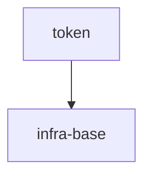

# token-authoring-benchmark

## Vision

Локальный детерминированный нормализатор токенов для CLI и библиотечных потребителей: одна чистая функция `normalizeToken(input: string): string` приводит ASCII-строку к единому виду — обрезает крайние пробелы, приводит ASCII-буквы к нижнему регистру и свёртывает серии пробелов, подчёркиваний и дефисов в один дефис. Пустой вход, строка только из разделителей и вход с не-ASCII символами дают `TypeError` без ввода-вывода.

- **Для кого:** разработчики локальных CLI-инструментов и библиотек, которым нужен единый формат токена без сети и хранилища.
- **Боль:** без общего правила каждый потребитель нормализует токены по-своему, поэтому одинаковый ввод даёт разные ключи, а ошибочный ввод маскируется пустым корректным значением.
- **Успех:** `normalizeToken("  Foo__BAR  ")` возвращает `"foo-bar"`, а пустой, разделительный и не-ASCII вход стабильно дают `TypeError` без побочных эффектов; поведение воспроизводимо в CLI и в библиотеке.
- **Принципы:** чистая функция без состояния и ввода-вывода, детерминированный результат, явная ошибка вместо тихой подмены, ASCII-only границы входа.

## Scope Graph

## Scopes

| Scope | Type | Spec | Description |
|---|---|---|---|
| [`token`](./token/token.spec.md) | library | 🚧 | Детерминированный `normalizeToken` для локальных CLI и библиотечных потребителей; спека в авторстве, ожидает решения владельца. |
| [`infra-base`](./infra-base/infra-base.spec.md) | infrastructure | 🚧 | Базовая инфраструктура проверок для токен-скоупа; спека в авторстве, ожидает решения владельца. |
