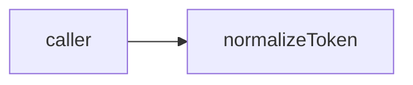

# infra-base: infrastructure specification

<!--SECTION:SPEC_ID-->
INFRA-BASE
<!--/SECTION:SPEC_ID-->

<!--SECTION:SCOPE_TYPE-->
## scope-type
infrastructure
<!--/SECTION:SCOPE_TYPE-->

<!--SECTION:VISION-->
## Vision
A deterministic token normalizer for local CLI and library consumers; no network or persistence.
<!--/SECTION:VISION-->

<!--SECTION:OVERVIEW-->
## Overview

_Нормализация токена без состояния._
<!--/SECTION:OVERVIEW-->

<!--SECTION:SCOPE_DEPENDENCIES-->
## Scope Dependencies
- **Depends on:** None
- **Provides to:** token authoring scopes.
<!--/SECTION:SCOPE_DEPENDENCIES-->

<!--SECTION:REQUIREMENTS_AND_CONSTRAINTS-->
## Requirements & Constraints
### IB-REQ-1 [должен]
**Когда** передана ASCII-строка, **нормализатор должен** обрезать крайние пробелы, привести буквы к lower-case и свернуть пробелы, underscore и hyphen в один hyphen.
> Один детерминированный формат токена нужен CLI и библиотечным потребителям.

### IB-REQ-2 [должен · нештатная]
**Если** строка пустая, состоит из разделителей или содержит не-ASCII символы, **то нормализатор должен** выбросить TypeError без ввода-вывода.
> Ошибку входа нельзя маскировать пустым корректным токеном.

| Input | Outcome |
|---|---|
| `"  Foo__BAR  "` | `"foo-bar"` |
| `""` | `TypeError` |

### Out-of-Scope
- Unicode transliteration, network and persistent configuration.

### Runtime & Deferred Scope
Not implemented; no runtime claim.

### Rules
No additional activated rule set.
<!--/SECTION:REQUIREMENTS_AND_CONSTRAINTS-->

<!--SECTION:TOOL_STACK-->
## Tool Stack
| Tool | Role |
|---|---|
| Node.js 22 | Local token CLI runtime; not installed by this draft. |
<!--/SECTION:TOOL_STACK-->

<!--SECTION:WORKFLOW_EXAMPLE-->
## Developer Workflow Example
A local consumer passes "  Foo__BAR  " and receives "foo-bar". Empty input produces TypeError without network calls.
<!--/SECTION:WORKFLOW_EXAMPLE-->

<!--SECTION:FILE_STRUCTURE-->
## File Structure
Planned, not implemented:
```text
src/normalize-token.ts
src/normalize-token.test.ts
```
<!--/SECTION:FILE_STRUCTURE-->

<!--SECTION:EFFECTIVE_RULES-->
## Effective Rules (for cascade)
No extra activated rules.
<details><summary>Rule audit</summary>Local pure behavior only; no external service rules.</details>
<!--/SECTION:EFFECTIVE_RULES-->

<!--SECTION:VERIFICATION_COMMANDS-->
## Verification Commands
After implementation: node --test src/normalize-token.test.ts. No tests have been executed or claimed complete.
<!--/SECTION:VERIFICATION_COMMANDS-->

<!--SECTION:RESEARCH-->
## Research
No research documents for this bounded deterministic draft.
<!--/SECTION:RESEARCH-->

<!--SECTION:DECISION_LOG-->
## Decision Log
IB-DL-1 — keep authoring pending; no operator approval exists.
<details><summary>Boundary</summary>Pure local operation; no implementation or approval claimed.</details>
<!--/SECTION:DECISION_LOG-->

<!--SECTION:BOOTSTRAP_REQUIREMENTS-->
## Prerequisites
No external bootstrap required.
<details><summary>Bootstrap audit</summary>
The authoring fixture has no executable product code, package setup or external service prerequisite.
</details>
<!--/SECTION:BOOTSTRAP_REQUIREMENTS-->

<!--SECTION:HANDOFF-->
## Handoff
- **Status:** pending-operator
- **Operator decision:** pending
No tickets created or execution approved by this draft.
<!--/SECTION:HANDOFF-->
