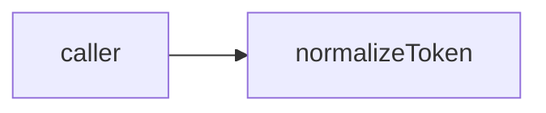

# normalize: module specification

<!--SECTION:SPEC_ID-->
TOKEN-NORMALIZE
<!--/SECTION:SPEC_ID-->

<!--SECTION:MODULE_VISION-->
## Module Vision
Own normalizeToken(input: string): string and its invalid-input TypeError; no state or I/O.
<!--/SECTION:MODULE_VISION-->

<!--SECTION:OVERVIEW-->
## Overview

_Нормализация токена без состояния._
<!--/SECTION:OVERVIEW-->

<!--SECTION:MODULE_USAGE_EXAMPLE-->
## Module Usage Example
```ts
normalizeToken("  Foo__BAR  "); // "foo-bar"
normalizeToken(""); // throws TypeError
```
<!--/SECTION:MODULE_USAGE_EXAMPLE-->

<!--SECTION:MODULE_REQUIREMENTS-->
## Requirements
### NOR-REQ-1 [должен]
**Когда** передана ASCII-строка, **нормализатор должен** обрезать крайние пробелы, привести буквы к lower-case и свернуть пробелы, underscore и hyphen в один hyphen.
> Один детерминированный формат токена нужен CLI и библиотечным потребителям.

### NOR-REQ-2 [должен · нештатная]
**Если** строка пустая, состоит из разделителей или содержит не-ASCII символы, **то нормализатор должен** выбросить TypeError без ввода-вывода.
> Ошибку входа нельзя маскировать пустым корректным токеном.

| Input | Outcome |
|---|---|
| `"  Foo__BAR  "` | `"foo-bar"` |
| `""` | `TypeError` |
<!--/SECTION:MODULE_REQUIREMENTS-->

<!--SECTION:INTER_MODULE_DEPENDENCIES-->
## Inter-Module Dependencies
No sibling dependencies.
[Parent specification](../token.spec.md)
<!--/SECTION:INTER_MODULE_DEPENDENCIES-->

<!--SECTION:ENTITY_INVENTORY-->
## Entity Inventory
| Entity | Type | Purpose |
|---|---|---|
| normalizeToken | Function | Deterministic token conversion |
<!--/SECTION:ENTITY_INVENTORY-->

<!--SECTION:ENTITY_SURFACES-->
## Entity Surfaces
One public function.
<details><summary>Function surface</summary>
normalizeToken(input: string): string. Invalid input throws TypeError. No lifecycle or emitted events.
</details>
<!--/SECTION:ENTITY_SURFACES-->

<!--SECTION:MODULE_CONTRACTS-->
## Module Contracts
One pure service, no ports/adapters or call-chain graph.
<details><summary>Contract</summary>
Pre: ASCII input with letters or digits. Post: trim, lower-case, collapse separator runs to hyphen. On violation: TypeError; no I/O or mutation.
</details>
<!--/SECTION:MODULE_CONTRACTS-->

<!--SECTION:PUBLIC_OPTIONS-->
## Public Options & Policies
No public options.
<details><summary>Policy</summary>Fixed deterministic transformation; no mutable configuration.</details>
<!--/SECTION:PUBLIC_OPTIONS-->

<!--SECTION:FILE_STRUCTURE-->
## File Structure
Planned, not implemented:
```text
src/normalize-token.ts
src/normalize-token.test.ts
```
<!--/SECTION:FILE_STRUCTURE-->

<!--SECTION:RESEARCH-->
## Research
No research documents for this bounded deterministic draft.
<!--/SECTION:RESEARCH-->

<!--SECTION:MODULE_DECISION_LOG-->
## Module Decision Log
No independent module decisions or approval.
<details><summary>Boundary</summary>Parent normalization rules are inherited unchanged.</details>
<!--/SECTION:MODULE_DECISION_LOG-->

<!--SECTION:HANDOFF-->
## Handoff to Tasks
- **Status:** pending-operator
- **Operator decision:** pending
No tickets created or execution approved by this draft.
<!--/SECTION:HANDOFF-->

<!--SECTION:IMPLEMENTATION_INSIGHTS-->
## Implementation Insights
Not implemented; no implementation findings claimed.
<!--/SECTION:IMPLEMENTATION_INSIGHTS-->
