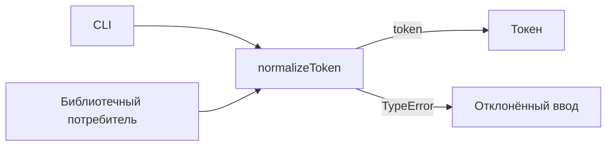
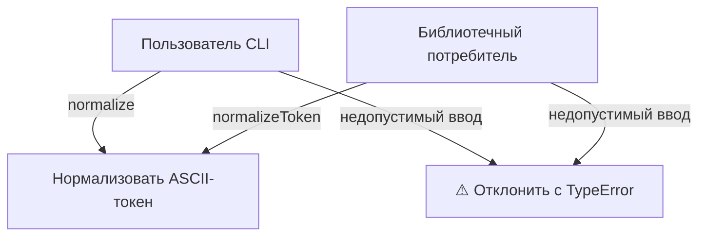
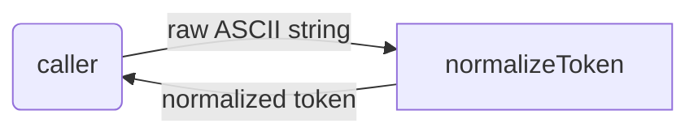
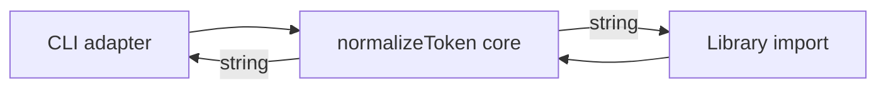

# token: Scope Specification

<!--SECTION:SPEC_ID-->
TOKEN
<!--/SECTION:SPEC_ID-->

<!--SECTION:SCOPE_TYPE-->
## scope-type
product
<!--/SECTION:SCOPE_TYPE-->

<!--SECTION:VISION-->
## Vision & Primary Goal
Локальный детерминированный нормализатор токенов для CLI и библиотечных потребителей: одна ASCII-строка на входе превращается в единый hyphen-separated токен без сети, файлов и состояния.
<!--/SECTION:VISION-->

<!--SECTION:OVERVIEW-->
## Overview

_Место нормализатора между локальными потребителями и результатом._
<!--/SECTION:OVERVIEW-->

<!--SECTION:PROJECT_TYPE-->
## Project Type
- **Type:** cli-utility
- **Why this type:** Локальная вызываемая функция и тонкая CLI-обёртка без UI, сетевого сервиса и собственного хранилища.
<!--/SECTION:PROJECT_TYPE-->

<!--SECTION:GOLDEN_DX-->
## Target Experience
Целевой опыт описан для будущей реализации; эта спека не создаёт код.

- **Инициализация:** отдельная настройка не нужна — потребитель импортирует `normalizeToken` или вызывает локальный CLI.
- **Успешный путь:** потребитель передаёт `"  Foo__BAR  "` и получает `"foo-bar"`; CLI печатает нормализованный токен.
- **Ошибка:** пустая строка, строка только из разделителей или не-ASCII ввод дают `TypeError` до любых операций ввода-вывода; CLI завершается с ошибкой и не обращается к сети или файлам.
- **Деградация:** внешних зависимостей нет, поэтому поведение не зависит от локали, сети или состояния процесса.
<!--/SECTION:GOLDEN_DX-->

<!--SECTION:SCOPE_DEPENDENCIES-->
## Scope Dependencies
- **Depends on:** [`infra-base`](../infra-base/infra-base.spec.md) — локальная базовая обвязка; сам нормализатор не использует её сетевые или файловые возможности.
- **Provides to:** внешние CLI и библиотечные потребители; отдельных consumer-спек пока нет.
<!--/SECTION:SCOPE_DEPENDENCIES-->

<!--SECTION:REQUIREMENTS_AND_CONSTRAINTS-->
## Requirements & Constraints

### Requirements

### TOK-REQ-1 [должен]
**Когда** потребитель передаёт ASCII-строку, **нормализатор должен** обрезать ведущие и замыкающие ASCII-пробелы, привести ASCII-буквы к нижнему регистру и свернуть каждый непрерывный участок пробелов, underscore и hyphen в один hyphen.

> Единый формат токена нужен, чтобы разные написания одного имени давали одинаковый результат у CLI и библиотечных потребителей.

### TOK-REQ-2 [должен · нештатная]
**Если** входная строка пустая, состоит только из разделителей (ASCII-пробелы, underscore, hyphen) или содержит хотя бы один не-ASCII символ, **то нормализатор должен** выбросить `TypeError` без операций ввода-вывода.

> Пустой корректный токен замаскировал бы ошибку входа; отказ без I/O сохраняет чистую детерминированную функцию.

| Input | Outcome |
|---|---|
| `"  Foo__BAR  "` | `"foo-bar"` |
| `""` | `TypeError` |

### Out-of-Scope
- Транслитерация и нормализация Unicode.
- Сеть, файлы, базы данных и постоянная конфигурация.
- Реализация кода, пакета и тестов в рамках этой спеки.

### Runtime & Deferred Scope
Нормализация — полностью локальная чистая операция; сетевого, файлового и БД-бэкинга нет. Реализация и runtime отложены: спека не создаёт код, пакет или исполняемый артефакт. Доверительная граница — входная строка вызывающего процесса; проверка ASCII выполняется в памяти.

### Rules
| Rule | Category | Source |
|---|---|---|
| Только локальная чистая трансформация без ввода-вывода | Determinism | `docs/token-contract.md` |
<!--/SECTION:REQUIREMENTS_AND_CONSTRAINTS-->

<!--SECTION:USE_CASES-->
## Use Cases

_Сценарии нормализации и отказа при недопустимом входе — TOK-REQ-1, TOK-REQ-2._
<!--/SECTION:USE_CASES-->

<!--SECTION:DATA_FLOW-->
## Data Flow

_Путь валидной строки через нормализатор — TOK-REQ-1._
<!--/SECTION:DATA_FLOW-->

<!--SECTION:ARCHITECTURE-->
## High-Level Architecture
Выбран один чистый модуль нормализации и тонкий CLI-адаптер; библиотечный потребитель вызывает тот же модуль напрямую. Слоёв, хранилищ и сетевых клиентов нет.

_Состав нормализатора и направление результата к потребителям._

- **normalizeToken core** — единственная точка правила: обрезка ASCII-пробелов, lower-case ASCII, свёртка разделителей, отказ `TypeError`.
- **CLI adapter** — передаёт аргумент в core, печатает токен или сообщает об ошибке; бизнес-правил не содержит.
- **Library import** — прямой вызов core без адаптера.

### Rejected Alternatives
- **Регулярное выражение без отдельной проверки входа** — отклонено: пустой, separator-only и не-ASCII случаи стали бы неявными.
- **Unicode-aware нормализация** — отклонено: выходит за рамки контракта и усложняет детерминизм.
- **Конфигурируемый или stateful нормализатор** — отклонено: контракт фиксирован, состояние и настройки не нужны.
<!--/SECTION:ARCHITECTURE-->

<!--SECTION:MODULE_MAP-->
## Module Map
Modules not yet decomposed — run `module-decomposition token`.
<!--/SECTION:MODULE_MAP-->

<!--SECTION:RESEARCH-->
## Research
Ресёрч не проводился: контракт задан в `docs/token-contract.md` и `inputs/brief.md`.
<!--/SECTION:RESEARCH-->

<!--SECTION:DECISION_LOG-->
## Decision Log
Спорных автономных решений нет: границы и поведение следуют `inputs/brief.md` и `docs/token-contract.md`.

Полные записи Decision Log

Записей нет.

<!--/SECTION:DECISION_LOG-->

<!--SECTION:BOOTSTRAP_REQUIREMENTS-->
## Prerequisites
Внешних предусловий нет.

Таблица предусловий

| Requirement | Kind | Owner | Resolution | Readiness Gates | Gate Artifacts |
|---|---|---|---|---|---|
| — | — | — | No external bootstrap required. | — | — |

<!--/SECTION:BOOTSTRAP_REQUIREMENTS-->

<!--SECTION:HANDOFF-->
## Handoff to Modules
- **Primary input:** `specs/token/token.spec.md`
- **Areas requiring decomposition:** ядро нормализации, CLI-адаптер, набор тестов (планируется; реализация не начата).
- **Named abstractions:** `normalizeToken(input: string): string`.
- **Bootstrap tickets ready for cascade:** нет, см. Prerequisites.
- **Open risks:** Unicode поведение вне области; separator-only и не-ASCII требуют явных тестов; поверхность CLI ещё не специфицирована.
- **Status:** pending operator approval; Approval #1 не выдан, тикеты не создавались, выполнение не заявлено.
<!--/SECTION:HANDOFF-->
