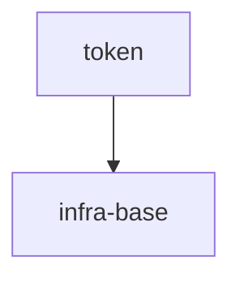

# token-authoring-benchmark

## Vision

A local, deterministic token normalizer shared by CLI and library consumers: it turns any valid ASCII token into one canonical hyphenated form, without network calls, persistence, or hidden state.

- **Для кого:** CLI и библиотечные потребители, которым нужен одинаковый токен из одного вызова `normalizeToken`.
- **Боль:** каждый потребитель иначе сам решает, как обрабатывать регистр, пробелы, underscore и hyphen, и получает свой вариант токена.
- **Успех:** `normalizeToken("  Foo__BAR  ")` возвращает `"foo-bar"`, а пустая строка, строка только из разделителей или не-ASCII вход дают `TypeError` без ввода-вывода.
- **Принципы:** детерминизм, чистый вызов без состояния и сети, ASCII-only контракт входа, явная ошибка вместо подмены неверного входа.

## Scope Graph

## Scopes

| Scope | Type | Spec | Description |
|---|---|---|---|
| [`token`](./token/token.spec.md) | library | 🚧 | Локальный детерминированный нормализатор токенов для CLI и библиотечных потребителей |
| [`infra-base`](./infra-base/infra-base.spec.md) | infrastructure | 🚧 | Локальное окружение авторинга: Node.js 22 и установленный Gennady CLI |
