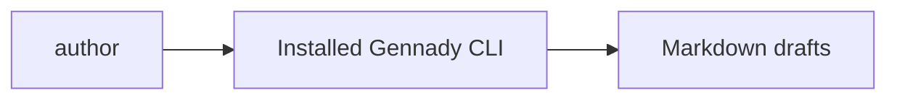

# infra-base: infrastructure specification

<!--SECTION:SPEC_ID-->
INFRA-BASE
<!--/SECTION:SPEC_ID-->

<!--SECTION:SCOPE_TYPE-->
## scope-type
infrastructure
<!--/SECTION:SCOPE_TYPE-->

<!--SECTION:VISION-->
## Vision
Own the local specification-authoring environment: Node.js 22 and the installed Gennady CLI. Product behavior belongs to its separate scope and module owners.
<!--/SECTION:VISION-->

<!--SECTION:OVERVIEW-->
## Overview

_Локальный CLI создаёт и проверяет черновики спецификаций._
<!--/SECTION:OVERVIEW-->

<!--SECTION:SCOPE_DEPENDENCIES-->
## Scope Dependencies
- **Depends on:** None
- **Provides to:** token authoring scopes.
<!--/SECTION:SCOPE_DEPENDENCIES-->

<!--SECTION:REQUIREMENTS_AND_CONSTRAINTS-->
## Requirements & Constraints
### IB-REQ-1 [должен]
**Когда** автор создаёт или проверяет черновик, **окружение должно** предоставлять локальный Gennady CLI через npx --no-install без загрузки пакетов из registry.
> Один предоставленный harness набор инструментов делает авторинг воспроизводимым.

### IB-REQ-2 [должен · нештатная]
**Если** локальный CLI или Node.js 22 недоступен, **то автор должен** остановиться до изменения целевого артефакта и сообщить фактическую ошибку запуска, не устанавливая другой инструмент.
> Отсутствие инструмента нельзя маскировать выдуманным результатом проверки.

### Out-of-Scope
- Product-domain algorithms, application APIs and product implementation.

### Runtime & Deferred Scope
The harness provisions the local CLI and dependency bindings; this reference is not an execution or verification receipt.

### Rules
No additional activated rule set.
<!--/SECTION:REQUIREMENTS_AND_CONSTRAINTS-->

<!--SECTION:TOOL_STACK-->
## Tool Stack
| Tool | Role |
|---|---|
| Node.js 22 | Local CLI runtime |
| Installed Gennady CLI | Canonical artifact creation and scoped authoring checks |
<!--/SECTION:TOOL_STACK-->

<!--SECTION:WORKFLOW_EXAMPLE-->
## Developer Workflow Example
Use npx --no-install gennady sdd-new with the case-owned arguments, read the created template, then author the requested draft. Scope/module drafts use npx --no-install gennady sdd-check --spec with their exact target and --authoring. Missing tooling stops the workflow; no registry installation or fabricated receipt.
<!--/SECTION:WORKFLOW_EXAMPLE-->

<!--SECTION:FILE_STRUCTURE-->
## File Structure
Provisioned tooling and authored drafts are separate:
```text
node_modules/.bin/gennady
node_modules/gennady/
specs/
```
<!--/SECTION:FILE_STRUCTURE-->

<!--SECTION:EFFECTIVE_RULES-->
## Effective Rules (for cascade)
No extra activated rules.
<details><summary>Rule audit</summary>The infrastructure supplies local authoring tools only; it does not own product-domain requirements.</details>
<!--/SECTION:EFFECTIVE_RULES-->

<!--SECTION:VERIFICATION_COMMANDS-->
## Verification Commands
For scope/module drafts, use npx --no-install gennady sdd-check --spec with the exact draft path and --authoring. Portal/index cases use the host artifact oracle; no exact product authoring CLI is asserted for them. No verification result is claimed here.
<!--/SECTION:VERIFICATION_COMMANDS-->

<!--SECTION:RESEARCH-->
## Research
No research documents for this bounded deterministic draft.
<!--/SECTION:RESEARCH-->

<!--SECTION:DECISION_LOG-->
## Decision Log
IB-DL-1 — use the provided local tool copy without registry installation; operator approval remains pending.
<details><summary>Boundary</summary>No product behavior, implementation or operator approval is owned by this tooling reference.</details>
<!--/SECTION:DECISION_LOG-->

<!--SECTION:BOOTSTRAP_REQUIREMENTS-->
## Prerequisites
No external bootstrap required.
<details><summary>Bootstrap audit</summary>The harness already supplies the local CLI and dependency bindings. If unavailable, stop and report the concrete invocation error; do not install a replacement.</details>
<!--/SECTION:BOOTSTRAP_REQUIREMENTS-->

<!--SECTION:HANDOFF-->
## Handoff
- **Status:** pending-operator
- **Operator decision:** pending
No tickets created or execution approved by this draft.
<!--/SECTION:HANDOFF-->
