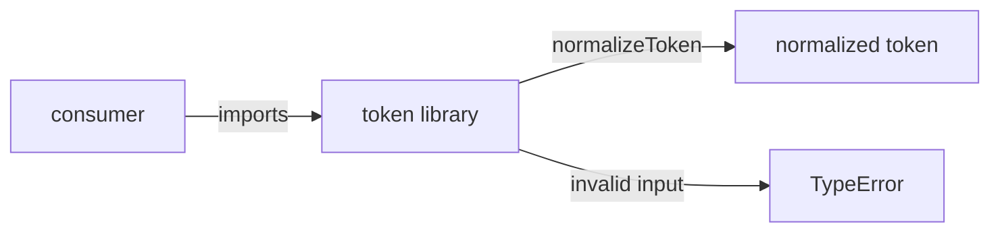
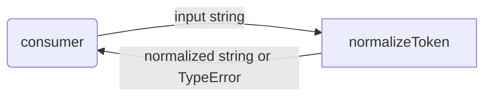

# token: Library Specification

<!--SECTION:SPEC_ID-->
TOKEN
<!--/SECTION:SPEC_ID-->

<!--SECTION:SCOPE_TYPE-->
## scope-type
library
<!--/SECTION:SCOPE_TYPE-->

<!--SECTION:VISION-->
## Vision & Primary Goal
`token` is a local deterministic token-normalization library. It turns a valid ASCII input string into one canonical lowercase, hyphen-separated token, so local CLI and library consumers stop producing inconsistent spellings of the same logical name. The transformation has no network, filesystem, or persistent state, and invalid input fails explicitly instead of being normalized silently.
<!--/SECTION:VISION-->

<!--SECTION:OVERVIEW-->
## Overview

_Локальная библиотека превращает допустимый ASCII-токен в каноническую форму, а невалидный ввод отвергает._
<!--/SECTION:OVERVIEW-->

<!--SECTION:GOLDEN_DX-->
## Target Experience
No setup or initialisation is required: a consumer imports the library and calls the pure function directly.

```ts
import { normalizeToken } from './token';

// Happy path: surrounding spaces, mixed case and repeated separators disappear.
const token = normalizeToken('  Foo__BAR  ');
// token === 'foo-bar'
```

```ts
import { normalizeToken } from './token';

// Error path: invalid input raises TypeError and returns no normalized value.
try {
  normalizeToken('');
} catch (error) {
  // error instanceof TypeError
}
```

The intent is a small, predictable surface: one call, one canonical result, and an explicit failure for input that cannot represent a token.
<!--/SECTION:GOLDEN_DX-->

<!--SECTION:SCOPE_DEPENDENCIES-->
## Scope Dependencies
- **Depends on:** [`infra-base`](../infra-base/infra-base.spec.md) — local Node.js and Gennady CLI environment for authoring and later verification.
- **Provides to:** local CLI and library consumers; no consumer scope spec exists yet.
<!--/SECTION:SCOPE_DEPENDENCIES-->

<!--SECTION:REQUIREMENTS_AND_CONSTRAINTS-->
## Requirements & Constraints

### Requirements

### TOK-REQ-1 [должен]
**Когда** потребитель импортирует библиотеку, **библиотека должна** предоставлять чистую функцию `normalizeToken(input: string): string`, не требующую инициализации или глобального состояния.

> Единственная публичная операция зафиксирована контрактом [`token-contract.md`](../../docs/token-contract.md); отсутствие setup делает вызов одинаковым в CLI и библиотечном коде.

### TOK-REQ-2 [должен]
**Когда** на вход поступает непустая ASCII-строка с буквами, пробелами, подчёркиваниями или дефисами, **библиотека должна** убрать ведущие и завершающие ASCII-пробелы, привести ASCII-буквы к нижнему регистру и заменить каждую непрерывную последовательность ASCII-пробелов, подчёркиваний или дефисов одним дефисом.

> Каноническая форма нужна потребителям для сравнения имён; без единого правила одно и то же имя получает разные написания.

### TOK-REQ-3 [должен · нештатная]
**Если** вход пуст, состоит только из ASCII-пробелов, подчёркиваний и дефисов **или** содержит хотя бы один символ вне ASCII, **то библиотека должна** бросить `TypeError` без возврата нормализованного значения.

> Молчаливая нормализация пустого или не-ASCII входа искажает идентичность токена; явная ошибка оставляет решение о таком вводе вызывающему коду.

### TOK-REQ-4 [должен]
**Когда** вызывается `normalizeToken`, **библиотека должна** выполнять преобразование без файлового, сетевого или иного ввода-вывода и без обращения к внешнему состоянию.

> Локальная детерминированная функция не должна зависеть от окружения, иначе одинаковый ввод перестаёт давать предсказуемый результат.

### TOK-REQ-5 [должен]
**Когда** одна и та же допустимая строка передаётся повторно, **библиотека должна** возвращать один и тот же результат.

> Повторяемость необходима CLI и библиотечным потребителям, которые сравнивают и кэшируют нормализованные имена.

**Наблюдаемые исходы:**

| Input | Outcome |
|---|---|
| `"  Foo__BAR  "` | `"foo-bar"` |
| `""` | `TypeError` |

### Out-of-Scope
- Implementation, package publishing, CLI wiring, persistence, networking, telemetry, Unicode transliteration and Unicode normalization are not part of this draft.
- No implementation is requested or claimed by this specification.

### Runtime & Deferred Scope
Runtime backing comes from `infra-base` (Node.js and the local Gennady CLI); the normalization itself requires no runtime dependency. Module decomposition and implementation are explicitly deferred to later owners.

### Rules
| Rule | Category | Source |
|---|---|---|
| No additional activated rule set | — | — |
<!--/SECTION:REQUIREMENTS_AND_CONSTRAINTS-->

<!--SECTION:DATA_FLOW-->
## Data Flow

_Путь строки через normalizeToken и обратно к потребителю — TOK-REQ-2, TOK-REQ-3._
<!--/SECTION:DATA_FLOW-->

<!--SECTION:PUBLIC_API_SURFACE-->
## Public API Surface
- **`normalizeToken`** — canonical normalization of one ASCII token; returns a string for valid input and raises `TypeError` for empty, separator-only or non-ASCII input. The owning module is pending `module-decomposition token`; its exact operations and signatures stay in that module spec.
<!--/SECTION:PUBLIC_API_SURFACE-->

<!--SECTION:ARCHITECTURE-->
## Architecture
The chosen design is a single stateless pure function with a fixed transformation order: trim ASCII spaces, lowercase ASCII letters, then collapse separator runs. Rejected alternatives: a stateful normalizer class (no lifecycle to manage), a plugin or adapter pipeline (one fixed operation does not justify extension points), and best-effort silent normalization (it hides invalid input instead of failing explicitly).
<!--/SECTION:ARCHITECTURE-->

<!--SECTION:MODULE_MAP-->
## Module Map
Modules not yet decomposed — run `module-decomposition token`
<!--/SECTION:MODULE_MAP-->

<!--SECTION:RESEARCH-->
## Research
No research documents apply: the scope is a bounded deterministic contract taken from [`token-contract.md`](../../docs/token-contract.md), and no external research was needed.
<!--/SECTION:RESEARCH-->

<!--SECTION:DECISION_LOG-->
## Decision Log
No disputed decisions; operator approval remains pending.

<details>
<summary>Полные записи Decision Log</summary>

None. This bounded authoring records no accepted verdict and no operator decision.

</details>
<!--/SECTION:DECISION_LOG-->

<!--SECTION:BOOTSTRAP_REQUIREMENTS-->
## Prerequisites
No external bootstrap required; Node.js and the local Gennady CLI belong to `infra-base`, and this library adds no package dependencies.

<details>
<summary>Таблица предусловий</summary>

| Requirement | Kind | Owner | Resolution | Readiness Gates | Gate Artifacts |
|---|---|---|---|---|---|

</details>
<!--/SECTION:BOOTSTRAP_REQUIREMENTS-->

<!--SECTION:HANDOFF-->
## Handoff to Modules
- **Areas requiring decomposition:** the `normalizeToken` normalizer and its tests, via `module-decomposition token`.
- **Named abstractions:** `normalizeToken`.
- **Bootstrap tickets ready for cascade:** see Prerequisites (none required).
- **Open risks:** exact separator-handling semantics and error messages are not implemented or validated by this draft.
- **Status:** pending-operator; Approval #1 has not been given, no tickets were created, and no execution is claimed.
<!--/SECTION:HANDOFF-->
