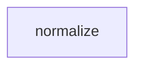

# Tasks: token

## Scope Spec
- [Scope spec](./token.spec.md)

## Cascade Table
Effective rules for this scope, from the Scope Graph (depends-on transitive closure). Tier order (low → high on collision): traversed-scopes → target-scope → module → phase.
| Tier | coding | testing | architecture | infra |
|------|--------|---------|--------------|-------|
| infra-base (traversed) | — | — | — | — |
| token (target) | — | — | — | — |

No additional rule IDs have been activated.

## Inter-Module DAG

The only module is normalize; no inter-module dependency edges exist.

## Tracker
| Task-ID | Title | Module | Dependencies | Status | Reopens |
|---------|-------|--------|--------------|--------|---------|
| NOR-normalize | Normalize ASCII token | normalize | — | [ ] TODO | — |
| NOR-reject | Reject empty token | normalize | NOR-normalize | [ ] TODO | — |

## Decision Log (scope task level)
No scope-level decomposition or planning decisions recorded. No operator approval exists; owner handoff remains pending.
