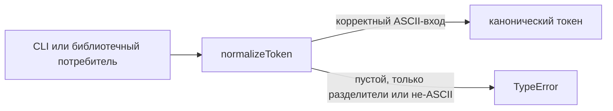
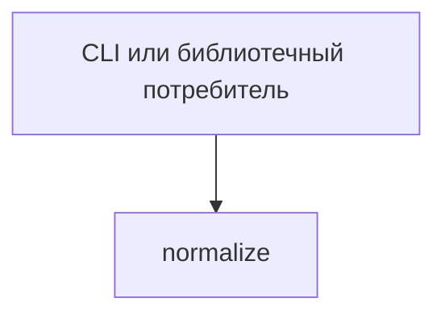

# Module: normalize

<!--SECTION:SPEC_ID-->
TOKEN-NORMALIZE
<!--/SECTION:SPEC_ID-->

<!--SECTION:MODULE_VISION-->
## Module Vision
Модуль `normalize` владеет единственной операцией скоупа [token](../token.spec.md): детерминированным преобразованием входной ASCII-строки в канонический токен. Публичная поверхность — `normalizeToken(input: string): string`; реализация, хранилище и сетевые зависимости в модуль не входят. Родительский скоуп — [token](../token.spec.md), дочерних модулей нет.
<!--/SECTION:MODULE_VISION-->

<!--SECTION:OVERVIEW-->
## Overview

_Преобразование входа в канонический токен или отказ без ввода-вывода — NOR-REQ-1, NOR-REQ-2._
<!--/SECTION:OVERVIEW-->

<!--SECTION:MODULE_USAGE_EXAMPLE-->
## Module Usage Example
```ts
import { normalizeToken } from "./normalize";

const token = normalizeToken("  Foo__BAR  ");
console.log(token);

try {
  normalizeToken("");
} catch (error) {
  if (error instanceof TypeError) {
    console.error("некорректный вход");
  }
}
```
<!--/SECTION:MODULE_USAGE_EXAMPLE-->

<!--SECTION:MODULE_REQUIREMENTS-->
## Requirements
### NOR-REQ-1 [должен]
**Когда** передана непустая ASCII-строка, не состоящая только из разделителей, **normalizeToken должен** убрать крайние ASCII-пробелы, привести ASCII-буквы к нижнему регистру и заменить каждый непрерывный ряд ASCII-пробелов, `_` и `-` одним `-`.

> Уточняет TOK-REQ-1 для публичной функции модуля: одинаковый вход всегда даёт один канонический токен, пригодный как идентификатор.

### NOR-REQ-2 [должен · нештатная]
**Если** вход пуст, состоит только из ASCII-пробелов, `_` и `-` или содержит не-ASCII символ, **то normalizeToken должен** выбросить `TypeError`, не выполняя ввода-вывода.

> Уточняет TOK-REQ-2: вызывающий код должен отличать ошибку входа от корректного токена; модуль не обращается к файлам, сети, часам или общему состоянию.

| Input | Outcome |
|---|---|
| `"  Foo__BAR  "` | `"foo-bar"` |
| `""` | `TypeError` |
<!--/SECTION:MODULE_REQUIREMENTS-->

<!--SECTION:INTER_MODULE_DEPENDENCIES-->
## Inter-Module Dependencies
- **Depends on:** нет модулей внутри скоупа `token`.
- **Scope Reference (cross-scope):** нет.
- **Provides to:** нет других модулей; `normalizeToken` вызывают внешние CLI- и библиотечные потребители.


_Внешний потребитель вызывает единственный модуль скоупа, межмодульных рёбер нет._
<!--/SECTION:INTER_MODULE_DEPENDENCIES-->

<!--SECTION:ENTITY_INVENTORY-->
## Entity Inventory

_Это полный список сущностей модуля. Любое введение сущности execution-агентом помимо этого списка считается drift'ом и требует обновления spec._

| Name | Type | Purpose |
|------|------|---------|
| `normalizeToken` | Function | Детерминированно преобразует ASCII-строку в канонический токен. |

Ошибки: throw `TypeError` → `normalizeToken`.

ER-эскиз не строится: в инвентаре одна сущность, связывать нечего.
<!--/SECTION:ENTITY_INVENTORY-->

<!--SECTION:ENTITY_SURFACES-->
## Entity Surfaces
Поверхность одна: чистая функция `normalizeToken` с сигнатурой `normalizeToken(input: string): string` и отказом через `TypeError`.

<details>
<summary>Полные поверхности сущностей</summary>

### `normalizeToken`
- **Type:** Function
- **Purpose:** Возвращает канонический токен для корректной ASCII-строки.
- **Public Properties:** N/A
- **Public Operations:** `normalizeToken(input: string): string` — нормализует вход или выбрасывает `TypeError`.
- **Lifecycle:** Создаётся вызовом, завершается возвратом значения или исключением; состояния между вызовами нет.
- **Events Emitted:** N/A
- **Errors & Degradation:** `TypeError` через throw для пустого входа, входа только из разделителей и входа с не-ASCII символом; владелец и источник ошибки — `normalizeToken`, потребитель получает её напрямую.
- **Consumers:**
  - Internal: `src/token/normalize/index.ts`
  - External: CLI- и библиотечные потребители скоупа `token`.

</details>
<!--/SECTION:ENTITY_SURFACES-->

<!--SECTION:MODULE_CONTRACTS-->
## Module Contracts
Модуль определяет одну чистую функцию `normalizeToken`; Port и Adapter не вводятся. Граф зависимостей не рисуется: в модуле нет Port/Adapter, только функция `normalizeToken`.

<details>
<summary>Контракты DbC</summary>

#### Service: `normalizeToken`
- **Purpose:** Детерминированно преобразует корректную ASCII-строку в канонический токен.
- **Consumers:** CLI- и библиотечные потребители скоупа `token`.
- **Runtime Backing:** `not-implemented`
- **Verification Levels:** `contract`, `unit`
- **Deferred Runtime Scope:** Вся заявленная обработка: реализация в этом черновике не создаётся.

**Contract (DbC)**
- `normalizeToken`:
  - Pre: вход — строка типа `string`, содержащая хотя бы один ASCII-символ вне множества ASCII-пробелов, `_` и `-`, и не содержащая не-ASCII символов.
  - Post: крайние ASCII-пробелы удалены, ASCII-буквы приведены к нижнему регистру, каждый непрерывный ряд ASCII-пробелов, `_` и `-` заменён одним `-`.
  - On pre-violation: выбрасывается `TypeError` без ввода-вывода.

**Invariants:** Функция не читает и не изменяет внешнее состояние, не выполняет ввода-вывода и не кеширует результат между вызовами.

</details>
<!--/SECTION:MODULE_CONTRACTS-->

<!--SECTION:PUBLIC_OPTIONS-->
## Public Options & Policies
Публичных флагов, опций и политик в v1 нет.

<details>
<summary>Опции и политики</summary>

Not applicable: единственная операция не принимает опций, режимов или конфигурации; `deferred / not consumed in v1`.

</details>
<!--/SECTION:PUBLIC_OPTIONS-->

<!--SECTION:FILE_STRUCTURE-->
## File Structure
```
src/token/normalize/
├── index.ts
└── index.test.ts
```

**File Mapping:**
- `src/token/normalize/index.ts`: реализация и экспорт `normalizeToken`.
- `src/token/normalize/index.test.ts`: модульные тесты нормализации и путей отказа.
<!--/SECTION:FILE_STRUCTURE-->

<!--SECTION:RESEARCH-->
## Research
Not applicable: отдельных research-документов для этой детерминированной локальной операции нет.
<!--/SECTION:RESEARCH-->

<!--SECTION:MODULE_DECISION_LOG-->
## Module Decision Log
Записано одно решение: модуль остаётся чистой функцией без Port/Adapter.

<details>
<summary>Полные записи Decision Log</summary>

NOR-DL-1 2026-10-22 — Port/Adapter не вводятся, модуль остаётся чистой функцией `normalizeToken` (почему: одна детерминированная операция без вариативности и внешних ресурсов; отвергнуто: Port/Adapter — лишний слой без подтверждённого тестового шва; риск: абстракция понадобится только при появлении альтернативной политики нормализации).

</details>
<!--/SECTION:MODULE_DECISION_LOG-->

<!--SECTION:HANDOFF-->
## Handoff to Tasks
- **Implementation files to be created:** `src/token/normalize/index.ts`
- **Test files to be created:** `src/token/normalize/index.test.ts`
- **Stack dependencies:**
  - Language: `TypeScript` (resolves to `ai/directives/coding/typescript-rules.xml`)
  - Test framework: `node:test` (resolves to `ai/directives/testing/node-test.xml`)
- **Module Rules Additions:** None; scope-wide baseline applies.
- **Open risks & validation needs:** Реализация и тесты ещё не созданы; точный текст сообщения `TypeError` не задан, поэтому тесты должны проверять тип ошибки, а не сообщение.
- **Status:** pending-operator
- **Operator decision:** pending
- **Approval #1:** pending-operator
<!--/SECTION:HANDOFF-->

<!--SECTION:IMPLEMENTATION_INSIGHTS-->
## Implementation Insights
Not applicable: реализация не выполнялась, поэтому post-implementation наблюдений нет.
<!--/SECTION:IMPLEMENTATION_INSIGHTS-->
