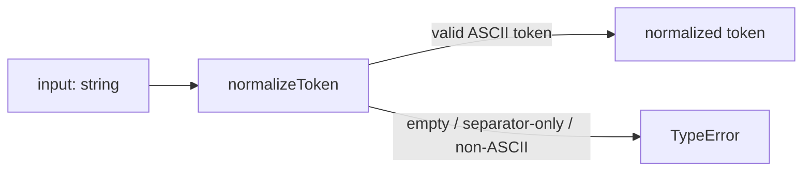
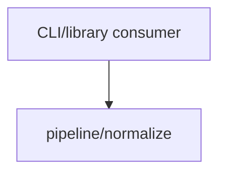

# Module: pipeline/normalize

<!--SECTION:SPEC_ID-->
TOKEN-PIPELINE-NORMALIZE
<!--/SECTION:SPEC_ID-->

<!--SECTION:MODULE_VISION-->
## Module Vision
Модуль владеет детерминированной нормализацией ASCII-токена для локальных CLI- и библиотечных потребителей. Родительский scope: [token](../../token.spec.md). Parent module: none — `pipeline` is a path namespace, not a separately specified module. Child modules: none. Sibling modules: none.

Границы модуля: входная проверка и преобразование строки. Сеть, файлы, конфигурация и хранение состояния не принадлежат модулю.
<!--/SECTION:MODULE_VISION-->

<!--SECTION:OVERVIEW-->
## Overview


_Один вызов normalizeToken: допустимый ASCII-вход даёт токен, недопустимый — TypeError — TOK-REQ-1, TOK-REQ-2._
<!--/SECTION:OVERVIEW-->

<!--SECTION:MODULE_USAGE_EXAMPLE-->
## Module Usage Example

```ts
import { normalizeToken } from "./normalize";

const token = normalizeToken("  Foo__BAR  ");
console.log(token);

try {
  normalizeToken("");
} catch (error) {
  if (error instanceof TypeError) {
    console.log("invalid token input");
  } else {
    throw error;
  }
}
```

Ожидаемый вывод: `foo-bar`, затем `invalid token input`.
<!--/SECTION:MODULE_USAGE_EXAMPLE-->

<!--SECTION:MODULE_REQUIREMENTS-->
## Requirements

No module-specific requirements. Implements parent requirements: TOK-REQ-1, TOK-REQ-2.

| Input | Outcome |
|---|---|
| `"  Foo__BAR  "` | `"foo-bar"` |
| `""` | `TypeError` |

Строки `normalize-example` и `empty-input-rejection` фиксируют наблюдаемые примеры для TOK-REQ-1 и TOK-REQ-2.
<!--/SECTION:MODULE_REQUIREMENTS-->

<!--SECTION:INTER_MODULE_DEPENDENCIES-->
## Inter-Module Dependencies
- **Depends on:** None.
- **Scope Reference (cross-scope):** None.
- **Provides to:** No sibling modules in scope `token`; the public function is consumed by scope-level CLI and library consumers.


_Модуль не зависит от соседей и предоставляет нормализацию потребителям scope token._
<!--/SECTION:INTER_MODULE_DEPENDENCIES-->

<!--SECTION:ENTITY_INVENTORY-->
## Entity Inventory

_Это полный список сущностей модуля. Любое введение сущности execution-агентом помимо этого списка считается drift'ом и требует обновления spec._

| Name | Type | Purpose |
|------|------|---------|
| `normalizeToken` | Function | Детерминированно нормализует ASCII-токен или выбрасывает TypeError |

Ошибки: throw → `normalizeToken`

ER sketch not applicable: inventory has one entity and no relational structure.
<!--/SECTION:ENTITY_INVENTORY-->

<!--SECTION:ENTITY_SURFACES-->
## Entity Surfaces

Одна сущность — чистая функция `normalizeToken` с публичным вводом и выводом и без состояния.

<details>
<summary>Полные поверхности сущностей</summary>

### `normalizeToken`
- **Type:** Function
- **Purpose:** Преобразует допустимый ASCII-токен в единый канонический вид.
- **Public Properties:** N/A — функция без состояния.
- **Public Operations:** Возвращает нормализованный токен для допустимого ASCII-входа; выбрасывает TypeError для пустого, separator-only или не-ASCII входа.
- **Lifecycle:** Stateless; создаётся при импорте модуля, не имеет завершения и не удерживает ресурсы.
- **Events Emitted:** N/A.
- **Errors & Degradation:** `TypeError` via throw для пустого, separator-only, не-ASCII или не-string входа; владелец — `normalizeToken`, ошибка передаётся вызывающему без I/O и без fallback.
- **Consumers:**
  - Internal: module export only; no internal callers yet.
  - External: local CLI and library consumers.
- **Usage Waiver (external: local CLI and library consumers):** Сущность — весь публичный контракт модуля; без неё у потребителей нет точки нормализации.

</details>
<!--/SECTION:ENTITY_SURFACES-->

<!--SECTION:MODULE_CONTRACTS-->
## Module Contracts

Модуль определяет одну функцию-сервис `normalizeToken`; Ports и Adapters отсутствуют.

Граф не рисуется: в модуле нет Port/Adapter, только Service `normalizeToken`.

Call Chain не рисуется: одна абстракция `normalizeToken`, последовательности между сущностями нет.

<details>
<summary>Контракты DbC</summary>

### Services

#### Service: `normalizeToken`
- **Purpose:** Детерминированно нормализовать ASCII-токен на границе модуля.
- **Consumers:** Internal module export; external local CLI and library consumers.
- **Runtime Backing:** `not-implemented`
- **Verification Levels:** `contract`, `unit`
- **Deferred Runtime Scope:** Вся заявленная функциональность без реального runtime: артефакт описывает контракт, реализации нет.

**Contract (DbC)**
- `normalizeToken(input)`:
  - Pre: вызывающий передаёт одно значение типа string; вход непустой, содержит хотя бы один символ вне ASCII-пробелов, underscore и hyphen, и состоит только из ASCII-символов.
  - Post: возвращает строку, в которой удалены крайние ASCII-пробелы, ASCII-буквы приведены к нижнему регистру, а каждая серия ASCII-пробелов, underscore и hyphen заменена одним hyphen; внешних чтений и записей нет.
  - On pre-violation: выбрасывает TypeError без ввода-вывода; не-string, пустой, separator-only и не-ASCII вход также дают TypeError.

**Invariants:** Один и тот же вход даёт тот же результат или тот же TypeError; функция не читает и не пишет внешнее состояние.

</details>
<!--/SECTION:MODULE_CONTRACTS-->

<!--SECTION:PUBLIC_OPTIONS-->
## Public Options & Policies

Публичных опций и политик нет: сигнатура `normalizeToken` фиксирована.

<details>
<summary>Опции и политики</summary>

Неприменимо: модуль не читает конфигурацию, переменные окружения или флаги.

</details>
<!--/SECTION:PUBLIC_OPTIONS-->

<!--SECTION:FILE_STRUCTURE-->
## File Structure
```text
src/pipeline/normalize/
└── normalize.ts
```

**File Mapping:**
- `src/pipeline/normalize/normalize.ts`: единственный публичный вход; экспортирует `normalizeToken`, проверяет вход и выполняет детерминированную нормализацию.
<!--/SECTION:FILE_STRUCTURE-->

<!--SECTION:RESEARCH-->
## Research

Неприменимо: research-документов для модуля нет; контракт задан [docs/token-contract.md](../../../docs/token-contract.md) и [scope spec](../../token.spec.md).
<!--/SECTION:RESEARCH-->

<!--SECTION:MODULE_DECISION_LOG-->
## Module Decision Log

Записаны решения о чистой функции без Port/Adapter, о TypeError как единственном механизме ошибок и о целевом стеке; approval остаётся pending.

<details>
<summary>Полные записи Decision Log</summary>

NORM-DL-1 2026-10-22 — `normalizeToken` оформлен как чистая функция без Port/Adapter (почему: одна детерминированная реализация, подтверждённой вариативности нет; отвергнуто: Port/Adapter-слой — лишняя абстракция; риск: смена алгоритма потребует явного изменения контракта функции)

NORM-DL-2 2026-10-22 — единственный механизм ошибок — throw TypeError без собственного класса (почему: TOK-REQ-2 фиксирует TypeError; отвергнуто: собственный InvalidTokenError — не требуется контрактом; риск: вызывающий различает только TypeError)

NORM-DL-3 2026-10-22 — целевой стек TypeScript и node:test; где: specs/token/pipeline/normalize/normalize.spec.md#handoff-to-tasks (почему: сигнатура normalizeToken записана в TypeScript, infra-base фиксирует Node.js 22; отвергнуто: JavaScript без типов — слабее фиксирует контракт) [verdict: pending-operator]

</details>
<!--/SECTION:MODULE_DECISION_LOG-->

<!--SECTION:HANDOFF-->
## Handoff to Tasks
- **Status:** pending-operator
- **Operator decision:** pending
- **Implementation files to be created:** `src/pipeline/normalize/normalize.ts`
- **Test files to be created:** `test/pipeline/normalize/normalize.test.ts`
- **Stack dependencies:**
  - Language: `typescript` (resolves to `ai/directives/coding/typescript-rules.xml`)
  - Test framework: `node:test` (resolves to `ai/directives/testing/node-test.xml`)
- **Module Rules Additions:** None.
- **Open risks & validation needs:** Реализации нет; проверка должна покрыть пустой вход, separator-only, не-ASCII, крайние пробелы, смешанные разделители и смену регистра. Выбор языка и test framework ожидает подтверждения оператора (NORM-DL-3). Tickets не созданы, execution не одобрен.
<!--/SECTION:HANDOFF-->

<!--SECTION:IMPLEMENTATION_INSIGHTS-->
## Implementation Insights

Неприменимо: реализации ещё нет; appendix заполняется после audit-cycle compaction.

<details>
<summary>Заметки по реализации</summary>

Сейчас нечего фиксировать: модуль существует только как спецификация.
</details>
<!--/SECTION:IMPLEMENTATION_INSIGHTS-->
