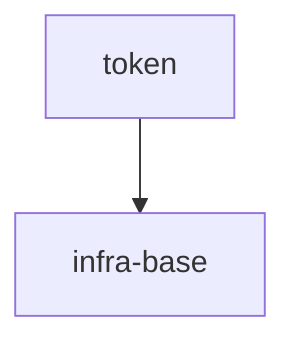

# token-normalizer

## Vision

Локальный детерминированный нормализатор токенов для CLI и библиотечных потребителей: одна функция `normalizeToken` приводит ASCII-строку к единому lower-case виду с одним hyphen между словами, не обращается к сети и не хранит состояние.

- **Для кого:** CLI-инструменты и библиотечные потребители, которым нужен стабильный токен без настройки и внешних зависимостей.
- **Боль:** разные написания одного и того же токена ломают сравнение и идентификацию, а ручная нормализация дублируется в каждом потребителе.
- **Успех:** `normalizeToken("  Foo__BAR  ")` детерминированно даёт `"foo-bar"`, а пустой, состоящий только из разделителей или не-ASCII вход даёт `TypeError` без ввода-вывода.
- **Принципы:** локальность и детерминизм, отсутствие сети и состояния, явная ошибка вместо молчаливой подмены некорректного входа.

## Scope Graph

## Scopes

| Scope | Type | Spec | Description |
|---|---|---|---|
| [`token`](./token/token.spec.md) | library | 🚧 | Локальный детерминированный нормализатор токенов |
| [`infra-base`](./infra-base/infra-base.spec.md) | infrastructure | 🚧 | Базовое локальное окружение авторинга: Node.js 22 и установленный Gennady CLI |
