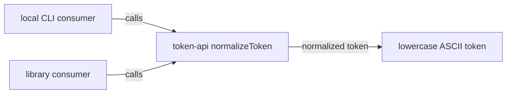

# token-api: Interface Specification

<!--SECTION:SPEC_ID-->
TOKEN-API
<!--/SECTION:SPEC_ID-->

<!--SECTION:SCOPE_TYPE-->
## scope-type
interface
<!--/SECTION:SCOPE_TYPE-->

<!--SECTION:VISION-->
## Vision
Defines the deterministic in-process token normalization contract for local CLI and library consumers: `normalizeToken(input: string): string` trims leading and trailing ASCII spaces, lowercases ASCII letters, and collapses runs of ASCII spaces, underscores and hyphens into one hyphen. Empty, separator-only and non-ASCII input fails with `TypeError`; the contract performs no I/O. Persistence, network access and product UI are out of scope.
<!--/SECTION:VISION-->

<!--SECTION:OVERVIEW-->
## Overview

_Как потребители вызывают контракт нормализации токена._
<!--/SECTION:OVERVIEW-->

<!--SECTION:SCOPE_DEPENDENCIES-->
## Scope Dependencies
- **Depends on:** [`infra-base`](../infra-base/infra-base.spec.md) — local Node.js runtime and authoring tooling.
- **Provides interface to:** local CLI and library consumers. No separate consumer scope spec exists in the current scope graph; consumers are declared here by role.
<!--/SECTION:SCOPE_DEPENDENCIES-->

<!--SECTION:REQUIREMENTS_AND_CONSTRAINTS-->
## Requirements & Constraints

### TA-REQ-1 [должен]
**Когда** `normalizeToken` получает строку, **функция должна** обрезать ведущие и замыкающие ASCII-пробелы, перевести ASCII-буквы в нижний регистр и заменить каждую серию ASCII-пробелов, подчёркиваний и дефисов одним дефисом.

> Это единственное преобразование контракта; от него зависит одинаковое написание токена у всех потребителей.

### TA-REQ-2 [должен · нештатная]
**Если** входная строка пуста, **то функция должна** выбросить `TypeError` до любого I/O.

> Пустой токен не имеет корректного нормализованного представления; явный отказ не даёт потребителю принять пустое значение за валидный результат.

### TA-REQ-3 [должен · нештатная]
**Если** входная строка состоит только из ASCII-пробелов, подчёркиваний и дефисов, **то функция должна** выбросить `TypeError` до любого I/O.

> Строка из одних разделителей нормализуется в пустой токен; отказ сохраняет инвариант непустого результата.

### TA-REQ-4 [должен · нештатная]
**Если** входная строка содержит хотя бы один не-ASCII символ, **то функция должна** выбросить `TypeError` до любого I/O.

> Контракт ограничен ASCII; молчаливое удаление или искажение не-ASCII символов сделало бы результат недетерминированным относительно заявленного домена.

### TA-REQ-5 [должен]
**Функция должна** возвращать результат, зависящий только от входной строки, без сетевого, файлового или иного I/O и без сохранения состояния между вызовами.

> Детерминированная чистая функция позволяет использовать контракт и в CLI, и в библиотеке без инфраструктурных зависимостей.

**Input/Outcome examples**

| Input | Outcome |
|---|---|
| `"  Foo__BAR  "` | `"foo-bar"` |
| `""` | `TypeError` |
<!--/SECTION:REQUIREMENTS_AND_CONSTRAINTS-->

<!--SECTION:INTERFACE_DECLARATION-->
## Interface Declaration
- **Schema format:** None — the contract is an in-process TypeScript function, `normalizeToken(input: string): string`; no OpenAPI, gRPC proto, JSON Schema or GraphQL SDL document is defined.
- **Versioning scheme:** none — initial unversioned local contract (see Versioning Policy).
- **Namespace:** none declared; one exported operation, `normalizeToken`.
- **Interfaces:** `normalizeToken(input: string): string` is the only operation. The accepted input domain is ASCII text containing at least one character that is not an ASCII space, underscore or hyphen; output is a lowercase ASCII token with single hyphens.
<!--/SECTION:INTERFACE_DECLARATION-->

<!--SECTION:VERSIONING_POLICY-->
## Versioning Policy
The current scheme is `none`: the contract is an unversioned local function with no published package. Any change to the accepted input domain, the separator set (`U+0020`, `U+005F`, `U+002D`), casing behavior, output shape or error type is a breaking change and replaces the contract in place; the same change must update this specification. There is no deprecation window until a package version exists. Consumers are notified through this specification and its Git diff; the contract itself performs no notification I/O.
<!--/SECTION:VERSIONING_POLICY-->

<!--SECTION:COMPATIBILITY_MATRIX-->
## Compatibility Matrix
Two consumer types (local CLI and library), no published version, and no pending breaking changes.

Матрица совместимости

| Consumer scope | Min compatible version | Breaking change protocol |
|---|---|---|
| local CLI consumer (no separate scope spec) | unversioned current contract | specification update and same-change notification |
| library consumer (no separate scope spec) | unversioned current contract | specification update and same-change notification |

<!--/SECTION:COMPATIBILITY_MATRIX-->

<!--SECTION:RESEARCH-->
## Research
No research documents; this bounded contract derives from the operator brief and `docs/token-contract.md`.
<!--/SECTION:RESEARCH-->

<!--SECTION:DECISION_LOG-->
## Decision Log
Four decisions: contract shape, versioning, invalid-input policy and purity; approval #1 remains pending.

Полные записи Decision Log

TA-DL-1 2026-10-22 — define the contract as a pure in-process function instead of a wire schema (почему: the intent names a local CLI/library normalizer and forbids I/O; отвергнуто: OpenAPI or JSON Schema because no serialization surface is needed; риск: no machine-readable schema for cross-language code generation).
TA-DL-2 2026-10-22 — use versioning scheme `none` for the initial unversioned contract, replacing breaking changes in place (почему: no published package or version exists yet; отвергнуто: semver from v0 because it would fabricate pre-release metadata; риск: consumers must re-sync on every change until a package version is introduced).
TA-DL-3 2026-10-22 — reject empty, separator-only and non-ASCII input with `TypeError` before transformation (почему: the intent requires explicit invalid-input failure and no I/O; отвергнуто: returning an empty string or silently dropping non-ASCII characters because either hides invalid input; риск: callers must catch `TypeError`).
TA-DL-4 2026-10-22 — keep the operation stateless and deterministic, with ASCII separators limited to space, underscore and hyphen (почему: the intent fixes the separator set and forbids I/O and state; отвергнуто: configurable separators or locale-aware lowercasing because they would make results environment-dependent; риск: a caller needing locale or Unicode behavior cannot use this contract).

### Approval #1 — current specification set
- **Status:** pending
- **Reviewed set:** `specs/token-api/token-api.spec.md`
- **Independent review:** pending
- **Operator decision:** pending
- **Recorded:** 2026-10-22
<!--/SECTION:DECISION_LOG-->

<!--SECTION:BOOTSTRAP_REQUIREMENTS-->
## Prerequisites
No external bootstrap required; the contract is documentation-only and its local runtime belongs to `infra-base`.

Таблица предусловий

No external bootstrap required: there are no external packages, schemas or services, and the local authoring runtime is provided by `infra-base`.

| Requirement | Kind | Owner | Resolution | Readiness Gates | Gate Artifacts |
|---|---|---|---|---|---|
| — | — | — | No external bootstrap required | — | — |

<!--/SECTION:BOOTSTRAP_REQUIREMENTS-->

<!--SECTION:HANDOFF-->
## Handoff
- **Contract files to scaffold:** None — the contract is captured by this specification; no schema file or codegen configuration is requested.
- **Bootstrap tickets ready for cascade:** None — see Prerequisites.
- **Open risks:** Versioning remains `none` until a package version is introduced; no consumer scope specification exists yet, so consumers are declared by role only.
- **Status:** pending-operator
- **Operator decision:** pending

No tickets were created and no execution is approved by this draft.
<!--/SECTION:HANDOFF-->
