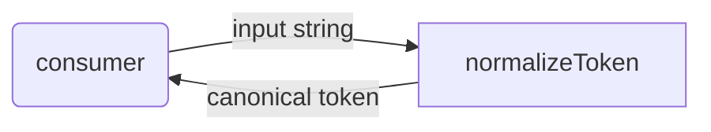
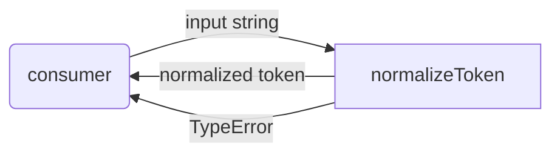

# token: Library Specification

<!--SECTION:SPEC_ID-->
TOKEN
<!--/SECTION:SPEC_ID-->

<!--SECTION:SCOPE_TYPE-->
## scope-type
library
<!--/SECTION:SCOPE_TYPE-->

<!--SECTION:VISION-->
## Vision & Primary Goal
`token` is a local deterministic library that turns caller-supplied ASCII strings into one canonical hyphenated spelling. It removes duplicated whitespace, case, and separator cleanup from consumer code while keeping invalid input a visible `TypeError`. The library performs no I/O and owns no persistent state.
<!--/SECTION:VISION-->

<!--SECTION:OVERVIEW-->
## Overview


_Как consumer получает канонический токен из библиотеки._
<!--/SECTION:OVERVIEW-->

<!--SECTION:GOLDEN_DX-->
## Target Experience
Setup requires only importing the exported function; there is no initialization call, configuration object, or global state.

```ts
import { normalizeToken } from "token";

// Happy path: outer spaces disappear, ASCII letters lowercase,
// and each separator run becomes one hyphen.
const token = normalizeToken("  Foo__BAR  ");
// token === "foo-bar"

// Error path: invalid input fails explicitly instead of returning a fallback.
try {
  normalizeToken("");
} catch (error) {
  // error instanceof TypeError
}
```

The intent is a direct, predictable call: callers pass one string and receive either the canonical token or a `TypeError` they cannot accidentally mistake for a valid empty result.
<!--/SECTION:GOLDEN_DX-->

<!--SECTION:SCOPE_DEPENDENCIES-->
## Scope Dependencies
- **Depends on:** [infra-base](../infra-base/infra-base.spec.md) — local authoring tooling only; no runtime dependency.
- **Provides to:** None.
<!--/SECTION:SCOPE_DEPENDENCIES-->

<!--SECTION:REQUIREMENTS_AND_CONSTRAINTS-->
## Requirements & Constraints

### Requirements

### TOK-REQ-1 [должен]
**Когда** на вход поступает строка `input`, **нормализатор должен** удалить ведущие и завершающие ASCII-пробелы (U+0020), привести ASCII-буквы к нижнему регистру и заменить каждую последовательность ASCII-пробелов, символов подчёркивания и дефисов одним дефисом.

> Каноническое написание убирает косметические различия и делает сравнение токенов независимым от регистра и разделителей.

### TOK-REQ-2 [должен · нештатная]
**Если** `input` пуст или состоит только из ASCII-пробелов, символов подчёркивания и дефисов, **то нормализатор должен** выбросить `TypeError` и не возвращать строку.

> У пустого или разделительного ввода нет идентичности токена; молчаливый пустой результат скрыл бы ошибку вызывающего кода.

### TOK-REQ-3 [должен · нештатная]
**Если** `input` содержит хотя бы один символ вне ASCII, **то нормализатор должен** выбросить `TypeError` без транслитерации и без иного преобразования символов.

> Контракт ограничен ASCII; транслитерация сделала бы результат зависимым от локали и неявных таблиц.

### TOK-REQ-4 [должен]
**Нормализатор должен** быть чистой функцией: одинаковый `input` даёт одинаковый результат, без сетевого, файлового или иного ввода-вывода и без сохранения состояния между вызовами.

> Детерминированная локальная операция позволяет использовать библиотеку в CLI и в тестах без окружения и побочных эффектов.

### TOK-REQ-5 [должен]
**Когда** `input` состоит только из ASCII-пробелов, ASCII-букв, ASCII-цифр, символов подчёркивания и дефисов, **результат должен** содержать только ASCII-буквы нижнего регистра, ASCII-цифры и одиночные дефисы, без двух дефисов подряд.

> Наблюдаемая форма результата не даёт соседним разделителям или верхнему регистру просочиться к потребителю.

Observable examples:

| Input | Outcome |
|---|---|
| `"  Foo__BAR  "` | `"foo-bar"` |
| `""` | `TypeError` |

### Out-of-Scope
- Implementation code, package layout, CLI wiring, tests, and ticket execution.
- Transliteration, Unicode normalization, locale-aware case folding, and non-ASCII handling.
- Configuration, logging, persistence, network access, and caching.

### Runtime & Deferred Scope
The capability is a synchronous in-memory string transformation; no external runtime service backs it. Deferred to module authoring: module boundaries, exact `TypeError` wording, export layout, package publication, and any CLI wrapper.

### Rules
| Rule | Category | Source |
|---|---|---|
| ASCII-only token contract | Domain | [token contract](../../docs/token-contract.md) |
| No I/O and no hidden state | Architecture | [token contract](../../docs/token-contract.md) |
<!--/SECTION:REQUIREMENTS_AND_CONSTRAINTS-->

<!--SECTION:DATA_FLOW-->
## Data Flow


_Путь входной строки к нормализованному токену или явной ошибке — TOK-REQ-1, TOK-REQ-2, TOK-REQ-3._
<!--/SECTION:DATA_FLOW-->

<!--SECTION:PUBLIC_API_SURFACE-->
## Public API Surface
- **Token normalization** — accepts one ASCII string and returns its canonical hyphenated form, or fails with `TypeError` for empty, separator-only, or non-ASCII input. The owning module is not yet created; its spec link is added by `module-decomposition token` (see Module Map).

No other composition-level capability is exposed by this scope.
<!--/SECTION:PUBLIC_API_SURFACE-->

<!--SECTION:ARCHITECTURE-->
## Architecture
Chosen design: a pure synchronous pipeline behind one exported function, with a fixed order — trim ASCII spaces, lowercase ASCII letters, then collapse separator runs into one hyphen. The pipeline shape keeps each transformation observable and makes the no-I/O constraint structural rather than incidental.

Rejected alternatives: a stateful normalizer class (unneeded lifecycle and hidden state); a regex-only design treated as architecture (an implementation detail that would hide the ordered transformations); and a CLI-first design (the contract is a library call, with any CLI as a future consumer).
<!--/SECTION:ARCHITECTURE-->

<!--SECTION:MODULE_MAP-->
## Module Map
Modules not yet decomposed — run `module-decomposition token`.
<!--/SECTION:MODULE_MAP-->

<!--SECTION:RESEARCH-->
## Research
No research documents feed this bounded deterministic draft.
<!--/SECTION:RESEARCH-->

<!--SECTION:DECISION_LOG-->
## Decision Log
No autonomous deviations recorded; operator approval remains pending.

<details>
<summary>Полные записи Decision Log</summary>

No entries.

</details>
<!--/SECTION:DECISION_LOG-->

<!--SECTION:BOOTSTRAP_REQUIREMENTS-->
## Prerequisites
No external bootstrap required.

<details>
<summary>Bootstrap audit</summary>

No external packages, credentials, services, or runtime provisioning are assumed by this authoring boundary.

| Requirement | Kind | Owner | Resolution | Readiness Gates | Gate Artifacts |
|---|---|---|---|---|---|
</details>
<!--/SECTION:BOOTSTRAP_REQUIREMENTS-->

<!--SECTION:HANDOFF-->
## Handoff to Modules
- **Areas requiring decomposition:** the single cohesive token-normalization capability; one module is expected but no module spec or ticket is created here.
- **Named abstractions:** `normalizeToken`, canonical token, invalid-input `TypeError`.
- **Bootstrap tickets ready for cascade:** none — see Prerequisites.
- **Open risks:** exact `TypeError` wording, treatment of ASCII characters outside the stated classes, and module/export layout remain for module authoring.
- **Operator approval:** pending — no approval, ticket creation, or execution is claimed.
<!--/SECTION:HANDOFF-->
