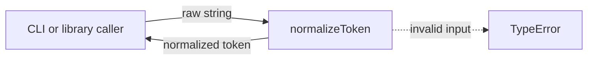
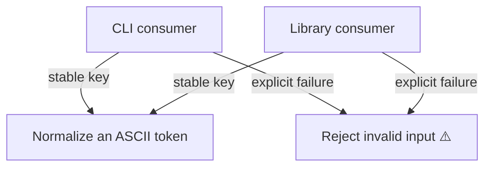
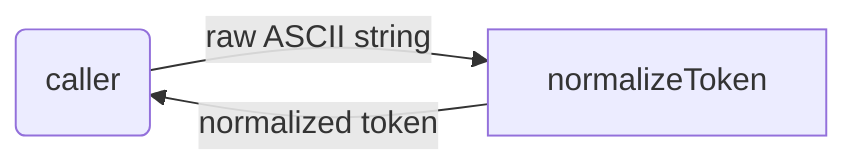
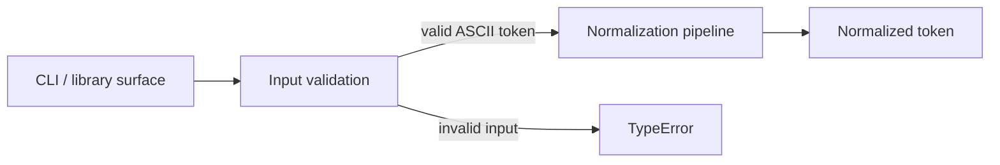

# token: Scope Specification

<!--SECTION:SPEC_ID-->
TOKEN
<!--/SECTION:SPEC_ID-->

<!--SECTION:SCOPE_TYPE-->
## scope-type
product
<!--/SECTION:SCOPE_TYPE-->

<!--SECTION:VISION-->
## Vision & Primary Goal
Provide a local, deterministic token normalizer for CLI and library consumers. It turns an ASCII token into a lowercase hyphen-separated form and rejects empty, separator-only, or non-ASCII input with `TypeError`, without I/O.
<!--/SECTION:VISION-->

<!--SECTION:OVERVIEW-->
## Overview
A single pure function sits between callers and the normalized token. Invalid input fails at the same boundary.


_Нормализатор принимает строку и возвращает токен либо TypeError._
<!--/SECTION:OVERVIEW-->

<!--SECTION:PROJECT_TYPE-->
## Project Type
- **Type:** cli-utility
- **Why this type:** The scope exposes a local command/library function with no server, network, or persistent state.
<!--/SECTION:PROJECT_TYPE-->

<!--SECTION:GOLDEN_DX-->
## Target Experience
**Init/setup.** A consumer installs or links the local package. There is no service to start, no credential, and no environment configuration; the same `normalizeToken` entry point serves CLI and library callers.

**Happy path.** The caller passes an ASCII token and receives one canonical form:

```js
normalizeToken('  Foo__BAR  '); // 'foo-bar'
```

**Error/degradation.** Empty input, separator-only input, or non-ASCII input raises `TypeError` at the call boundary. No partial result, file, network request, or log write is produced.
<!--/SECTION:GOLDEN_DX-->

<!--SECTION:SCOPE_DEPENDENCIES-->
## Scope Dependencies
- **Depends on:** [`infra-base`](../infra-base/infra-base.spec.md) — Node.js 22 runtime and the local Gennady tooling.
- **Provides to:** No downstream specs; local CLI and library callers consume the function directly.
<!--/SECTION:SCOPE_DEPENDENCIES-->

<!--SECTION:REQUIREMENTS_AND_CONSTRAINTS-->
## Requirements & Constraints

### Requirements

### TOK-REQ-1 [должен]
**Когда** вызывается `normalizeToken` с ASCII-строкой, содержащей хотя бы одну ASCII-букву, **функция должна** обрезать ведущие и хвостовые ASCII-пробелы, привести ASCII-буквы к нижнему регистру и заменить каждый непрерывный участок ASCII-пробелов, подчёркиваний и дефисов одним дефисом.

> Одна детерминированная форма нужна как стабильный ключ; без неё потребители получают разные написания одного токена.

### TOK-REQ-2 [должен · нештатная]
**Если** вход пуст или состоит только из ASCII-пробелов, подчёркиваний и дефисов, **то normalizeToken должен** выбросить `TypeError` без выполнения ввода-вывода.

> Пустой или разделительный вход не содержит токена; молчаливый возврат пустой строки или дефиса скрыл бы ошибку вызова.

### TOK-REQ-3 [должен · нештатная]
**Если** вход содержит хотя бы один не-ASCII символ, **то normalizeToken должен** выбросить `TypeError` без выполнения ввода-вывода.

> Бриф ограничивает контракт ASCII; неявная нормализация Unicode сделала бы результат зависимым от локали и окружения.

### TOK-REQ-4 [должен]
**Когда** `normalizeToken` получает допустимый вход, **функция должна** вернуть результат, зависящий только от входной строки, без файлового, сетевого, часового или случайного ввода-вывода.

> Детерминизм и отсутствие I/O позволяют использовать функцию в CLI и библиотеке без настройки окружения и делают результат воспроизводимым.

Проверочные примеры:

| Input | Outcome |
|---|---|
| "  Foo__BAR  " | "foo-bar" |
| "" | TypeError |

### Out-of-Scope
- Product implementation, package publishing, CLI argument parsing, and distribution.
- Filesystem, network, environment, clock, randomness, and other I/O.
- Locale-sensitive case folding, Unicode normalization, digit handling, and ASCII punctuation beyond the three named separators.
- Task ticket creation, execution, and operator approval.

### Runtime & Deferred Scope
Runtime backing: the function runs in-process on Node.js 22 supplied by `infra-base`; its only input is the caller's string and its only output is a string or `TypeError`. Deferred: package layout, CLI argument parsing, publishing, and digit/other-punctuation behavior. Trust boundary: the caller controls the string; the function must not read files, network, environment, clock, or randomness.

### Rules
| Rule | Category | Source |
|---|---|---|
| No additional activated rule set. | — | — |
<!--/SECTION:REQUIREMENTS_AND_CONSTRAINTS-->

<!--SECTION:USE_CASES-->
## Use Cases

_Сценарии использования — TOK-REQ-1, TOK-REQ-2, TOK-REQ-3._
<!--/SECTION:USE_CASES-->

<!--SECTION:DATA_FLOW-->
## Data Flow

_Путь строки через нормализатор — TOK-REQ-1, TOK-REQ-4._
<!--/SECTION:DATA_FLOW-->

<!--SECTION:ARCHITECTURE-->
## High-Level Architecture
The scope is a single pure pipeline behind a narrow surface:


_Уровни нормализатора — TOK-REQ-1, TOK-REQ-2, TOK-REQ-3, TOK-REQ-4._

- **Surface:** `normalizeToken(input: string): string`; both CLI and library callers use it.
- **Input validation:** rejects empty, separator-only, and non-ASCII input before transformation.
- **Normalization pipeline:** trims ASCII spaces, lowercases ASCII letters, and collapses separator runs into one hyphen.
- **Failure boundary:** raises `TypeError` with no I/O.

### Rejected Alternatives
- **Locale-aware or Unicode-aware lowercase** — rejected because the contract is ASCII-only and locale-dependent behavior would be non-deterministic across environments.
- **Preserving original separators** — rejected because the target output is one canonical hyphen-separated form.
- **A networked or stateful normalization service** — rejected because the scope is a local pure function with no I/O.
<!--/SECTION:ARCHITECTURE-->

<!--SECTION:MODULE_MAP-->
## Module Map
Modules not yet decomposed — run `module-decomposition token`.
<!--/SECTION:MODULE_MAP-->

<!--SECTION:RESEARCH-->
## Research
No research documents; the contract is fully specified by the operator brief.
<!--/SECTION:RESEARCH-->

<!--SECTION:DECISION_LOG-->
## Decision Log
0 decisions; no autonomous choice was needed because the operator brief fixes the contract.

<details>
<summary>Полные записи Decision Log</summary>

Записей нет: все требования прямо следуют из брифа; неоднозначных решений не принималось.

</details>
<!--/SECTION:DECISION_LOG-->

<!--SECTION:BOOTSTRAP_REQUIREMENTS-->
## Prerequisites
No external bootstrap required; only the upstream `infra-base` runtime is assumed.

<details>
<summary>Таблица предусловий</summary>

| Requirement | Kind | Owner | Resolution | Readiness Gates | Gate Artifacts |
|---|---|---|---|---|---|
| Node.js 22 and local Gennady CLI runtime | runtime | `infra-base` | Upstream scope provides the runtime; this scope adds no package files. | — | — |

</details>
<!--/SECTION:BOOTSTRAP_REQUIREMENTS-->

<!--SECTION:HANDOFF-->
## Handoff to Modules
- **Primary input:** `specs/token/token.spec.md`
- **Areas requiring decomposition:** input validation, ASCII normalization, public function surface, and the `TypeError` failure contract.
- **Named abstractions:** `normalizeToken(input: string): string`; `TypeError` for invalid input.
- **Bootstrap tickets ready for cascade:** see Prerequisites.
- **Open risks:** digits and ASCII punctuation other than spaces, underscores, and hyphens are not specified by the brief; module design must resolve them without widening this scope contract.
- **Status:** pending-operator
- **Operator decision:** pending
No tickets were created, and no execution or approval is claimed by this draft.
<!--/SECTION:HANDOFF-->
