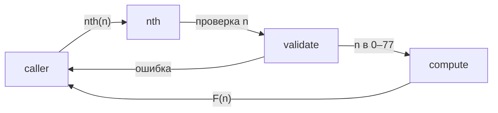

# Module: core

<!--SECTION:SPEC_ID-->
FIBONACCI-CORE
<!--/SECTION:SPEC_ID-->

<!--SECTION:MODULE_VISION-->
## Module Vision

Модуль `core` — единственный модуль скоупа [fibonacci](../fibonacci.spec.md). Он владеет всей публичной возможностью библиотеки: функцией `nth(n)`, проверкой индекса и вычислением числа Фибоначчи. Соседних модулей и родительских модулей нет.
<!--/SECTION:MODULE_VISION-->

<!--SECTION:OVERVIEW-->
## Overview


_Главный путь: вызов проходит проверку индекса, затем вычисление, и возвращает результат или ошибку — FIB-REQ-1, FIB-REQ-2, FIB-REQ-3, FIB-REQ-4._
<!--/SECTION:OVERVIEW-->

<!--SECTION:MODULE_USAGE_EXAMPLE-->
## Module Usage Example

```ts
import { nth } from './src/core/index.ts';

nth(0); // 0
nth(10); // 55
nth(77); // 5527939700884757

try {
  nth(-1);
} catch (error) {
  // RangeError: индекс должен быть в диапазоне 0–77
}

try {
  nth(1.5);
} catch (error) {
  // TypeError: индекс должен быть целым числом
}
```
<!--/SECTION:MODULE_USAGE_EXAMPLE-->

<!--SECTION:MODULE_REQUIREMENTS-->
## Requirements

No module-specific requirements. Implements parent requirements: FIB-REQ-1, FIB-REQ-2, FIB-REQ-3, FIB-REQ-4, FIB-REQ-5, FIB-REQ-6.
<!--/SECTION:MODULE_REQUIREMENTS-->

<!--SECTION:INTER_MODULE_DEPENDENCIES-->
## Inter-Module Dependencies
- **Depends on:** None
- **Scope Reference (cross-scope):** None
- **Provides to:** None


_Модуль стоит отдельно: ни входящих, ни исходящих рёбер нет._
<!--/SECTION:INTER_MODULE_DEPENDENCIES-->

<!--SECTION:ENTITY_INVENTORY-->
## Entity Inventory

_Это полный список сущностей модуля. Любое введение сущности execution-агентом помимо этого списка считается drift'ом и требует обновления spec._

| Name | Type | Purpose |
|------|------|---------|
| `nth` | Function | Проверяет индекс и возвращает F(n) или выбрасывает ошибку. |

Ошибки: throw → `nth`

ER-набросок не нужен: в инвентаре одна сущность, связывать нечего.
<!--/SECTION:ENTITY_INVENTORY-->

<!--SECTION:ENTITY_SURFACES-->
## Entity Surfaces

`nth` — единственная публичная функция модуля; её поверхность, ошибки и жизненный цикл ниже.

<details>
<summary>Полные поверхности сущностей</summary>

### `nth`
- **Type:** Function
- **Purpose:** Возвращает число Фибоначчи по целому индексу 0–77.
- **Public Properties:** N/A
- **Public Operations:** `nth(n)` — принимает индекс и возвращает F(n).
- **Lifecycle:** создаётся при загрузке модуля, состояния не хранит, завершается с возвратом или ошибкой на каждом вызове.
- **Events Emitted:** N/A
- **Errors & Degradation:** `RangeError` для отрицательного индекса или индекса больше 77, `TypeError` для нецелого `number`, `NaN`, `Infinity` и не-number значения; выбрасываются через `throw`, владелец — `nth`, вызывающий код обрабатывает их сам.
- **Consumers:**
  - Internal: `src/core/index.ts`
  - External: потребители библиотеки
- **Usage Waiver (external: library consumers):** это единственная публичная функция библиотеки; порог в два внутренних использования к ней не применим.

</details>
<!--/SECTION:ENTITY_SURFACES-->

<!--SECTION:MODULE_CONTRACTS-->
## Module Contracts

Модуль даёт одну Service-функцию `nth`; Port и Adapter не нужны.

Граф не рисуется: в модуле нет Port/Adapter, только Service `nth`.

Цепочка вызовов не рисуется: в инвентаре одна абстракция — `nth`.

<details>
<summary>Контракты DbC</summary>

### Services

#### Service: `nth`
- **Purpose:** Проверяет индекс и вычисляет число Фибоначчи.
- **Consumers:** `src/core/index.ts`; внешние потребители библиотеки.
- **Runtime Backing:** `not-implemented`
- **Verification Levels:** `contract`, `unit`
- **Deferred Runtime Scope:** None

**Contract (DbC)** — one block per operation:
- `nth(n)`:
  - Pre: `n` — значение типа `number`, целое, от 0 до 77 включительно.
  - Post: возвращает `F(n)` как `number`, где `F(0) = 0`, `F(1) = 1`, `F(n) = F(n-1) + F(n-2)`; внешнее состояние не меняет.
  - On pre-violation: для целого `n` вне 0–77 выбрасывает `RangeError`; для нецелого `number`, `NaN`, `Infinity` или не-number значения выбрасывает `TypeError`; сообщение называет допустимый диапазон или требование целого числа.

**Invariants:** при одном и том же `n` результат один и тот же; функция не хранит состояние между вызовами и не делает ввода-вывода.

</details>
<!--/SECTION:MODULE_CONTRACTS-->

<!--SECTION:PUBLIC_OPTIONS-->
## Public Options & Policies

Публичных опций и политик нет.

<details>
<summary>Опции и политики</summary>

None — API состоит из одной функции без параметров конфигурации.

</details>
<!--/SECTION:PUBLIC_OPTIONS-->

<!--SECTION:FILE_STRUCTURE-->
## File Structure
```
src/core/
├── index.ts
├── nth.ts
└── nth.test.ts
```

**File Mapping:**
- `src/core/nth.ts`: проверка индекса и вычисление F(n)
- `src/core/index.ts`: публичный реэкспорт `nth`
- `src/core/nth.test.ts`: unit-тесты happy path, границ и ошибок
<!--/SECTION:FILE_STRUCTURE-->

<!--SECTION:RESEARCH-->
## Research

Внешних исследований не требуется: контракт задан в brief скоупа и не опирается на внешние источники.
<!--/SECTION:RESEARCH-->

<!--SECTION:MODULE_DECISION_LOG-->
## Module Decision Log

Две записи: отказ от Port/Adapter и завершение черновика; Approval #1 ожидает решения оператора.

<details>
<summary>Полные записи Decision Log</summary>

COR-DL-1 2026-10-22 — модуль без Port/Adapter, одна чистая функция (почему: нет внешней зависимости, вариантов реализации и точки подмены; отвергнуто: Port + Adapter ради симметрии с контрактной нотацией — лишний слой без потребителя; риск: нет)

### Approval #1 — current specification set
- **Status:** pending
- **Reviewed set:** `specs/fibonacci/fibonacci.spec.md`, `specs/fibonacci/core/core.spec.md`
- **Independent review:** clean
- **Operator decision:** pending
- **Recorded:** 2026-10-22

COR-DL-2 2026-10-22 — module draft complete (почему: sdd-check --spec specs/fibonacci/core/core.spec.md --authoring прошёл без замечаний)

</details>
<!--/SECTION:MODULE_DECISION_LOG-->

<!--SECTION:HANDOFF-->
## Handoff to Tasks
- **Implementation files to be created:** `src/core/nth.ts`, `src/core/index.ts`
- **Test files to be created:** `src/core/nth.test.ts`
- **Stack dependencies:**
  - Language: `typescript` (resolves to `ai/directives/coding/typescript-rules.xml`)
  - Test framework: `node:test` (resolves to `ai/directives/testing/node-test.xml`)
- **Module Rules Additions:** None

  | Rule | Category | Source |
  |------|----------|--------|
  | None | — | — |

- **Open risks & validation needs:** точное значение `F(77)` и поведение на `NaN`, `Infinity` и дробях проверить тестами; тексты ошибок не зафиксированы дословно.
<!--/SECTION:HANDOFF-->

<!--SECTION:IMPLEMENTATION_INSIGHTS-->
## Implementation Insights

Пока нет: раздел заполняется после реализации.

<details>
<summary>Заметки по реализации</summary>

После первого цикла реализации сюда попадёт то, что нельзя вывести из контракта: особенности вычисления и тестов на границах.

</details>
<!--/SECTION:IMPLEMENTATION_INSIGHTS-->
