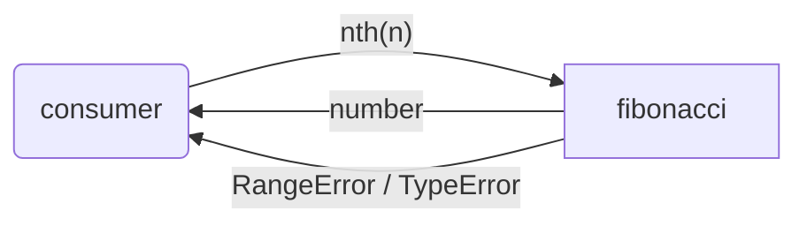
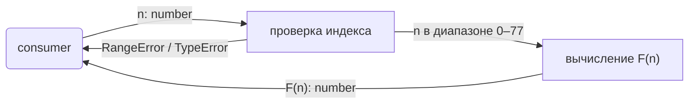
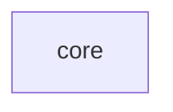

# fibonacci: Library Specification

<!--SECTION:SPEC_ID-->
FIBONACCI
<!--/SECTION:SPEC_ID-->

<!--SECTION:SCOPE_TYPE-->
## scope-type
library
<!--/SECTION:SCOPE_TYPE-->

<!--SECTION:VISION-->
## Vision & Primary Goal

Библиотека даёт одноимённую функцию `nth(n)`, которая по целому индексу возвращает число Фибоначчи. Она снимает с потребителя необходимость писать и проверять собственную реализацию последовательности: границы индекса, точность результата и поведение на недопустимом входе уже заданы контрактом.

Библиотека рассчитана на прикладной TypeScript-код, которому нужно точное значение в диапазоне, помещающемся в `number`. За пределами этого диапазона API честно отказывает, а не возвращает округлённое число.
<!--/SECTION:VISION-->

<!--SECTION:OVERVIEW-->
## Overview


_Потребитель получает от библиотеки число Фибоначчи или явную ошибку._
<!--/SECTION:OVERVIEW-->

<!--SECTION:GOLDEN_DX-->
## Target Experience

Подключение не требует настройки: потребитель импортирует `nth` из точки входа библиотеки и вызывает её с целым индексом.

```ts
import { nth } from 'fibonacci';

nth(0); // 0
nth(1); // 1
nth(10); // 55
nth(77); // 5527939700884757
```

Ошибочный вход останавливает вызов сразу и называет причину:

```ts
nth(-1); // RangeError: индекс должен быть в диапазоне 0–77
nth(1.5); // TypeError: индекс должен быть целым числом
nth(-1.5); // TypeError: индекс должен быть целым числом
nth(78); // RangeError: индекс должен быть в диапазоне 0–77
```

Вызывающий код не обязан знать внутреннее устройство библиотеки: имя функции, тип аргумента и тип ошибки — весь публичный контракт.
<!--/SECTION:GOLDEN_DX-->

<!--SECTION:SCOPE_DEPENDENCIES-->
## Scope Dependencies
- **Depends on:** None
- **Provides to:** None
<!--/SECTION:SCOPE_DEPENDENCIES-->

<!--SECTION:REQUIREMENTS_AND_CONSTRAINTS-->
## Requirements & Constraints

### Requirements

### FIB-REQ-1 [должен]
**Когда** потребитель вызывает `nth(n)` с целым числом `n` от 0 до 77 включительно, **функция должна** вернуть соответствующее число Фибоначчи, где `F(0) = 0` и `F(1) = 1`.

> Это основной сценарий библиотеки. Значения `F(0)` и `F(1)` задают последовательность; без них остальные результаты не определены.

### FIB-REQ-2 [должен · нештатная]
**Если** `n` — целое число меньше нуля, **то функция должна** выбросить `RangeError` с сообщением, где назван допустимый диапазон 0–77.

> Отрицательные индексы не определены для этой последовательности. Молчаливый возврат произвольного значения скрыл бы ошибку вызова.

### FIB-REQ-3 [должен · нештатная]
**Если** `n` не является целым числом — дробное (включая отрицательное), `NaN` или `Infinity`, **то функция должна** выбросить `TypeError` с сообщением, где сказано, что индекс должен быть целым числом.

> Нецелый индекс — ошибка типа аргумента, а не диапазона. Проверка целости идёт первой: `-1.5` и `Infinity` дают `TypeError`, а не `RangeError`.

### FIB-REQ-4 [должен · нештатная]
**Если** `n` — целое число больше 77, **то функция должна** выбросить `RangeError` с сообщением, где назван верхний предел 77.

> Верхняя граница задана контрактом библиотеки. Без неё результат рано или поздно выйдет за точность `number` и станет неверным.

### FIB-REQ-5 [должен]
**Функция должна** быть чистой: не читать и не писать внешнее состояние, не делать ввода-вывода и возвращать один и тот же результат при одном и том же `n`.

> Чистую функцию просто кэшировать и тестировать. Побочные эффекты сделали бы результат зависимым от порядка вызовов.

### FIB-REQ-6 [должен]
**Функция должна** документировать в публичном API допустимый диапазон 0–77, значения `F(0) = 0` и `F(1) = 1`, а также все три класса ошибок.

> Без документации вызывающий код узнаёт о границах только из падения. Brief требует явно описать каждый край.

### Out-of-Scope

- Генерация последовательности, итераторы и потоковые API.
- Отрицательные индексы и обобщение на целые числа меньше нуля.
- Произвольная точность (`BigInt`, строковые числа) и индексы больше 77.
- Конфигурация, мемоизация и кэш как публичные опции.
- CLI, сетевой сервис и хранение данных.

### Runtime & Deferred Scope

Runtime-основа — синхронный вызов в процессе Node.js на TypeScript, без внешних сервисов и файловых операций. Отложено: произвольная точность за пределами 77, генератор последовательности и работа с отрицательными индексами.

### Rules
| Rule | Category | Source |
|---|---|---|
| Публичный API — `nth(n: number): number`, других экспортов нет | architecture | `specs/fibonacci/fibonacci.spec.md#public-api-surface` |
| Индекс — целое число 0–77 | contract | `FIB-REQ-1`, `FIB-REQ-2`, `FIB-REQ-3`, `FIB-REQ-4` |
| Сначала проверяется целость, затем диапазон | contract | `FIB-REQ-2`, `FIB-REQ-3`, `FIB-REQ-4` |
| Функция чистая, без ввода-вывода | architecture | `FIB-REQ-5` |
| `RangeError` для целого индекса вне диапазона, `TypeError` для нецелого аргумента | contract | `FIB-REQ-2`, `FIB-REQ-3`, `FIB-REQ-4` |
<!--/SECTION:REQUIREMENTS_AND_CONSTRAINTS-->

<!--SECTION:DATA_FLOW-->
## Data Flow


_Путь вызова от потребителя до результата или ошибки — FIB-REQ-1, FIB-REQ-2, FIB-REQ-3, FIB-REQ-4._
<!--/SECTION:DATA_FLOW-->

<!--SECTION:PUBLIC_API_SURFACE-->
## Public API Surface

- `nth(n: number): number` — принимает целый индекс от 0 до 77 и возвращает `F(n)`; для недопустимого входа выбрасывает `RangeError` или `TypeError`. Реализация принадлежит модулю [core](./core/core.spec.md), точная сигнатура и DbC — в его спеке.

Других публичных возможностей в v1 нет.
<!--/SECTION:PUBLIC_API_SURFACE-->

<!--SECTION:ARCHITECTURE-->
## Architecture

Одна чистая функция в одном модуле `core`. Вычисление идёт итеративно снизу вверх: O(n) по времени и O(1) по памяти. Port, Adapter и слой сервисов не нужны — внешней зависимости, варианта подмены и точки стыковки с другим runtime здесь нет.

Отвергнутые варианты: наивная рекурсия растёт экспоненциально и повторяет одни и те же подзадачи; формула Бине теряет точность на больших индексах из-за плавающей точки; мемоизация добавляет общее изменяемое состояние и нарушает чистоту.
<!--/SECTION:ARCHITECTURE-->

<!--SECTION:MODULE_MAP-->
## Module Map

### Modules
- [core](./core/core.spec.md) — проверяет индекс и вычисляет F(n).

### Inter-Module Dependency Map
Один модуль, рёбер между модулями нет.


_Один модуль, внешних рёбер нет._

### Stack Dependencies
- Languages: TypeScript (Node.js, ES2022, strict)
- Test frameworks: node:test

### Handoff to Tasks
- **Primary input:** `specs/fibonacci/fibonacci.spec.md` (this file).
- **Required directives:** `ai/directives/coding/typescript-rules.xml`, `ai/directives/testing/node-test.xml`.
- **Open risks & validation needs:** тестами проверить точное значение `F(77)` и поведение на `NaN`, `Infinity` и дробях; дословные тексты сообщений об ошибках контрактом не зафиксированы.
<!--/SECTION:MODULE_MAP-->

<!--SECTION:RESEARCH-->
## Research

Внешних исследований не требуется: контракт задан brief и не опирается на внешние источники.
<!--/SECTION:RESEARCH-->

<!--SECTION:DECISION_LOG-->
## Decision Log

Две записи: типы ошибок и граница точности; Approval #1 ожидает решения оператора.

<details>
<summary>Полные записи Decision Log</summary>

FIB-DL-1 2026-10-22 — типы ошибок: `RangeError` для целого индекса вне диапазона, `TypeError` для нецелого (почему: вызывающий код различает ошибку диапазона и ошибку типа; отвергнуто: один общий `Error` на все случаи — не даёт различить причину)

### Approval #1 — current specification set
- **Status:** pending
- **Reviewed set:** `specs/fibonacci/fibonacci.spec.md`, `specs/fibonacci/core/core.spec.md`
- **Independent review:** clean
- **Operator decision:** pending
- **Recorded:** 2026-10-22

FIB-DL-2 2026-10-22 — scope draft complete (почему: sdd-check --spec specs/fibonacci/fibonacci.spec.md --authoring прошёл без замечаний)

</details>
<!--/SECTION:DECISION_LOG-->

<!--SECTION:BOOTSTRAP_REQUIREMENTS-->
## Prerequisites

Внешних предусловий нет: TypeScript, `node:test` и гейты уже стоят в проекте.

<details>
<summary>Таблица предусловий</summary>

No external bootstrap required.

| Requirement | Kind | Owner | Resolution | Readiness Gates | Gate Artifacts |
|---|---|---|---|---|---|

</details>
<!--/SECTION:BOOTSTRAP_REQUIREMENTS-->

<!--SECTION:HANDOFF-->
## Handoff to Modules
- **Areas requiring decomposition:** реализация `nth` целиком входит в модуль `core`; других областей нет.
- **Named abstractions:** `nth`.
- **Bootstrap tickets ready for cascade:** see Prerequisites.
- **Open risks:** точность на границе 77 проверить тестом; тексты ошибок не зафиксированы дословно.

<!--/SECTION:HANDOFF-->
