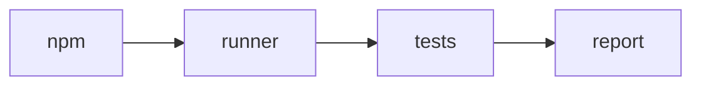

# eval-tools: Infrastructure Specification

<!--SECTION:SPEC_ID-->
ET
<!--/SECTION:SPEC_ID-->

<!--SECTION:SCOPE_TYPE-->
## scope-type
infrastructure
<!--/SECTION:SCOPE_TYPE-->

<!--SECTION:VISION-->
## Vision
Run the fixture tests and produce coverage through the real Node toolchain.
<!--/SECTION:VISION-->

<!--SECTION:OVERVIEW-->
## Overview


_Npm scripts delegate to subprocess runners and preserve their failure status._
<!--/SECTION:OVERVIEW-->

<!--SECTION:SCOPE_DEPENDENCIES-->
## Scope Dependencies
- **Depends on:** none
- **Provides rules to:** fibonacci
<!--/SECTION:SCOPE_DEPENDENCIES-->

<!--SECTION:REQUIREMENTS_AND_CONSTRAINTS-->
## Requirements & Constraints

### Requirements

### ET-REQ-1 [должен]
**Когда** npm test starts, **the runner must** execute existing TypeScript test files with Node and propagate the terminal exit code; before tests exist the test wrapper returns zero without claiming test statistics.

### ET-REQ-2 [должен · нештатная]
**Если** the subprocess fails, **the runner must** return nonzero; the coverage wrapper must also fail when no test file exists.

### ET-REQ-3 [должен]
**Когда** coverage is requested with existing tests, **the coverage runner must** execute c8 and write coverage/coverage-final.json.

### Out-of-Scope
- Product algorithms, authored specifications and operator approvals.

### Runtime & Deferred Scope
No deferred runner behaviour.

### Rules
| Rule | Category | Source |
|---|---|---|
| node-test | testing | ai/directives/testing/node-test.xml |
<!--/SECTION:REQUIREMENTS_AND_CONSTRAINTS-->

<!--SECTION:TOOL_STACK-->
## Tool Stack

### Categories Covered
Node test execution and c8 coverage; no remote CI.

### Tool Choices
| Category | Tool | Rationale |
|---|---|---|
| runtime | Node 22+ | fixture runtime |
| coverage | c8 ^12 | V8 coverage adapter |

### Integration Detail
- Node: spawn process.execPath with inherited output; preserve exit status.
- c8: execute through the installed local binary and collect JSON output.
<!--/SECTION:TOOL_STACK-->

<!--SECTION:WORKFLOW_EXAMPLE-->
## Developer Workflow Example

```bash
npm test
npm run test:coverage
```
A failure returns to the caller; no automatic approval or product repair occurs.
<!--/SECTION:WORKFLOW_EXAMPLE-->

<!--SECTION:FILE_STRUCTURE-->
## File Structure

```text
scripts/test.mjs
scripts/test-coverage.mjs
```

**File Mapping:**
- `scripts/test.mjs`: test discovery and Node invocation.
- `scripts/test-coverage.mjs`: c8 invocation and coverage report.
<!--/SECTION:FILE_STRUCTURE-->

<!--SECTION:EFFECTIVE_RULES-->
## Effective Rules
One testing rule.

<details>
<summary>Rules</summary>

| Rule | Category | Source |
|---|---|---|
| node-test | testing | ai/directives/testing/node-test.xml |

</details>
<!--/SECTION:EFFECTIVE_RULES-->

<!--SECTION:VERIFICATION_COMMANDS-->
## Verification Commands
| Command Name | Invocation |
|---|---|
| typecheck-command | npm run type-check |
| test-command | npm test |
| coverage-command | npx gennady testcov src --min=100 |
| lint-command | npm run lint |
| format-command | npm run format |

Coverage reads the c8 JSON report; generated coverage/ and node_modules/ remain ignored.
<!--/SECTION:VERIFICATION_COMMANDS-->

<!--SECTION:RESEARCH-->
## Research
No external research; recovered from the shipped runner source.
<!--/SECTION:RESEARCH-->

<!--SECTION:DECISION_LOG-->
## Decision Log
Recovered fixture ownership only; no operator approval is implied.

<details>
<summary>Recovery provenance</summary>

The provisioned scripts and package.json are the evidence for this specification. Product authoring remains pending its own Approval #1.

</details>
<!--/SECTION:DECISION_LOG-->

<!--SECTION:BOOTSTRAP_REQUIREMENTS-->
## Prerequisites
The provisioner installs the toolchain before the scenario.

<details>
<summary>Prerequisites</summary>

| Requirement | Kind | Owner | Resolution | Readiness Gates | Gate Artifacts |
|---|---|---|---|---|---|
| Node and c8 | tool | operator-action | fixture provisioner | executable available | node_modules |

</details>
<!--/SECTION:BOOTSTRAP_REQUIREMENTS-->

<!--SECTION:HANDOFF-->
## Handoff
- **Setup tasks to scaffold:** none; existing fixture infrastructure.
- **Effective rules ready for cascade:** node-test.
- **Verification Commands ready for cascade:** table above.
- **Open risks:** product test files do not exist until implementation.
<!--/SECTION:HANDOFF-->
