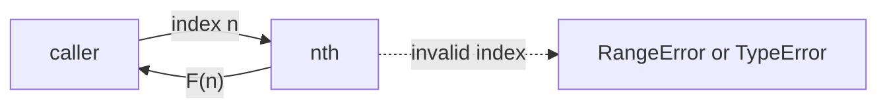
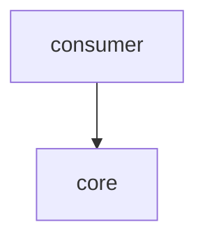

# Module: core

<!--SECTION:SPEC_ID-->
FIBONACCI-CORE
<!--/SECTION:SPEC_ID-->

<!--SECTION:MODULE_VISION-->
## Module Vision

Модуль `core` владеет единственной публичной функцией `nth` и всей проверкой индекса: целостность, диапазон 0..77, начальные значения F(0)=0 и F(1)=1. Родительская спека — [fibonacci](../fibonacci.spec.md). Других модулей в скоупе нет, поэтому внутрискоупных зависимостей и потребителей тоже нет.
<!--/SECTION:MODULE_VISION-->

<!--SECTION:OVERVIEW-->
## Overview


_Индекс проходит проверку и превращается в число либо в явную ошибку — FIB-REQ-1, FIB-REQ-3, FIB-REQ-4, FIB-REQ-5._
<!--/SECTION:OVERVIEW-->

<!--SECTION:MODULE_USAGE_EXAMPLE-->
## Module Usage Example

```ts
import { nth } from './nth';

nth(0);  // 0
nth(1);  // 1
nth(10); // 55
nth(77); // 5527939700884757 — последний поддерживаемый индекс

try {
  nth(1.5);
} catch (error) {
  // TypeError: индекс должен быть целым числом
}
```
<!--/SECTION:MODULE_USAGE_EXAMPLE-->

<!--SECTION:MODULE_REQUIREMENTS-->
## Requirements

No module-specific requirements. Implements parent requirements: FIB-REQ-1, FIB-REQ-2, FIB-REQ-3, FIB-REQ-4, FIB-REQ-5, FIB-REQ-6, FIB-REQ-7.
<!--/SECTION:MODULE_REQUIREMENTS-->

<!--SECTION:INTER_MODULE_DEPENDENCIES-->
## Inter-Module Dependencies

- **Depends on:** None.
- **Scope Reference (cross-scope):** None.
- **Provides to:** None.


_Внешний потребитель зависит от core; других модулей в скоупе нет — FIB-REQ-2._
<!--/SECTION:INTER_MODULE_DEPENDENCIES-->

<!--SECTION:ENTITY_INVENTORY-->
## Entity Inventory

_Это полный список сущностей модуля. Любое введение сущности execution-агентом помимо этого списка считается drift'ом и требует обновления spec._

| Name | Type | Purpose |
|------|------|---------|
| `nth` | Function | Чистая публичная функция: вычисляет F(n) и проверяет индекс |

Ошибки: throw `RangeError` и `TypeError` → владелец `nth`.

Одна сущность, связей между сущностями нет.
<!--/SECTION:ENTITY_INVENTORY-->

<!--SECTION:ENTITY_SURFACES-->
## Entity Surfaces

Одна сущность `nth`: публичная операция, отказы и потребители.

<details>
<summary>Полные поверхности сущностей</summary>

### `nth`
- **Type:** Function
- **Purpose:** Вычисляет n-е число Фибоначчи для индекса 0..77 и отвергает всё остальное.
- **Public Properties:** N/A
- **Public Operations:** `nth(n)` — вернуть F(n) или бросить типизированную ошибку.
- **Lifecycle:** Создаётся импортом модуля; живёт как чистая функция без состояния; завершения нет.
- **Events Emitted:** N/A
- **Errors & Degradation:** `RangeError` для целого индекса меньше 0 или больше 77; `TypeError` для дробного, `NaN`, `Infinity` и `-Infinity`. Ошибку обрабатывает вызывающий код; `nth` не возвращает частичный результат.
- **Consumers:**
  - Internal: None.
  - External: приложение или библиотека, импортирующие `nth(n: number): number`.
- **Usage Waiver (external: consumer application importing the package):** Единственная публичная операция библиотеки; меньше двух внутренних использований ожидаемо, потому что точка входа предназначена внешнему потребителю.

</details>
<!--/SECTION:ENTITY_SURFACES-->

<!--SECTION:MODULE_CONTRACTS-->
## Module Contracts

Один Service `nth`, без Port и Adapter; контракт — чистая функция с двумя классами ошибок.

Граф не рисуется: в модуле нет Port/Adapter, только Service `nth`.

Цепочка вызовов не рисуется: в модуле одна абстракция, `nth` не вызывает других сущностей.

<details>
<summary>Контракты DbC</summary>

### nth

#### Service: `nth`
- **Purpose:** Вычисляет n-е число Фибоначчи для индекса 0..77 и отвергает недопустимый индекс.
- **Consumers:** внешние вызывающие, импортирующие модуль.
- **Runtime Backing:** `not-implemented`
- **Verification Levels:** `contract`, `unit`
- **Deferred Runtime Scope:** None

**Contract (DbC)** — одна операция:
- `nth`:
  - Pre: `n` — целое конечное число: не `NaN`, не `Infinity`, не `-Infinity`, без дробной части.
  - Pre: `0 <= n <= 77`.
  - Post: возвращает F(n), где F(0)=0, F(1)=1, F(n)=F(n−1)+F(n−2); результат — точное целое число, зависящее только от `n`.
  - On pre-violation: если `n` не целое конечное число — бросает `TypeError` с сообщением, что индекс должен быть целым числом; иначе если `n < 0` или `n > 77` — бросает `RangeError` с сообщением, что индекс вне диапазона 0..77; число не возвращается.

**Invariants:** результат всегда целое число из последовательности Фибоначчи; вызов не меняет внешнее состояние.

</details>
<!--/SECTION:MODULE_CONTRACTS-->

<!--SECTION:PUBLIC_OPTIONS-->
## Public Options & Policies

Публичных опций и политик нет: функция не принимает настроек.

<details>
<summary>Опции и политики</summary>

Опций нет.
</details>
<!--/SECTION:PUBLIC_OPTIONS-->

<!--SECTION:FILE_STRUCTURE-->
## File Structure

```
src/
├── nth.ts
└── nth.test.ts
```

**File Mapping:**
- `src/nth.ts`: чистая функция `nth` и проверка входа.
- `src/nth.test.ts`: тесты границ, негативных случаев и чистоты.
<!--/SECTION:FILE_STRUCTURE-->

<!--SECTION:RESEARCH-->
## Research

Внешних исследований нет: контракт задан родительскими требованиями FIB-REQ-1…FIB-REQ-7.
<!--/SECTION:RESEARCH-->

<!--SECTION:MODULE_DECISION_LOG-->
## Module Decision Log

Решений, требующих отдельной записи, нет: контракт задан родительскими требованиями.

<details>
<summary>Полные записи Decision Log</summary>

Записей нет.

COR-DL-1 2026-10-22 — module draft complete (почему: sdd-check --spec specs/fibonacci/core/core.spec.md --authoring прошёл без замечаний)

</details>

### Approval #1 — current specification set
- **Status:** pending
- **Reviewed set:** `specs/fibonacci/fibonacci.spec.md`, `specs/fibonacci/core/core.spec.md`
- **Independent review:** pending
- **Operator decision:** pending
- **Recorded:** 2026-10-22
<!--/SECTION:MODULE_DECISION_LOG-->

<!--SECTION:HANDOFF-->
## Handoff to Tasks

- **Implementation files to be created:** `src/nth.ts`
- **Test files to be created:** `src/nth.test.ts`
- **Stack dependencies:**
  - Language: `typescript` (resolves to `ai/directives/coding/typescript-rules.xml`)
  - Test framework: `node-test` (resolves to `ai/directives/testing/node-test.xml`)
- **Module Rules Additions:** None.
- **Open risks & validation needs:** проверить индексы 0, 1, 2, 77 и отказы для -1, 78, 1.5, `NaN`, `Infinity`; убедиться, что `nth` не кэширует состояние между вызовами.
<!--/SECTION:HANDOFF-->

<!--SECTION:IMPLEMENTATION_INSIGHTS-->
## Implementation Insights

Не требуется до реализации: заметок по реализации пока нет.

<details>
<summary>Заметки по реализации</summary>

Заметок нет.
</details>
<!--/SECTION:IMPLEMENTATION_INSIGHTS-->
