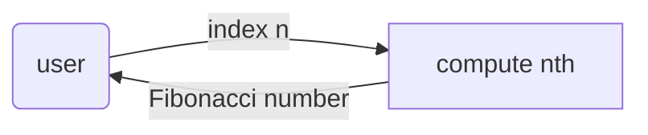

# fibonacci: Library Specification

<!--SECTION:SPEC_ID-->
FIBONACCI
<!--/SECTION:SPEC_ID-->

<!--SECTION:SCOPE_TYPE-->
## scope-type
library
<!--/SECTION:SCOPE_TYPE-->

<!--SECTION:VISION-->
## Vision & Primary Goal

Библиотека отдаёт n-е число Фибоначчи по целочисленному индексу и явно отвергает индексы вне поддерживаемого диапазона, чтобы вызывающий код не получал тихо неверный результат.

<!--/SECTION:VISION-->

<!--SECTION:OVERVIEW-->
## Overview


_Как потребитель получает число Фибоначчи или явную ошибку — FIB-REQ-1, FIB-REQ-2._
<!--/SECTION:OVERVIEW-->

<!--SECTION:GOLDEN_DX-->
## Target Experience

Потребитель импортирует одну функцию и вызывает её с целым индексом от 0 до 77. Возвращается точное целое число; недопустимый индекс не превращается в число, а даёт типизированную ошибку.

```ts
import { nth } from './nth';

nth(0);  // 0
nth(1);  // 1
nth(10); // 55
nth(77); // 5527939700884757 — последний поддерживаемый индекс
```

Ошибочные входы:

```ts
nth(-1);  // RangeError: индекс вне диапазона 0..77
nth(1.5); // TypeError: индекс должен быть целым числом
nth(78);  // RangeError: индекс вне диапазона 0..77
```
<!--/SECTION:GOLDEN_DX-->

<!--SECTION:SCOPE_DEPENDENCIES-->
## Scope Dependencies

- **Depends on:** [`eval-tools`](../eval-tools/eval-tools.spec.md) — правило `node-test`, Node и c8 для проверки библиотеки.
- **Provides to:** None; библиотека публикует `nth` внешним потребителям, внутри репозитория потребителей пока нет.
<!--/SECTION:SCOPE_DEPENDENCIES-->

<!--SECTION:REQUIREMENTS_AND_CONSTRAINTS-->
## Requirements & Constraints

### Requirements

### FIB-REQ-1 [должен]
**Когда** вызывающий передаёт целое число `n` от 0 до 77 включительно, **библиотека должна** вернуть n-е число Фибоначчи по правилам F(0)=0, F(1)=1, F(n)=F(n−1)+F(n−2).

> Диапазон и начальные значения — контракт библиотеки; без них потребитель не может рассчитывать на результат.

### FIB-REQ-2 [должен]
**Библиотека должна** оставлять `nth` единственной публичной операцией; проверка индекса и вычисление остаются внутренними деталями модуля.

> Одна публичная точка входа не даёт потребителю обойти проверку диапазона и получить недостоверное число.

### FIB-REQ-3 [должен · нештатная]
**Если** `n` — целое отрицательное число, **то библиотека должна** отклонить вызов и бросить `RangeError` с сообщением, называющим допустимый диапазон 0..77, вместо возврата числа.

> Отрицательный индекс не адресует элемент последовательности; тихий возврат 0 или `NaN` маскирует ошибку вызывающего.

### FIB-REQ-4 [должен · нештатная]
**Если** `n` — целое число больше 77, **то библиотека должна** отклонить вызов и бросить `RangeError` с сообщением, называющим допустимый диапазон 0..77.

> Верхняя граница 77 задана контрактом библиотеки; без явного отказа поведение за границей становится неопределённым.

### FIB-REQ-5 [должен · нештатная]
**Если** `n` не является целым конечным числом — дробное значение, `NaN`, `Infinity` или `-Infinity`, — **то библиотека должна** отклонить вызов и бросить `TypeError` с сообщением, что индекс должен быть целым числом.

> Такие значения не адресуют элемент последовательности; без проверки `NaN` и `Infinity` дают бессмысленный результат.

### FIB-REQ-6 [должен]
**Когда** библиотека вычисляет число для одного и того же `n`, **она должна** возвращать один и тот же результат и не менять внешнее состояние, входные данные или глобальные переменные.

> Чистота функции — часть контракта: потребитель может вызывать её в любом порядке и кэшировать результат.

### FIB-REQ-7 [должен]
**Пока** библиотека публикует функцию `nth`, **её документация должна** перечислять допустимый диапазон 0..77, значения F(0) и F(1) и все отказы: отрицательный индекс, дробный индекс, `NaN`, `Infinity` и индекс больше 77.

> Каждый крайний случай должен быть виден потребителю до вызова, иначе отказ выглядит как дефект библиотеки.

### Out-of-Scope

- Код продукта и тесты в этой спеке: здесь только контракт и границы.
- Отрицательные индексы через тождество F(−n).
- Индексы больше 77, `BigInt` и произвольная точность.
- Мемоизация, кэш и генерация последовательности.
- Публикация пакета, CI и версионирование.

### Runtime & Deferred Scope

Runtime — чистая функция TypeScript в Node 22+ на уже установленном инструментарии: без ввода-вывода, внешних сервисов и хранилища. Отложено: индексы больше 77 и `BigInt` — вне текущего диапазона; мемоизация и генератор последовательности не входят в v1.

### Rules

| Rule | Category | Source |
|---|---|---|
| typescript | coding | ai/directives/coding/typescript-rules.xml |
| node-test | testing | ai/directives/testing/node-test.xml |
<!--/SECTION:REQUIREMENTS_AND_CONSTRAINTS-->

<!--SECTION:DATA_FLOW-->
## Data Flow


_Путь индекса к результату — FIB-REQ-1, FIB-REQ-2._
<!--/SECTION:DATA_FLOW-->

<!--SECTION:PUBLIC_API_SURFACE-->
## Public API Surface

- `nth` — возвращает n-е число Фибоначчи для целого индекса 0..77 и явно отвергает недопустимый индекс. Операция, сигнатура, ошибки и DbC живут в модуле [core](./core/core.spec.md).
- Других публичных операций нет.
<!--/SECTION:PUBLIC_API_SURFACE-->

<!--SECTION:ARCHITECTURE-->
## Architecture

Одна чистая функция без классов, портов и адаптеров. Вычисление — итеративное накопление двух предыдущих значений, поэтому результат остаётся точным целым числом в пределах диапазона, а состояние между вызовами не нужно.

Отвергнуто: формула Бине (плавающая точка даёт ошибку округления на больших n), рекурсия без мемоизации (экспоненциальное время), таблица предвычисленных значений (лишнее состояние и копия формулы).
<!--/SECTION:ARCHITECTURE-->

<!--SECTION:MODULE_MAP-->
## Module Map

- [core](./core/core.spec.md) — чистая функция `nth`, проверка индекса и типы ошибок.

### Inter-Module Dependency Map

Межмодульных рёбер нет: в скоупе один модуль.

### Stack Dependencies

- TypeScript (`ai/directives/coding/typescript-rules.xml`).
- Node 22+ и `node:test` (`ai/directives/testing/node-test.xml`).

### Handoff to Tasks

Задачи нарезаются после Approval #1: реализация `src/nth.ts`, тесты `src/nth.test.ts`, проверка границ и типов ошибок.
<!--/SECTION:MODULE_MAP-->

<!--SECTION:RESEARCH-->
## Research

Внешних исследований нет: контракт задан диапазоном 0..77, начальными значениями F(0)=0 и F(1)=1 и требованиями к отказам.
<!--/SECTION:RESEARCH-->

<!--SECTION:DECISION_LOG-->
## Decision Log

Решений, требующих отдельной записи, нет: диапазон и классы ошибок заданы требованиями и разделом Out-of-Scope.

<details>
<summary>Полные записи Decision Log</summary>

Записей нет.

FIB-DL-1 2026-10-22 — scope draft complete (почему: sdd-check --spec specs/fibonacci/fibonacci.spec.md --authoring прошёл без замечаний)

</details>

### Approval #1 — current specification set
- **Status:** pending
- **Reviewed set:** `specs/fibonacci/fibonacci.spec.md`, `specs/fibonacci/core/core.spec.md`
- **Independent review:** pending
- **Operator decision:** pending
- **Recorded:** 2026-10-22
<!--/SECTION:DECISION_LOG-->

<!--SECTION:BOOTSTRAP_REQUIREMENTS-->
## Prerequisites

Внешних предусловий нет: Node, c8 и скрипты гейтов приходят из `eval-tools`.

<details>
<summary>Таблица предусловий</summary>

| Requirement | Kind | Owner | Resolution | Readiness Gates | Gate Artifacts |
|---|---|---|---|---|---|
| Node.js, npm и c8 | tool | eval-tools | Наследуются из инфраструктурного скоупа | `node` и `npm` доступны | `package.json` |

</details>
<!--/SECTION:BOOTSTRAP_REQUIREMENTS-->

<!--SECTION:HANDOFF-->
## Handoff to Modules

- **Areas requiring decomposition:** модуль `core` — чистая функция `nth`, проверка входа и два класса ошибок.
- **Named abstractions:** `nth`.
- **Bootstrap tickets ready for cascade:** see Prerequisites — внешних нет.
- **Open risks:** граница 77 остаётся продуктовым решением; тесты должны покрыть 0, 1, 2, 77 и отказы для −1, 78, 1.5, `NaN`, `Infinity`.
<!--/SECTION:HANDOFF-->
