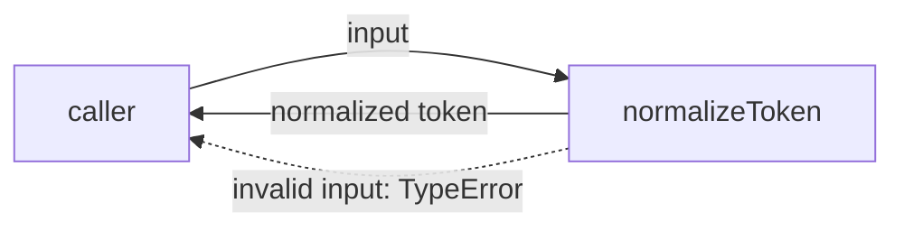
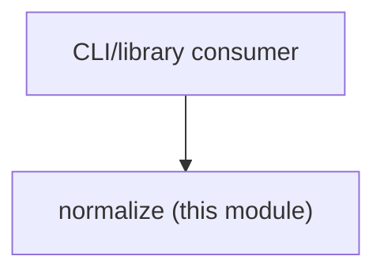

# Module: normalize

<!--SECTION:SPEC_ID-->
TOKEN-NORMALIZE
<!--/SECTION:SPEC_ID-->

<!--SECTION:MODULE_VISION-->
## Module Vision

Модуль `normalize` владеет единственной ответственностью скоупа [`token`](../token.spec.md): детерминированной нормализацией ASCII-токена в локальной CLI/библиотечной среде. Модуль плоский; родительских, дочерних и соседних модулей нет. Сеть, файловый ввод-вывод и хранение состояния в границу модуля не входят.
<!--/SECTION:MODULE_VISION-->

<!--SECTION:OVERVIEW-->
## Overview


_Путь нормализации токена и отказ на некорректном входе — NOR-REQ-1, NOR-REQ-2._
<!--/SECTION:OVERVIEW-->

<!--SECTION:MODULE_USAGE_EXAMPLE-->
## Module Usage Example

```ts
import { normalizeToken } from "./normalize.js";

const token = normalizeToken("  Foo__BAR  ");
if (token !== "foo-bar") {
  throw new Error(`unexpected token: ${token}`);
}

try {
  normalizeToken("   ");
} catch (error) {
  if (!(error instanceof TypeError)) {
    throw error;
  }
}
```
<!--/SECTION:MODULE_USAGE_EXAMPLE-->

<!--SECTION:MODULE_REQUIREMENTS-->
## Requirements

### NOR-REQ-1 [должен]
**Когда** передана непустая ASCII-строка, содержащая хотя бы один символ вне разделителей, **нормализатор должен** обрезать крайние ASCII-пробелы, привести ASCII-буквы к нижнему регистру и свернуть каждую последовательность ASCII-пробелов, underscore и hyphen в один hyphen.

> Уточняет TOK-REQ-1: один детерминированный формат токена нужен CLI и библиотечным потребителям.

### NOR-REQ-2 [должен · нештатная]
**Если** вход пустой, состоит только из ASCII-пробелов, underscore или hyphen, либо содержит не-ASCII символ, **то нормализатор должен** выбросить TypeError без ввода-вывода.

> Уточняет TOK-REQ-2: ошибку входа нельзя маскировать пустым корректным токеном.

| Input | Outcome |
|---|---|
| `"  Foo__BAR  "` | `"foo-bar"` |
| `""` | `TypeError` |
<!--/SECTION:MODULE_REQUIREMENTS-->

<!--SECTION:INTER_MODULE_DEPENDENCIES-->
## Inter-Module Dependencies

- **Depends on:** None — соседних модулей в скоупе `token` нет.
- **Scope Reference (cross-scope):** None — модуль использует только стандартную библиотеку целевого языка.
- **Provides to:** None — публичная функция `normalizeToken` доступна потребителям скоупа `token` напрямую.


_Единственная связь — внешний потребитель вызывает `normalizeToken`; соседних модулей нет._
<!--/SECTION:INTER_MODULE_DEPENDENCIES-->

<!--SECTION:ENTITY_INVENTORY-->
## Entity Inventory

_Это полный список сущностей модуля. Любое введение сущности execution-агентом помимо этого списка считается drift'ом и требует обновления spec._

| Name | Type | Purpose |
|------|------|---------|
| `normalizeToken` | Function | Чистая ASCII-нормализация токена и отказ TypeError на некорректном входе. |

Ошибки: throw TypeError → `normalizeToken`

ER-набросок не рисуется: в инвентаре одна сущность — связывать нечего.
<!--/SECTION:ENTITY_INVENTORY-->

<!--SECTION:ENTITY_SURFACES-->
## Entity Surfaces

Одна публичная сущность — чистая функция `normalizeToken`; её полная поверхность раскрыта ниже.

<details>
<summary>Полные поверхности сущностей</summary>

### `normalizeToken`

- **Type:** Function
- **Purpose:** Превращает ASCII-строку в детерминированный токен или отклоняет некорректный вход.
- **Public Properties:** N/A
- **Public Operations:** нормализовать ASCII-токен; выбросить TypeError на пустом, разделительном или не-ASCII входе.
- **Lifecycle:** Создаётся потребителем через импорт или привязку; состояния не имеет; завершается после одного возврата или исключения.
- **Events Emitted:** N/A
- **Errors & Degradation:** `TypeError` выбрасывается синхронно самим `normalizeToken`; внешний ввод-вывод не выполняется; обработка остаётся за вызывающей стороной.
- **Consumers:**
  - Internal: `src/token/normalize/normalize.ts`
  - External: CLI и библиотечные потребители
- **Usage Waiver (external: CLI и библиотечные потребители):** модуль существует ради единственной публичной операции `normalizeToken`.

</details>
<!--/SECTION:ENTITY_SURFACES-->

<!--SECTION:MODULE_CONTRACTS-->
## Module Contracts

Модуль определяет один чистый Service `normalizeToken`; Port и Adapter не вводятся.

Граф не рисуется: в модуле нет Port/Adapter, только Service `normalizeToken`.

Цепочка вызовов не рисуется: в инвентаре одна абстракция (Service `normalizeToken`), порог ≥2 не достигнут.

<details>
<summary>Контракты DbC</summary>

### Services

#### Service: `normalizeToken`

- **Purpose:** Детерминированно нормализовать ASCII-токен или выбросить TypeError на некорректном входе.
- **Consumers:** внутренние: `src/token/normalize/normalize.ts`; внешние: CLI и библиотечные потребители.
- **Runtime Backing:** `not-implemented`
- **Verification Levels:** `contract`, `unit`
- **Deferred Runtime Scope:** Реализация и исполнение не создаются в рамках authoring.

**Contract (DbC)**

- `normalizeToken`:
  - Pre: Передана строка, содержащая хотя бы один ASCII-символ вне пробела, underscore и hyphen, и не содержащая не-ASCII символов.
  - Post: Возвращена строка без крайних ASCII-пробелов, с ASCII-буквами в нижнем регистре и с каждой последовательностью ASCII-пробелов, underscore и hyphen, заменённой одним hyphen; ввод-вывод не выполнялся.
  - On pre-violation: Выброшен `TypeError` без чтения или записи внешнего состояния.

**Invariants:** Функция детерминирована: одинаковый вход даёт одинаковый результат; между вызовами нет скрытого состояния и ввода-вывода.

</details>
<!--/SECTION:MODULE_CONTRACTS-->

<!--SECTION:PUBLIC_OPTIONS-->
## Public Options & Policies

Публичных опций нет — модуль не принимает флагов или политик.

<details>
<summary>Опции и политики</summary>

Не применимо: единственное поведение полностью задано контрактом `normalizeToken`; отложенных опций нет.

</details>
<!--/SECTION:PUBLIC_OPTIONS-->

<!--SECTION:FILE_STRUCTURE-->
## File Structure

```
src/token/normalize/
└── normalize.ts
```

**File Mapping:**
- `src/token/normalize/normalize.ts`: реализация функции `normalizeToken`
<!--/SECTION:FILE_STRUCTURE-->

<!--SECTION:RESEARCH-->
## Research

Не применимо: в этой ограниченной авторской задаче ресёрч-документы не создавались и не использовались.
<!--/SECTION:RESEARCH-->

<!--SECTION:MODULE_DECISION_LOG-->
## Module Decision Log

Записано одно решение: чистая функция остаётся Service без Port и Adapter.

<details>
<summary>Полные записи Decision Log</summary>

NOR-DL-1 2026-10-23 — `normalizeToken` остаётся чистым Service без Port (почему: одна реализация, подтверждённой вариативности и тестового шва нет; отвергнуто: Port ради абстракции — лишний слой для чистой функции; риск: вторая реализация потребует refactor) [verdict: pending-operator]

</details>
<!--/SECTION:MODULE_DECISION_LOG-->

<!--SECTION:HANDOFF-->
## Handoff to Tasks

- **Implementation files to be created:** `src/token/normalize/normalize.ts`
- **Test files to be created:** `src/token/normalize/normalize.test.ts`
- **Stack dependencies:**
  - Language: `TypeScript` (resolves to `ai/directives/coding/typescript-rules.xml`)
  - Test framework: `node-test` (resolves to `ai/directives/testing/node-test.xml`)
- **Module Rules Additions:** None — модуль использует baseline-правила скоупа.

  | Rule | Category | Source |
  |------|----------|--------|
  | None | — | — |

- **Open risks & validation needs:** Authoring only: реализация, тесты, тикеты и одобрение оператора не созданы. Проверка отказа на не-ASCII входе и отсутствия ввода-вывода остаётся задачей реализации и тестов.
- **Authoring status:** pending-operator
- **Operator decision:** pending
<!--/SECTION:HANDOFF-->

<!--SECTION:IMPLEMENTATION_INSIGHTS-->
## Implementation Insights

Не применимо на этапе authoring: реализации ещё нет.

<details>
<summary>Заметки по реализации</summary>

Появятся после реализации и audit-cycle compaction; сейчас фиксировать нечего.

</details>
<!--/SECTION:IMPLEMENTATION_INSIGHTS-->
