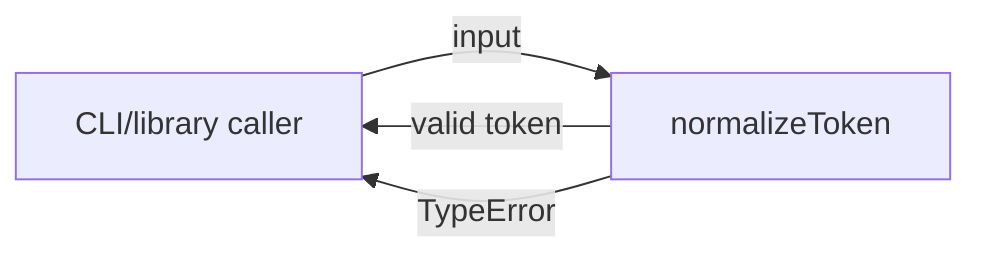
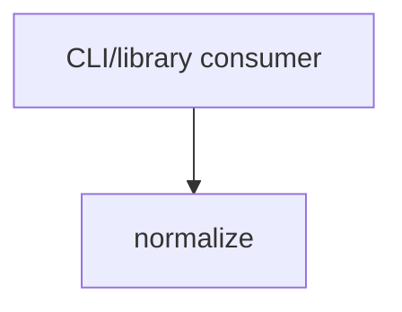

# Module: normalize

<!--SECTION:SPEC_ID-->
TOKEN-NORMALIZE
<!--/SECTION:SPEC_ID-->

<!--SECTION:MODULE_VISION-->
## Module Vision

`normalize` владеет единственной операцией преобразования входной строки в канонический токен внутри скоупа [`token`](../token.spec.md). Модуль не имеет parent/child-модулей и не выходит за границы локальной детерминированной нормализации; контракт входа описан в [token contract](../../../docs/token-contract.md).
<!--/SECTION:MODULE_VISION-->

<!--SECTION:OVERVIEW-->
## Overview


_Главный путь и отказ при недопустимом входе — NOR-REQ-1, NOR-REQ-2._
<!--/SECTION:OVERVIEW-->

<!--SECTION:MODULE_USAGE_EXAMPLE-->
## Module Usage Example

```ts
import { normalizeToken } from "./normalize.js";

const token = normalizeToken("  Foo__BAR  ");
console.log(token);

try {
  normalizeToken("");
} catch (error) {
  console.error(error instanceof TypeError ? error.message : "unexpected error");
}
```
<!--/SECTION:MODULE_USAGE_EXAMPLE-->

<!--SECTION:MODULE_REQUIREMENTS-->
## Requirements

### NOR-REQ-1 [должен]
**Когда** нормализатор получает непустую ASCII-строку, не состоящую только из разделителей, **он должен** обрезать крайние ASCII-пробелы, привести ASCII-буквы к нижнему регистру и свернуть каждую последовательность ASCII-пробелов, underscore и hyphen в один hyphen.

> Развивает TOK-REQ-1: потребителям нужен один детерминированный формат токена без настройки и без обращения к внешним источникам.

### NOR-REQ-2 [должен · нештатная]
**Если** входная строка пустая, состоит только из ASCII-пробелов, underscore и hyphen или содержит хотя бы один не-ASCII символ, **то нормализатор должен** выбросить TypeError, не выполняя ввода-вывода.

> Развивает TOK-REQ-2: ошибочный вход нельзя маскировать пустым или искажённым корректным токеном.

| Input | Outcome |
|---|---|
| `"  Foo__BAR  "` | `"foo-bar"` |
| `""` | `TypeError` |
<!--/SECTION:MODULE_REQUIREMENTS-->

<!--SECTION:INTER_MODULE_DEPENDENCIES-->
## Inter-Module Dependencies

- **Depends on:** нет модулей внутри скоупа `token`.
- **Scope Reference (cross-scope):** нет; скоуп `token` не объявляет межскоуповый интерфейс для этого модуля.
- **Provides to:** внешних CLI и библиотечных потребителей скоупа `token`; соседних модулей нет.


_Единственная зависимость — внешний вызов модуля; внутренних рёбер нет._
<!--/SECTION:INTER_MODULE_DEPENDENCIES-->

<!--SECTION:ENTITY_INVENTORY-->
## Entity Inventory

_Это полный список сущностей модуля. Любое введение сущности execution-агентом помимо этого списка считается drift'ом и требует обновления spec._

| Name | Type | Purpose |
|------|------|---------|
| `normalizeToken` | Function | Единственная чистая операция нормализации входа в канонический токен. |

Ошибки: throw → `normalizeToken`

ER-скетч не рисуется: в инвентаре одна сущность, связывать нечего.
<!--/SECTION:ENTITY_INVENTORY-->

<!--SECTION:ENTITY_SURFACES-->
## Entity Surfaces

Поверхность одна: чистая функция `normalizeToken` с единственной публичной операцией и синхронным TypeError на недопустимом входе.

<details>
<summary>Полные поверхности сущностей</summary>

### `normalizeToken`
- **Type:** Function
- **Purpose:** Преобразует допустимую ASCII-строку в канонический токен.
- **Public Properties:** N/A
- **Public Operations:** `normalizeToken(input: string): string` — вернуть нормализованный токен или выбросить TypeError.
- **Lifecycle:** Нет собственного жизненного цикла: вызывается по требованию и сразу завершается, состояние не сохраняется.
- **Events Emitted:** N/A
- **Errors & Degradation:** `TypeError` через throw; владелец — `normalizeToken`; вызывающий код получает ошибку без побочных эффектов и ввода-вывода.
- **Consumers:**
  - Internal: нет внутренних модулей скоупа.
  - External: CLI и библиотечные потребители скоупа `token`.
- **Usage Waiver (external: CLI/library consumers):** единственная публичная операция модуля; без неё у модуля нет поверхности.

</details>
<!--/SECTION:ENTITY_SURFACES-->

<!--SECTION:MODULE_CONTRACTS-->
## Module Contracts

Единственная поведенческая абстракция — чистая функция `normalizeToken`, оформленная как Service-контракт; Port и Adapter отсутствуют.

Граф не рисуется: в модуле нет Port/Adapter, только Service `normalizeToken`.

Цепочка вызовов не рисуется: в модуле одна абстракция, последовательности из двух и более шагов нет.

<details>
<summary>Контракты DbC</summary>

### Services

#### Service: `normalizeToken`
- **Purpose:** Детерминированно привести допустимую ASCII-строку к каноническому токену.
- **Consumers:** внешние CLI и библиотечные потребители скоупа `token`.
- **Runtime Backing:** `not-implemented`
- **Verification Levels:** `contract`, `unit`
- **Deferred Runtime Scope:** Всё объявленное поведение отложено: исполняемая реализация в этой итерации не создаётся.

**Contract (DbC)** — одна операция:
- `normalizeToken`:
  - Pre: вход — строка, непустая после обрезки крайних ASCII-пробелов, состоящая только из ASCII-символов и содержащая хотя бы один символ, отличный от ASCII-пробела, underscore и hyphen.
  - Post: возвращённая строка не имеет крайних ASCII-пробелов, ASCII-буквы приведены к нижнему регистру, каждая последовательность ASCII-пробелов, underscore и hyphen заменена одним hyphen.
  - On pre-violation: синхронно выбрасывается TypeError без ввода-вывода.

**Invariants:** Результат детерминирован для одного и того же входа; операция не хранит состояние и не выполняет ввода-вывода.

</details>
<!--/SECTION:MODULE_CONTRACTS-->

<!--SECTION:PUBLIC_OPTIONS-->
## Public Options & Policies

Публичных опций и политик нет: поведение нормализации фиксировано.

<details>
<summary>Опции и политики</summary>

Флагов, режимов и конфигурации нет; единственная политика — синхронный TypeError на недопустимый вход по NOR-REQ-2.

</details>
<!--/SECTION:PUBLIC_OPTIONS-->

<!--SECTION:FILE_STRUCTURE-->
## File Structure

```
normalize/
├── normalize.ts
└── normalize.test.ts
```

**File Mapping:**
- `normalize/normalize.ts`: реализация `normalizeToken`.
- `normalize/normalize.test.ts`: contract- и unit-проверки NOR-REQ-1 и NOR-REQ-2.
<!--/SECTION:FILE_STRUCTURE-->

<!--SECTION:RESEARCH-->
## Research

Ресёрч-документов нет: контракт модуля полностью задан брифом и детерминированным поведением.
<!--/SECTION:RESEARCH-->

<!--SECTION:MODULE_DECISION_LOG-->
## Module Decision Log

Записей нет: границы модуля и поведение прямо следуют из брифа, отклонений не зафиксировано.

<details>
<summary>Полные записи Decision Log</summary>

Записей нет.

</details>
<!--/SECTION:MODULE_DECISION_LOG-->

<!--SECTION:HANDOFF-->
## Handoff to Tasks

- **Implementation files to be created:** `normalize/normalize.ts`; код в этой authoring-итерации не создаётся.
- **Test files to be created:** `normalize/normalize.test.ts`.
- **Stack dependencies:**
  - Language: `typescript` (resolves to `ai/directives/coding/typescript-rules.xml`)
  - Test framework: `node-test` (resolves to `ai/directives/testing/node-test.xml`)
- **Module Rules Additions:** None
- **Open risks & validation needs:** Язык и тест-фреймворк не названы в брифе; TypeScript и `node-test` выбраны как минимальный локальный стек и требуют подтверждения на scaffold. Реализация не создана, поэтому runtime-поведение не проверено.
- **Status:** pending-operator — ожидает проверки и подтверждения оператора; тикеты и исполнение не создавались.
<!--/SECTION:HANDOFF-->

<!--SECTION:IMPLEMENTATION_INSIGHTS-->
## Implementation Insights

Не применимо: реализация ещё не создана, постимплементационных наблюдений нет.
<!--/SECTION:IMPLEMENTATION_INSIGHTS-->
