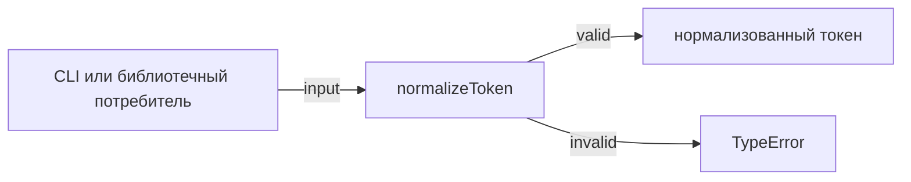
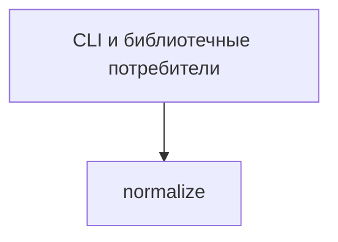

# Module: Normalize

<!--SECTION:SPEC_ID-->
TOKEN-NORMALIZE
<!--/SECTION:SPEC_ID-->

<!--SECTION:MODULE_VISION-->
## Module Vision
Модуль владеет единственной детерминированной операцией `normalizeToken`, которая превращает допустимую ASCII-строку в нормализованный токен и отклоняет недопустимый вход. Родительский скоуп: [token](../token.spec.md). Модуль плоский: дочерних и соседних модулей в скоупе нет.
<!--/SECTION:MODULE_VISION-->

<!--SECTION:OVERVIEW-->
## Overview


_Нормализация допустимого входа и отказ для недопустимого — NOR-REQ-1, NOR-REQ-2._
<!--/SECTION:OVERVIEW-->

<!--SECTION:MODULE_USAGE_EXAMPLE-->
## Module Usage Example

```ts
import { normalizeToken } from "./normalize.js";

const token = normalizeToken("  Foo__BAR  ");
console.log(token);

try {
  normalizeToken("");
} catch (error) {
  console.error(error instanceof TypeError ? "TypeError" : error);
}
```
<!--/SECTION:MODULE_USAGE_EXAMPLE-->

<!--SECTION:MODULE_REQUIREMENTS-->
## Requirements

### NOR-REQ-1 [должен]
**Когда** передана допустимая ASCII-строка, **нормализатор должен** обрезать ведущие и замыкающие ASCII-пробелы, привести ASCII-буквы к нижнему регистру и свернуть каждую серию пробелов, underscore и hyphen в один hyphen.

> Уточняет TOK-REQ-1: фиксирует точный набор преобразований, чтобы потребители получали один детерминированный формат токена.

### NOR-REQ-2 [должен · нештатная]
**Если** вход пустой, состоит только из разделителей или содержит не-ASCII символ, **то нормализатор должен** выбросить `TypeError` без ввода-вывода.

> Уточняет TOK-REQ-2: запрещает маскировать ошибку входа пустым или искажённым корректным токеном.

| Input | Outcome |
|---|---|
| `"  Foo__BAR  "` | `"foo-bar"` |
| `""` | `TypeError` |
<!--/SECTION:MODULE_REQUIREMENTS-->

<!--SECTION:INTER_MODULE_DEPENDENCIES-->
## Inter-Module Dependencies
- **Depends on:** нет модулей внутри скоупа.
- **Scope Reference (cross-scope):** нет.
- **Provides to:** нет модулей внутри скоупа; публичная функция доступна CLI и библиотечным потребителям.


_Потребители модуля и отсутствие внутренних зависимостей._
<!--/SECTION:INTER_MODULE_DEPENDENCIES-->

<!--SECTION:ENTITY_INVENTORY-->
## Entity Inventory

_Это полный список сущностей модуля. Любое введение сущности execution-агентом помимо этого списка считается drift'ом и требует обновления spec._

| Name | Type | Purpose |
|------|------|---------|
| `normalizeToken` | Function | Детерминированно преобразует допустимую ASCII-строку в нормализованный токен |

Ошибки: throw `TypeError` → `normalizeToken`.

ER-эскиз не рисуется: в инвентаре одна сущность, связывать её не с чем.
<!--/SECTION:ENTITY_INVENTORY-->

<!--SECTION:ENTITY_SURFACES-->
## Entity Surfaces
Одна сущность — чистая функция `normalizeToken`; её полная поверхность приведена ниже.

<details>
<summary>Полные поверхности сущностей</summary>

### `normalizeToken`
- **Type:** Function
- **Purpose:** Детерминированно преобразует допустимую ASCII-строку в нормализованный токен.
- **Public Properties:** N/A
- **Public Operations:** Нормализовать входную строку в токен; отклонить недопустимый вход.
- **Lifecycle:** Не хранит состояние; доступна при импорте модуля и завершается вместе с вызовом.
- **Events Emitted:** N/A
- **Errors & Degradation:** `TypeError` через throw для пустого, разделительного или не-ASCII входа; обработка принадлежит `normalizeToken`, fallback отсутствует.
- **Consumers:**
  - Internal: `normalize/normalize.ts`
  - External: CLI и библиотечные потребители
- **Usage Waiver (external: CLI и библиотечные потребители):** Публичная функция модуля; реализация ещё не создана, поэтому производственных использований пока нет.

</details>
<!--/SECTION:ENTITY_SURFACES-->

<!--SECTION:MODULE_CONTRACTS-->
## Module Contracts
Модуль определяет одну чистую функцию `normalizeToken`; Port и Adapter не вводятся.

Граф не рисуется: в модуле нет Port/Adapter, только Service `normalizeToken`.

Call Chain не рисуется: в модуле одна абстракция — `normalizeToken`.

<details>
<summary>Контракты DbC</summary>

### Services

#### Service: `normalizeToken`
- **Purpose:** Детерминированно преобразует допустимую ASCII-строку в нормализованный токен.
- **Consumers:** CLI и библиотечные потребители.
- **Runtime Backing:** `not-implemented`
- **Verification Levels:** `contract`, `unit`
- **Deferred Runtime Scope:** Реализация отсутствует; специфицировано только наблюдаемое поведение.

**Contract (DbC)** — одна операция:
- `normalizeToken`:
  - Pre: вход является строкой, не пуст, содержит хотя бы один символ помимо ASCII-пробела, underscore и hyphen, и состоит только из ASCII-символов.
  - Post: возвращена строка без ведущих и замыкающих ASCII-пробелов, с ASCII-буквами в нижнем регистре и каждой серией пробелов, underscore и hyphen, заменённой одним hyphen; остальные ASCII-символы сохранены.
  - On pre-violation: выброшен `TypeError` без ввода-вывода.

**Invariants:** Результат детерминирован для одного и того же входа; функция не хранит состояние и не выполняет ввод-вывод.

</details>
<!--/SECTION:MODULE_CONTRACTS-->

<!--SECTION:PUBLIC_OPTIONS-->
## Public Options & Policies
Not applicable: у модуля нет публично наблюдаемых опций или политик — поведение фиксировано.
<!--/SECTION:PUBLIC_OPTIONS-->

<!--SECTION:FILE_STRUCTURE-->
## File Structure

```
normalize/
├── normalize.ts
└── normalize.test.ts
```

**File Mapping:**
- `normalize/normalize.ts`: реализация `normalizeToken`
- `normalize/normalize.test.ts`: контрактные и unit-проверки `normalizeToken`
<!--/SECTION:FILE_STRUCTURE-->

<!--SECTION:RESEARCH-->
## Research
Not applicable: в скоупе token нет research-документов, на которые опирался бы модуль.
<!--/SECTION:RESEARCH-->

<!--SECTION:MODULE_DECISION_LOG-->
## Module Decision Log
Записаны решения о форме модуля и о рабочем стеке.

<details>
<summary>Полные записи Decision Log</summary>

NOR-DL-1 2026-10-23 — нормализация реализуется чистой функцией `normalizeToken` без Port/Adapter (почему: детерминированное преобразование без вариативности и внешних зависимостей; отвергнуто: Port/Adapter-слой — не оправдан отсутствием вариативности и тестового шва).

NOR-DL-2 2026-10-23 — стек TypeScript и `node:test` выбран как рабочий дефолт; где: specs/token/normalize/normalize.spec.md#handoff-to-tasks (почему: типизированная сигнатура и отсутствие внешнего тестового фреймворка) [verdict: pending-operator]

</details>
<!--/SECTION:MODULE_DECISION_LOG-->

<!--SECTION:HANDOFF-->
## Handoff to Tasks
- **Implementation files to be created:** `normalize/normalize.ts`
- **Test files to be created:** `normalize/normalize.test.ts`
- **Stack dependencies:**
  - Language: `TypeScript` (resolves to `ai/directives/coding/typescript-rules.xml`)
  - Test framework: `node:test` (resolves to `ai/directives/testing/node-test.xml`)
- **Module Rules Additions:** None — действует baseline скоупа.

- **Open risks & validation needs:**
  - Спека и стек не подтверждены оператором; handoff остаётся pending.
  - Реализация отсутствует; поведение проверено только на уровне спецификации.
  - Точная обработка ведущих и замыкающих разделителей, отличных от ASCII-пробела, не уточнена исходным интентом.
<!--/SECTION:HANDOFF-->

<!--SECTION:IMPLEMENTATION_INSIGHTS-->
## Implementation Insights
Not applicable: реализация не выполнялась, поэтому пост-имплементационных наблюдений нет.
<!--/SECTION:IMPLEMENTATION_INSIGHTS-->
