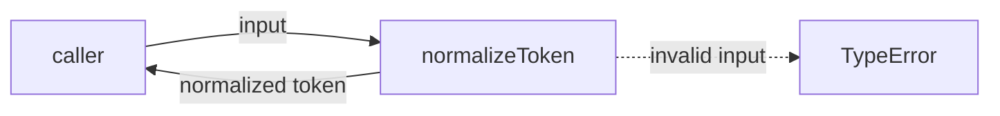
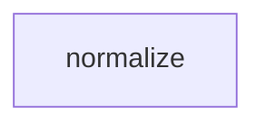

# Module: normalize

<!--SECTION:SPEC_ID-->
TOKEN-NORMALIZE
<!--/SECTION:SPEC_ID-->

<!--SECTION:MODULE_VISION-->
## Module Vision

`normalize` — единственный владелец детерминированной нормализации ASCII-токенов в скоупе `token`. Родительский скоуп: [token](../token.spec.md). Соседних, дочерних или зависимых модулей нет.
<!--/SECTION:MODULE_VISION-->

<!--SECTION:OVERVIEW-->
## Overview


_Один чистый вызов возвращает нормализованный токен либо TypeError — NOR-REQ-1, NOR-REQ-2._
<!--/SECTION:OVERVIEW-->

<!--SECTION:MODULE_USAGE_EXAMPLE-->
## Module Usage Example

Отдельная инициализация не нужна: модуль поставляет одну чистую функцию.

```ts
import { normalizeToken } from "./normalize";

const token = normalizeToken("  Foo__BAR  ");
console.log(token); // "foo-bar"

try {
  normalizeToken("");
} catch (error) {
  console.error(error instanceof TypeError ? "invalid input" : error);
}
```

Успешный вызов показывает намеренное преобразование входа; вызов с пустым входом показывает ожидаемый `TypeError`. Внутри `normalizeToken` ввод-вывод не выполняется.
<!--/SECTION:MODULE_USAGE_EXAMPLE-->

<!--SECTION:MODULE_REQUIREMENTS-->
## Requirements

### NOR-REQ-1 [должен]
**Когда** `normalizeToken` получает ASCII-строку, **функция должна** обрезать крайние ASCII-пробелы, привести ASCII-буквы к нижнему регистру и свернуть последовательности ASCII-пробелов, underscore и hyphen в один hyphen.

> Уточняет TOK-REQ-1 для единственной публичной операции модуля: формат токена должен совпадать у всех локальных CLI- и библиотечных вызовов, без состояния и ввода-вывода.

### NOR-REQ-2 [должен · нештатная]
**Если** вход пуст, состоит только из разделителей или содержит не-ASCII символ, **то функция должна** выбросить TypeError без ввода-вывода.

> Уточняет TOK-REQ-2: ошибочный вход нельзя маскировать пустым корректным токеном, а владельцем ошибки остаётся `normalizeToken`.

| Input | Outcome |
|---|---|
| `"  Foo__BAR  "` | `"foo-bar"` |
| `""` | `TypeError` |
<!--/SECTION:MODULE_REQUIREMENTS-->

<!--SECTION:INTER_MODULE_DEPENDENCIES-->
## Inter-Module Dependencies

- **Depends on:** None — в скоупе `token` нет соседних модулей.
- **Scope Reference (cross-scope):** None — модуль использует только локальную среду исполнения языка.
- **Provides to:** None — локальные CLI- и библиотечные потребители вызывают модуль напрямую.


_Модуль изолирован: внутренних и внешних рёбер зависимостей нет._
<!--/SECTION:INTER_MODULE_DEPENDENCIES-->

<!--SECTION:ENTITY_INVENTORY-->
## Entity Inventory

_Это полный список сущностей модуля. Любое введение сущности execution-агентом помимо этого списка считается drift'ом и требует обновления spec._

| Name | Type | Purpose |
|------|------|---------|
| `normalizeToken` | Function | Детерминированно нормализует ASCII-токен |

Ошибки: throw (TypeError) → `normalizeToken`

Одна сущность — связей для ER-наброска нет.
<!--/SECTION:ENTITY_INVENTORY-->

<!--SECTION:ENTITY_SURFACES-->
## Entity Surfaces

Одна публичная сущность — чистая функция `normalizeToken`.

<details>
<summary>Полные поверхности сущностей</summary>

### `normalizeToken`

- **Type:** Function
- **Purpose:** Нормализует ASCII-токен и отклоняет некорректный вход.
- **Public Properties:** N/A
- **Public Operations:** Нормализация ASCII-токена с отклонением некорректного входа.
- **Lifecycle:** Создаётся при импорте модуля, не хранит состояние, завершение не применимо.
- **Events Emitted:** N/A
- **Errors & Degradation:** `TypeError` через throw на пустом входе, входе только из разделителей или не-ASCII входе; представление ошибки остаётся за вызывающей стороной.
- **Consumers:**
  - Internal: нет внутренних вызовов
  - External: локальные CLI- и библиотечные потребители
- **Usage Waiver (external: local CLI and library consumers):** Единственная публичная операция модуля, требуемая родительским скоупом; альтернативного входа у потребителей нет.

</details>
<!--/SECTION:ENTITY_SURFACES-->

<!--SECTION:MODULE_CONTRACTS-->
## Module Contracts

Одна публичная операция `normalizeToken`; Port и Adapter отсутствуют.

Граф не рисуется: в модуле нет Port/Adapter, только Service `normalizeToken`.

Цепочка вызовов не рисуется: в модуле одна абстракция — `normalizeToken`.

<details>
<summary>Контракты DbC</summary>

### Services

#### Service: `normalizeToken`

- **Purpose:** Детерминированно нормализует ASCII-токен.
- **Consumers:** локальные CLI- и библиотечные потребители
- **Runtime Backing:** `not-implemented`
- **Verification Levels:** `contract`, `unit`
- **Deferred Runtime Scope:** Вся объявленная операция: реализация в этом изменении не создаётся.

**Contract (DbC):**
- `normalizeToken`:
  - Pre: Вход — строка только из ASCII-символов, содержащая хотя бы один символ, отличный от пробела, `_` и `-`.
  - Post: Результат — строка, в которой удалены крайние ASCII-пробелы, ASCII-буквы приведены к нижнему регистру, а каждая последовательность ASCII-пробелов, `_` и `-` заменена одним `-`; ввод-вывод не выполняется.
  - On pre-violation: Выбрасывается `TypeError` без побочных эффектов и ввода-вывода.

**Invariants** (omit when none): Функция не хранит состояние между вызовами и детерминирована: одинаковый вход даёт одинаковый результат или `TypeError`.

</details>
<!--/SECTION:MODULE_CONTRACTS-->

<!--SECTION:PUBLIC_OPTIONS-->
## Public Options & Policies

Не применимо: у модуля нет публично наблюдаемых флагов, опций или политик — поведение полностью задано NOR-REQ-1 и NOR-REQ-2.

<details>
<summary>Опции и политики</summary>

Не применимо: публичная поверхность состоит из одной операции без параметров конфигурации. Новые опции потребуют отдельного требования и не входят в текущую версию.

</details>
<!--/SECTION:PUBLIC_OPTIONS-->

<!--SECTION:FILE_STRUCTURE-->
## File Structure

```text
normalize/
├── normalize.ts
└── normalize.test.ts
```

**File Mapping:**
- `normalize/normalize.ts`: чистая реализация `normalizeToken` — будет создана задачей, не этим изменением
- `normalize/normalize.test.ts`: контрактные и unit-тесты для NOR-REQ-1 и NOR-REQ-2 — будут созданы задачей, не этим изменением
<!--/SECTION:FILE_STRUCTURE-->

<!--SECTION:RESEARCH-->
## Research

Не применимо: отдельных research-документов нет. Модуль выводится из [token](../token.spec.md) и [token contract](../../../docs/token-contract.md).
<!--/SECTION:RESEARCH-->

<!--SECTION:MODULE_DECISION_LOG-->
## Module Decision Log

Одно решение: `normalizeToken` остаётся чистым Function без Port/Adapter.

<details>
<summary>Полные записи Decision Log</summary>

NOR-DL-1 2026-10-23 — `normalizeToken` реализуется как чистый Function без Port/Adapter (почему: детерминированное преобразование без вариативности, тестового шва и ввода-вывода; отвергнуто: Port+Adapter — лишний слой без второй реализации).

</details>
<!--/SECTION:MODULE_DECISION_LOG-->

<!--SECTION:HANDOFF-->
## Handoff to Tasks

- **Implementation files to be created:** `normalize/normalize.ts`
- **Test files to be created:** `normalize/normalize.test.ts`
- **Stack dependencies:**
  - Language: `typescript` (resolves to `ai/directives/coding/typescript-rules.xml`)
  - Test framework: `node-test` (resolves to `ai/directives/testing/node-test.xml`)
- **Module Rules Additions:** None — базовый набор правил скоупа применяется без модульных дополнений.
- **Open risks & validation needs:** Проверить детерминированность, обработку не-ASCII и отсутствие ввода-вывода при реализации. Operator approval: pending — no approval has been given; tickets and execution are not created here.
<!--/SECTION:HANDOFF-->

<!--SECTION:IMPLEMENTATION_INSIGHTS-->
## Implementation Insights

Не применимо: реализации ещё нет, наблюдений после реализации нет.

<details>
<summary>Заметки по реализации</summary>

Раздел будет заполнен после реализации и audit-cycle compaction, если появятся нетривиальные наблюдения.

</details>
<!--/SECTION:IMPLEMENTATION_INSIGHTS-->
