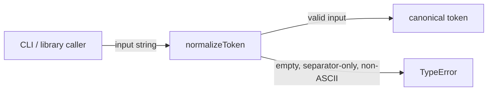
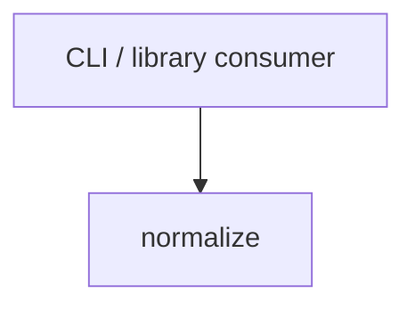

# Module: normalize

<!--SECTION:SPEC_ID-->
TOKEN-NORMALIZE
<!--/SECTION:SPEC_ID-->

<!--SECTION:MODULE_VISION-->
## Module Vision
`normalize` owns the single deterministic token transformation inside the [token](../token.spec.md) library scope: it turns an ASCII input string into the canonical lowercase hyphen-separated token, or rejects invalid input with `TypeError`. It is stateless and performs no I/O. No sibling modules exist inside this scope; [infra-base](../../infra-base/infra-base.spec.md) is authoring infrastructure, not a runtime dependency.

Status: draft; operator approval and task decomposition are pending.
<!--/SECTION:MODULE_VISION-->

<!--SECTION:OVERVIEW-->
## Overview

_Один детерминированный вызов: валидный вход даёт токен, невалидный — TypeError — NOR-REQ-1, NOR-REQ-2._
<!--/SECTION:OVERVIEW-->

<!--SECTION:MODULE_USAGE_EXAMPLE-->
## Module Usage Example
The module has no initialization, configuration, or I/O. Import the function once and call it with an ASCII string:

```ts
import { normalizeToken } from "./normalize";

const token = normalizeToken("  Foo__BAR  ");
// "foo-bar"
```

Invalid input is reported synchronously and produces no partial token:

```ts
import { normalizeToken } from "./normalize";

try {
  normalizeToken("");
} catch (error) {
  if (!(error instanceof TypeError)) throw error;
  // invalid token: no I/O was performed
}
```
<!--/SECTION:MODULE_USAGE_EXAMPLE-->

<!--SECTION:MODULE_REQUIREMENTS-->
## Requirements
### NOR-REQ-1 [должен]
**Когда** подана строка только из ASCII-символов, **нормализатор должен** убрать крайние пробелы, привести ASCII-буквы к нижнему регистру и свернуть каждую серию пробелов, подчёркиваний и дефисов в один дефис.

> Уточняет TOK-REQ-1: модуль фиксирует ровно ASCII-пробелы и разделители space, underscore, hyphen; без этого потребители получают разные токены для одного и того же входа.

### NOR-REQ-2 [должен · нештатная]
**Если** вход пустой, состоит только из разделителей или содержит хотя бы один не-ASCII символ, **то нормализатор должен** выбросить TypeError без ввода-вывода.

> Уточняет TOK-REQ-2: ошибка входа не маскируется пустым корректным токеном, а вызывающая сторона получает явный отказ без побочных эффектов.

Input/Outcome examples for these requirements:

| Input | Outcome |
|---|---|
| `"  Foo__BAR  "` | `"foo-bar"` |
| `""` | `TypeError` |
<!--/SECTION:MODULE_REQUIREMENTS-->

<!--SECTION:INTER_MODULE_DEPENDENCIES-->
## Inter-Module Dependencies
- **Depends on:** No modules within this scope.
- **Scope Reference (cross-scope):** None for runtime. The parent scope's authoring dependency on [infra-base](../../infra-base/infra-base.spec.md) is not a runtime dependency of this module.
- **Provides to:** No modules within this scope; local CLI and library consumers call `normalizeToken` directly.


_Единственная связь — внешний вызов normalize; соседних модулей нет._
<!--/SECTION:INTER_MODULE_DEPENDENCIES-->

<!--SECTION:ENTITY_INVENTORY-->
## Entity Inventory
_Это полный список сущностей модуля. Любое введение сущности execution-агентом помимо этого списка считается drift'ом и требует обновления spec._

| Name | Type | Purpose |
|------|------|---------|
| `normalizeToken` | Function | Pure normalization of one ASCII input string into a canonical token or a TypeError |

Ошибки: throw `TypeError` → `normalizeToken`.

ER sketch не рисуется: в инвентаре одна сущность, связывать нечего.
<!--/SECTION:ENTITY_INVENTORY-->

<!--SECTION:ENTITY_SURFACES-->
## Entity Surfaces
One public function, `normalizeToken`; it has no state, no events, and no lifecycle beyond a single call.

<details>
<summary>Полные поверхности сущностей</summary>

### `normalizeToken`
- **Type:** Function
- **Purpose:** Convert one ASCII input string into the canonical lowercase token or reject invalid input.
- **Public Properties:** N/A
- **Public Operations:** `normalizeToken` — trims, lowercases, and collapses separators; throws TypeError on invalid input.
- **Lifecycle:** Created on import as a stateless function; owns no resources and terminates after each call.
- **Events Emitted:** N/A
- **Errors & Degradation:** Throws `TypeError` synchronously for empty, separator-only, or non-ASCII input; the caller owns handling and display.
- **Consumers:**
  - Internal: no internal consumers; the function is the module's public surface
  - External: local CLI and library consumers
- **Usage Waiver (external: local CLI and library consumers):** `normalizeToken` is the module's only public entry point; its purpose is the external API itself, not internal reuse.

</details>
<!--/SECTION:ENTITY_SURFACES-->

<!--SECTION:MODULE_CONTRACTS-->
## Module Contracts
One pure Function, `normalizeToken`; there are no Ports or Adapters because a single deterministic transformation has no variability or test seam.

Граф не рисуется: в модуле нет Port/Adapter, только Function `normalizeToken`.

Call Chain не рисуется: в инвентаре одна сущность, последовательность ограничена вызовом `normalizeToken` → результат или `TypeError`.

<details>
<summary>Контракты DbC</summary>

### Services

#### Service: `normalizeToken`
- **Purpose:** Convert one ASCII input string into the canonical lowercase token or reject invalid input.
- **Consumers:** local CLI and library consumers
- **Runtime Backing:** `not-implemented`
- **Verification Levels:** `contract`, `unit`
- **Deferred Runtime Scope:** the complete declared behavior; no implementation or runtime exists in this draft

**Contract (DbC)**
- `normalizeToken`:
  - Pre: `input` is a string containing only ASCII characters and at least one non-separator character.
  - Post: returns a non-empty string with no leading or trailing spaces, all ASCII letters lowercased, and every run of spaces, underscores, or hyphens replaced by exactly one hyphen.
  - On pre-violation: throws `TypeError` synchronously, performs no I/O, and returns no partial token.

**Invariants:** deterministic — the same input always yields the same output or the same `TypeError`; no observable state and no I/O across the call.

</details>
<!--/SECTION:MODULE_CONTRACTS-->

<!--SECTION:PUBLIC_OPTIONS-->
## Public Options & Policies
Not applicable — `normalizeToken` accepts no flags, configuration, or policy switches.
<!--/SECTION:PUBLIC_OPTIONS-->

<!--SECTION:FILE_STRUCTURE-->
## File Structure
```
normalize/
└── normalize.ts
```

**File Mapping:**
- `normalize/normalize.ts`: `normalizeToken` implementation and TypeError validation
<!--/SECTION:FILE_STRUCTURE-->

<!--SECTION:RESEARCH-->
## Research
No research documents back this module; the behavior is fully specified by the parent [token](../token.spec.md) draft.
<!--/SECTION:RESEARCH-->

<!--SECTION:MODULE_DECISION_LOG-->
## Module Decision Log
One module-level decision recorded: no Port/Adapter abstraction for `normalizeToken`.

<details>
<summary>Полные записи Decision Log</summary>

NOR-DL-1 2026-10-23 — normalizeToken is a pure Function with no Port/Adapter; где: specs/token/normalize/normalize.spec.md#module-contracts (почему: a single deterministic transformation has no variability or test seam, so the contract lives directly on the Function) [verdict: pending-operator].

</details>
<!--/SECTION:MODULE_DECISION_LOG-->

<!--SECTION:HANDOFF-->
## Handoff to Tasks
- **Implementation files to be created:** `normalize/normalize.ts`
- **Test files to be created:** `normalize/normalize.test.ts`
- **Stack dependencies:**
  - Language: `TypeScript` (resolves to `ai/directives/coding/typescript-rules.xml`)
  - Test framework: `Vitest` (resolves to `ai/directives/testing/vitest-rules.xml`)
- **Module Rules Additions:** None.
- **Open risks & validation needs:**
  - No implementation, packaging, or runtime exists in this fixture.
  - The TypeScript + Vitest stack is a provisional handoff assumption pending operator confirmation.
  - Approval #1, task decomposition, and ticket creation remain pending.

Approval boundary: pending-operator; no tickets were created and no execution is claimed.
<!--/SECTION:HANDOFF-->

<!--SECTION:IMPLEMENTATION_INSIGHTS-->
## Implementation Insights
Not applicable — no implementation exists, so there are no post-implementation learnings.
<!--/SECTION:IMPLEMENTATION_INSIGHTS-->
