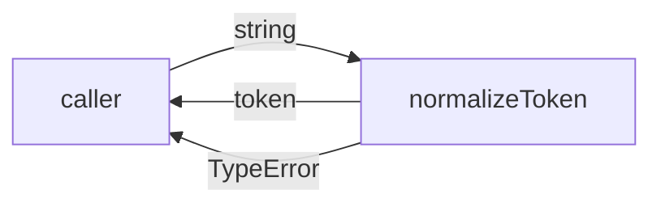
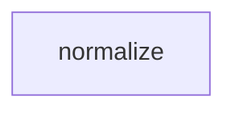

# Module: normalize

<!--SECTION:SPEC_ID-->
TOKEN-NORMALIZE
<!--/SECTION:SPEC_ID-->

<!--SECTION:MODULE_VISION-->
## Module Vision

`normalize` owns deterministic token normalization inside the [token](../token.spec.md) library scope: it trims outer ASCII spaces, lowercases ASCII letters, and collapses spaces, underscores, and hyphens into one hyphen. It has no sibling, parent, or child modules and does not own the scope's packaging or consumer wiring.
<!--/SECTION:MODULE_VISION-->

<!--SECTION:OVERVIEW-->
## Overview


_Нормализация строки в токен и отказ на непригодном входе — NOR-REQ-1, NOR-REQ-2._
<!--/SECTION:OVERVIEW-->

<!--SECTION:MODULE_USAGE_EXAMPLE-->
## Module Usage Example

```ts
import { normalizeToken } from "./normalize";

const token = normalizeToken("  Foo__BAR  ");
console.log(token);

try {
  normalizeToken("");
} catch (error) {
  console.error(error instanceof TypeError);
}
```

The first call shows the happy path and prints `"foo-bar"`. The second call shows the minimal error path: an empty input throws `TypeError` instead of returning a token. No setup, network, or shared state is involved.
<!--/SECTION:MODULE_USAGE_EXAMPLE-->

<!--SECTION:MODULE_REQUIREMENTS-->
## Requirements

### NOR-REQ-1 [должен]
**Когда** на вход передана ASCII-строка, **нормализатор должен** обрезать крайние ASCII-пробелы, привести ASCII-буквы к нижнему регистру и свернуть каждую серию ASCII-пробелов, символов `_` и `-` в один `-`.

> Уточняет TOK-REQ-1: модуль фиксирует точный результат нормализации для CLI и библиотечных потребителей, чтобы одно и то же написание токена не расходилось между вызовами.

### NOR-REQ-2 [должен · нештатная]
**Если** входная строка пуста, состоит только из разделителей или содержит хотя бы один не-ASCII символ, **то нормализатор должен** выбросить `TypeError` без ввода-вывода.

> Уточняет TOK-REQ-2: непригодный вход нельзя маскировать пустым или частично нормализованным токеном; явный отказ сохраняет детерминизм и не создаёт I/O-побочных эффектов.

| Input | Outcome |
|---|---|
| `"  Foo__BAR  "` | `"foo-bar"` |
| `""` | `TypeError` |
<!--/SECTION:MODULE_REQUIREMENTS-->

<!--SECTION:INTER_MODULE_DEPENDENCIES-->
## Inter-Module Dependencies

- **Depends on:** None — no sibling module in scope `token`.
- **Scope Reference (cross-scope):** None.
- **Provides to:** None — no sibling module consumes `normalize` yet.


_Изолированный модуль: рёбер межмодульных зависимостей нет._
<!--/SECTION:INTER_MODULE_DEPENDENCIES-->

<!--SECTION:ENTITY_INVENTORY-->
## Entity Inventory

_Это полный список сущностей модуля. Любое введение сущности execution-агентом помимо этого списка считается drift'ом и требует обновления spec._

| Name | Type | Purpose |
|------|------|---------|
| `normalizeToken` | Function | Pure entry point that trims, lowercases, and collapses token separators |

Ошибки: throw `TypeError` → `normalizeToken`

Single-entity inventory with no relations; the ER sketch is not applicable because there is nothing to relate.
<!--/SECTION:ENTITY_INVENTORY-->

<!--SECTION:ENTITY_SURFACES-->
## Entity Surfaces

`normalizeToken` is the module's only entity; its public surface folds below.

<details>
<summary>Полные поверхности сущностей</summary>

### `normalizeToken`
- **Type:** Function
- **Purpose:** Converts an ASCII input string into one canonical lowercase token.
- **Public Properties:** N/A
- **Public Operations:** Normalize a token string.
- **Lifecycle:** Imported into the calling process; stateless; no termination step.
- **Events Emitted:** N/A
- **Errors & Degradation:** `TypeError` via throw for empty, separator-only, or non-ASCII input; owned by `normalizeToken`.
- **Consumers:**
  - Internal: none
  - External: CLI and library consumers
- **Usage Waiver (external: CLI and library consumers):** the module exists to expose this single public operation; there is no second internal caller to count.

</details>
<!--/SECTION:ENTITY_SURFACES-->

<!--SECTION:MODULE_CONTRACTS-->
## Module Contracts

`normalize` has one public Function and no Ports or Adapters. Граф зависимостей не рисуется: в модуле нет Port/Adapter, только Function `normalizeToken`. Цепочка вызовов не рисуется: в Entity Inventory одна абстракция.

<details>
<summary>Контракты DbC</summary>

### Services

#### Service: `normalizeToken`
- **Purpose:** Produce one canonical ASCII token from a caller-supplied string.
- **Consumers:** CLI and library consumers.
- **Runtime Backing:** `not-implemented`
- **Verification Levels:** `contract`, `unit`
- **Deferred Runtime Scope:** All behavior; no implementation is requested in this authoring task.

**Contract (DbC)**
- `normalize`:
  - Pre: `input` is a string value.
  - Post: returns the input with leading and trailing ASCII spaces removed, ASCII letters lowercased, and every maximal run of ASCII spaces, underscores, or hyphens replaced by one hyphen.
  - On pre-violation: throws `TypeError` without I/O when the input is empty, separator-only, or contains a non-ASCII character.

**Invariants:** The operation is pure and stateless; repeated calls with the same input produce the same result or the same `TypeError`.

### Ports

Not applicable: no confirmed variability or test seam justifies a Port.

### Adapters

Not applicable: the module has no external system to adapt.

</details>
<!--/SECTION:MODULE_CONTRACTS-->

<!--SECTION:PUBLIC_OPTIONS-->
## Public Options & Policies

Not applicable: v1 exposes no flags, options, or policies.

<details>
<summary>Опции и политики</summary>

None. The only public surface is `normalizeToken`, whose behavior is fixed by NOR-REQ-1 and NOR-REQ-2.

</details>
<!--/SECTION:PUBLIC_OPTIONS-->

<!--SECTION:FILE_STRUCTURE-->
## File Structure

```text
normalize/
└── normalize.ts
```

**File Mapping:**
- `normalize/normalize.ts`: pure `normalizeToken` implementation.
<!--/SECTION:FILE_STRUCTURE-->

<!--SECTION:RESEARCH-->
## Research

Not applicable: no research documents feed this bounded deterministic module.
<!--/SECTION:RESEARCH-->

<!--SECTION:MODULE_DECISION_LOG-->
## Module Decision Log

One architecture decision is recorded: no Port/Adapter layer for the pure function.

<details>
<summary>Полные записи Decision Log</summary>

NOR-DL-1 2026-10-23 — `normalizeToken` stays a pure function without Port or Adapter; где: `specs/token/normalize/normalize.spec.md#module-contracts` (почему: stateless transformation has no confirmed variability or test seam; отвергнуто: service/port seam as unnecessary indirection; риск: a future runtime seam would need a refine-module) [verdict: pending-operator]

</details>
<!--/SECTION:MODULE_DECISION_LOG-->

<!--SECTION:HANDOFF-->
## Handoff to Tasks

- **Implementation files to be created:** `normalize/normalize.ts`
- **Test files to be created:** `normalize/normalize.test.ts`
- **Stack dependencies:**
  - Language: `typescript` (resolves to `ai/directives/coding/typescript-rules.xml`)
  - Test framework: `node-test` (resolves to `ai/directives/testing/node-test.xml`)
- **Module Rules Additions:** None
- **Open risks & validation needs:** No implementation exists; the Input/Outcome rows in Requirements remain unverified until a task runs them.
- **Approval status:** pending-operator — no tickets are created and no execution is approved by this draft.
<!--/SECTION:HANDOFF-->

<!--SECTION:IMPLEMENTATION_INSIGHTS-->
## Implementation Insights

Not applicable: no implementation exists, so there are no post-implementation learnings.

<details>
<summary>Заметки по реализации</summary>

None yet. This appendix becomes relevant only after an implementation and audit cycle.

</details>
<!--/SECTION:IMPLEMENTATION_INSIGHTS-->
