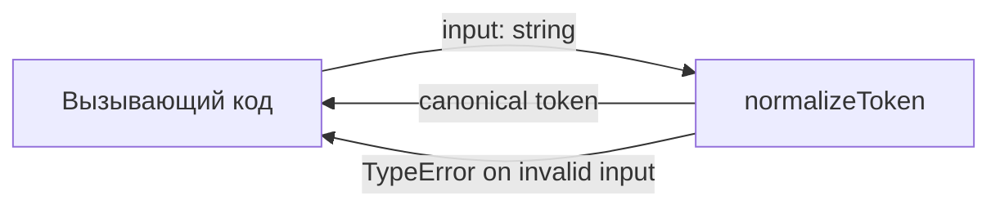
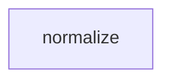

# Module: normalize

<!--SECTION:SPEC_ID-->
TOKEN-NORMALIZE
<!--/SECTION:SPEC_ID-->

<!--SECTION:MODULE_VISION-->
## Module Vision

Модуль `normalize` владеет единственной операцией scope `token` — детерминированным приведением входной строки к каноническому токену. Он не хранит состояние, не выполняет ввод-вывод и не зависит от других модулей.

- **Родительский scope:** [token](../token.spec.md)
- **Соседние модули:** отсутствуют — это единственный модуль scope `token`.
- **Дочерние модули:** отсутствуют — декомпозиция не требуется для одной чистой операции.
<!--/SECTION:MODULE_VISION-->

<!--SECTION:OVERVIEW-->
## Overview


_Путь одного вызова: проверка входа, нормализация, возврат канонического токена — NOR-REQ-1, NOR-REQ-2._
<!--/SECTION:OVERVIEW-->

<!--SECTION:MODULE_USAGE_EXAMPLE-->
## Module Usage Example

```ts
import { normalizeToken } from "./normalize.js";

// Happy path: trim, lowercase and collapse separators into one hyphen.
const token = normalizeToken("  Foo__BAR  ");
// token === "foo-bar"

// Error path: invalid input is rejected, never converted into an empty token.
try {
  normalizeToken("");
} catch (error) {
  // error instanceof TypeError
}
```

Инициализация не требуется: функция доступна сразу после импорта, не читает конфигурацию и не открывает ресурсы.
<!--/SECTION:MODULE_USAGE_EXAMPLE-->

<!--SECTION:MODULE_REQUIREMENTS-->
## Requirements

### NOR-REQ-1 [должен]
**Когда** передана непустая ASCII-строка, содержащая хотя бы один символ вне пробелов, underscore и hyphen, **нормализатор должен** обрезать крайние ASCII-пробелы, привести ASCII-буквы к нижнему регистру и свернуть каждый непрерывный ряд пробелов, underscore и hyphen в один hyphen.

> Уточняет TOK-REQ-1: фиксирует единственный канонический вид токена для CLI и библиотечных потребителей.

### NOR-REQ-2 [должен · нештатная]
**Если** входная строка пустая, состоит только из пробелов, underscore и hyphen или содержит хотя бы один не-ASCII символ, **то нормализатор должен** выбросить `TypeError` без выполнения ввода-вывода.

> Уточняет TOK-REQ-2: ошибочный вход нельзя маскировать пустым или искажённым токеном; операция остаётся локальной и чистой.

| Input | Outcome |
|---|---|
| `"  Foo__BAR  "` | `"foo-bar"` |
| `""` | `TypeError` |

Сценарий `normalize-example` фиксирует строку первого примера, сценарий `empty-input-rejection` — второго.
<!--/SECTION:MODULE_REQUIREMENTS-->

<!--SECTION:INTER_MODULE_DEPENDENCIES-->
## Inter-Module Dependencies

- **Depends on:** нет — модуль не использует другие модули scope `token`.
- **Scope Reference (cross-scope):** нет — модуль не обращается к другому scope.
- **Provides to:** нет — другие модули внутри scope `token` отсутствуют.


_У модуля нет входящих или исходящих зависимостей внутри scope._
<!--/SECTION:INTER_MODULE_DEPENDENCIES-->

<!--SECTION:ENTITY_INVENTORY-->
## Entity Inventory

_Это полный список сущностей модуля. Любое введение сущности execution-агентом помимо этого списка считается drift'ом и требует обновления spec._

| Name | Type | Purpose |
|------|------|---------|
| `normalizeToken` | Function | Детерминированно приводит ASCII-строку к каноническому токену |

Ошибки: throw → `normalizeToken`

ER-набросок не рисуется: в инвентаре одна сущность, связывать нечего.
<!--/SECTION:ENTITY_INVENTORY-->

<!--SECTION:ENTITY_SURFACES-->
## Entity Surfaces

Одна публичная функция `normalizeToken`; полная поверхность раскрыта ниже.

<details>
<summary>Полные поверхности сущностей</summary>

### `normalizeToken`
- **Type:** Function
- **Purpose:** Приводит допустимую ASCII-строку к каноническому токену либо отклоняет недопустимый вход.
- **Public Properties:** N/A — функция без свойств.
- **Public Operations:** `normalizeToken` — нормализует входную строку и возвращает канонический токен.
- **Lifecycle:** Чистая функция; доступна после загрузки модуля, состояния не имеет, завершение не применимо.
- **Events Emitted:** N/A
- **Errors & Degradation:** `TypeError` через `throw`; владелец — `normalizeToken`; обработка остаётся вызывающему коду.
- **Consumers:**
  - Internal: нет — другие модули scope `token` отсутствуют.
  - External: CLI и библиотечные потребители scope `token`.
- **Usage Waiver (external: CLI и библиотечные потребители):** Единственная публичная операция модуля, закреплённая TOK-REQ-1; без неё у scope нет наблюдаемого поведения.

</details>
<!--/SECTION:ENTITY_SURFACES-->

<!--SECTION:MODULE_CONTRACTS-->
## Module Contracts

Один Service `normalizeToken`; Port и Adapter отсутствуют, потому что реализация детерминирована и подтверждённой вариативности нет.

Граф не рисуется: в модуле нет Port/Adapter, только Service `normalizeToken`.

Цепочка вызовов не рисуется: в модуле одна абстракция `normalizeToken`, последовательность из одного участника не добавляет информации.

<details>
<summary>Контракты DbC</summary>

### Services

#### Service: `normalizeToken`
- **Purpose:** Возвращает канонический токен для допустимого ASCII-входа и отклоняет недопустимый вход.
- **Consumers:** CLI и библиотечные потребители scope `token`.
- **Runtime Backing:** `not-implemented`
- **Verification Levels:** `contract`, `unit`
- **Deferred Runtime Scope:** Вся нормализация — implementation не входит в этот авторский проход.

**Contract (DbC)**
- `normalizeToken`:
  - Pre: `input` — строка, содержащая только ASCII-символы и хотя бы один символ вне пробелов, underscore и hyphen.
  - Post: Возвращена строка без крайних ASCII-пробелов, с ASCII-буквами в нижнем регистре и каждым непрерывным рядом пробелов, underscore и hyphen, заменённым одним hyphen.
  - On pre-violation: Выброшен `TypeError`; ввод-вывод не выполняется, исходная строка не изменяется.

**Invariants:** Результат детерминирован для одного и того же входа; функция не читает и не изменяет разделяемое состояние и не выполняет ввод-вывод.

</details>
<!--/SECTION:MODULE_CONTRACTS-->

<!--SECTION:PUBLIC_OPTIONS-->
## Public Options & Policies

Публичных опций и политик нет.

<details>
<summary>Опции и политики</summary>

Не применимо: сигнатура и поведение полностью зафиксированы TOK-REQ-1 и TOK-REQ-2; конфигурация в v1 не предусмотрена.

</details>
<!--/SECTION:PUBLIC_OPTIONS-->

<!--SECTION:FILE_STRUCTURE-->
## File Structure

```
normalize/
├── src/
│   └── normalize.ts
└── test/
    └── normalize.test.ts
```

**File Mapping:**
- `normalize/src/normalize.ts`: реализация `normalizeToken`
- `normalize/test/normalize.test.ts`: модульные проверки `normalizeToken`
<!--/SECTION:FILE_STRUCTURE-->

<!--SECTION:RESEARCH-->
## Research

Ресёрч-документов нет: поведение модуля полностью определено TOK-REQ-1, TOK-REQ-2 и `docs/token-contract.md`; внешних исследований не требуется.
<!--/SECTION:RESEARCH-->

<!--SECTION:MODULE_DECISION_LOG-->
## Module Decision Log

Зафиксировано одно решение: `normalizeToken` реализуется как чистая функция без Port/Adapter.

<details>
<summary>Полные записи Decision Log</summary>

NOR-DL-1 2026-10-23 — `normalizeToken` реализуется как чистая функция без Port/Adapter (почему: одна детерминированная реализация, внешних эффектов и подтверждённой вариативности нет; отвергнуто: Port ради тестового шва — избыточен для чистой функции; риск: будущая замена реализации потребует рефакторинга) [verdict: pending-operator]

</details>
<!--/SECTION:MODULE_DECISION_LOG-->

<!--SECTION:HANDOFF-->
## Handoff to Tasks

- **Implementation files to be created:** `normalize/src/normalize.ts`
- **Test files to be created:** `normalize/test/normalize.test.ts`
- **Stack dependencies:**
  - Language: `typescript` (resolves to `ai/directives/coding/typescript-rules.xml`)
  - Test framework: `node-test` (resolves to `ai/directives/testing/node-test.xml`)
- **Module Rules Additions:** `None` — scope-wide baseline and TypeScript rules are sufficient.

  | Rule | Category | Source |
  |------|----------|--------|
  | None | — | — |

- **Open risks & validation needs:** Implementation and tests not created; runtime behavior unverified. Operator approval and scaffold/ticket creation remain pending.
- **Handoff status:** pending-operator — no tickets created and no execution approved.
<!--/SECTION:HANDOFF-->

<!--SECTION:IMPLEMENTATION_INSIGHTS-->
## Implementation Insights

Не применимо на этапе авторской спеки: implementation не запрошена.

<details>
<summary>Заметки по реализации</summary>

Раздел заполняется только после реализации и аудита; сейчас наблюдений нет.

</details>
<!--/SECTION:IMPLEMENTATION_INSIGHTS-->
