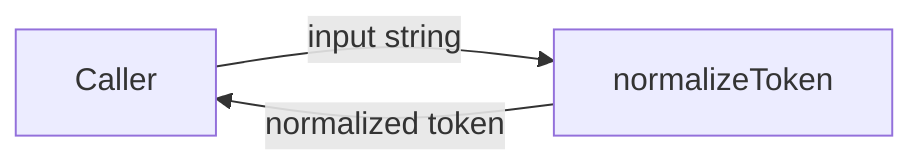
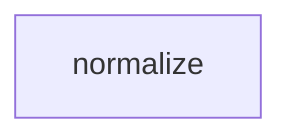

# Module: normalize

<!--SECTION:SPEC_ID-->
TOKEN-NORMALIZE
<!--/SECTION:SPEC_ID-->

<!--SECTION:MODULE_VISION-->
## Module Vision
`normalize` владеет единственной обязанностью скоупа [token](../token.spec.md): детерминированной нормализацией строки в токен через `normalizeToken`. Соседних модулей и дочерних модулей нет; контракт зафиксирован в [token contract](../../../docs/token-contract.md).
<!--/SECTION:MODULE_VISION-->

<!--SECTION:OVERVIEW-->
## Overview


_Вызов нормализации и возврат токена вызывающему — NOR-REQ-1._
<!--/SECTION:OVERVIEW-->

<!--SECTION:MODULE_USAGE_EXAMPLE-->
## Module Usage Example
Модуль не требует настройки: потребитель импортирует `normalizeToken` и передаёт строку.

```ts
import { normalizeToken } from "./normalize";

// Happy path: edges trimmed, ASCII letters lowered, separator runs collapsed.
const token = normalizeToken("  Foo__BAR  ");
// token === "foo-bar"

// Error path: invalid input fails loudly, without I/O.
try {
  normalizeToken("");
} catch (error) {
  // error is a TypeError
}
```
<!--/SECTION:MODULE_USAGE_EXAMPLE-->

<!--SECTION:MODULE_REQUIREMENTS-->
## Requirements
### NOR-REQ-1 [должен]
**Когда** передана непустая ASCII-строка, **нормализатор должен** удалить ведущие и хвостовые ASCII-пробелы, привести ASCII-буквы к нижнему регистру и заменить каждую непрерывную последовательность ASCII-пробелов, underscore и hyphen одним hyphen.

> Уточняет TOK-REQ-1: один детерминированный формат токена нужен CLI и библиотечным потребителям.

### NOR-REQ-2 [должен · нештатная]
**Если** строка пустая, состоит только из разделителей (ASCII-пробелы, underscore, hyphen) или содержит хотя бы один не-ASCII символ, **то нормализатор должен** выбросить TypeError без ввода-вывода.

> Уточняет TOK-REQ-2: ошибочный вход нельзя маскировать пустым корректным токеном.

| Input | Outcome |
|---|---|
| `"  Foo__BAR  "` | `"foo-bar"` |
| `""` | `TypeError` |
<!--/SECTION:MODULE_REQUIREMENTS-->

<!--SECTION:INTER_MODULE_DEPENDENCIES-->
## Inter-Module Dependencies
- **Depends on:** нет модулей внутри скоупа `token`.
- **Scope Reference (cross-scope):** нет.
- **Provides to:** нет других модулей скоупа; публичная поверхность предназначена для потребителей скоупа `token`.


_Единственный модуль скоупа без межмодульных рёбер._
<!--/SECTION:INTER_MODULE_DEPENDENCIES-->

<!--SECTION:ENTITY_INVENTORY-->
## Entity Inventory

_Это полный список сущностей модуля. Любое введение сущности execution-агентом помимо этого списка считается drift'ом и требует обновления spec._

| Name | Type | Purpose |
|------|------|---------|
| `normalizeToken` | Function | Чистая нормализация ASCII-строки в токен |

Ошибки: throw → `normalizeToken`

ER-эскиз не нужен: в инвентаре одна сущность, связывать нечего.
<!--/SECTION:ENTITY_INVENTORY-->

<!--SECTION:ENTITY_SURFACES-->
## Entity Surfaces
Одна публичная функция с чистым контрактом и без состояния.

<details>
<summary>Полные поверхности сущностей</summary>

### `normalizeToken`
- **Type:** Function
- **Purpose:** Преобразует входную ASCII-строку в нормализованный токен.
- **Public Properties:** N/A
- **Public Operations:** нормализовать входную строку в токен
- **Lifecycle:** Создаётся на время вызова, состояние не сохраняет, завершается возвратом токена или TypeError.
- **Events Emitted:** N/A
- **Errors & Degradation:** `TypeError` через `throw`; владелец — `normalizeToken`; ошибку обрабатывает вызывающий; ввод-вывод не выполняется.
- **Consumers:**
  - Internal: нет внутренних потребителей в модуле
  - External: CLI и библиотечные потребители
- **Usage Waiver (external: CLI и библиотечные потребители):** единственный публичный экспорт модуля; нормализация токена — его основная обязанность.

</details>
<!--/SECTION:ENTITY_SURFACES-->

<!--SECTION:MODULE_CONTRACTS-->
## Module Contracts
Модуль предоставляет одну чистую функцию `normalizeToken`; Port и Adapter не вводятся.

Граф не рисуется: в модуле нет Port/Adapter, только функция `normalizeToken`.
Цепочка вызовов не рисуется: в инвентаре одна абстракция — `normalizeToken`.

<details>
<summary>Контракты DbC</summary>

### Services
#### Service: `normalizeToken`
- **Purpose:** Выполняет детерминированную нормализацию ASCII-строки в токен.
- **Consumers:** CLI и библиотечные потребители.
- **Runtime Backing:** `not-implemented`
- **Verification Levels:** `contract`, `unit`
- **Deferred Runtime Scope:** Вся реализация отложена; в этом авторском изменении кода нет.

**Contract (DbC)** — одна операция:
- `normalizeToken`:
  - Pre: вход — непустая строка, состоящая только из ASCII-символов и содержащая хотя бы один символ, не являющийся разделителем.
  - Post: возвращается вход без ведущих и хвостовых ASCII-пробелов, с ASCII-буквами в нижнем регистре и с каждой непрерывной последовательностью ASCII-пробелов, underscore и hyphen, заменённой одним hyphen.
  - On pre-violation: выбрасывается TypeError; ввод-вывод не выполняется.

**Invariants:** Функция не сохраняет состояние, не выполняет ввод-вывод и для одного и того же входа всегда возвращает один и тот же результат или TypeError.

</details>
<!--/SECTION:MODULE_CONTRACTS-->

<!--SECTION:PUBLIC_OPTIONS-->
## Public Options & Policies
Публично настраиваемых опций и политик нет; нормализация всегда выполняется по одному правилу.

<details>
<summary>Опции и политики</summary>

Флаги, режимы и конфигурационные политики отсутствуют; отложенных опций нет.

</details>
<!--/SECTION:PUBLIC_OPTIONS-->

<!--SECTION:FILE_STRUCTURE-->
## File Structure
```
normalize/
├── normalize.ts
└── normalize.test.ts
```

**File Mapping:**
- `normalize/normalize.ts`: реализация `normalizeToken` (планируется, не создана)
- `normalize/normalize.test.ts`: модульные тесты контракта (планируются, не созданы)
<!--/SECTION:FILE_STRUCTURE-->

<!--SECTION:RESEARCH-->
## Research
Ресёрч-документов нет: контракт задан [token contract](../../../docs/token-contract.md) и требованиями TOK-REQ-1, TOK-REQ-2.
<!--/SECTION:RESEARCH-->

<!--SECTION:MODULE_DECISION_LOG-->
## Module Decision Log
Записано одно решение: чистая функция без Port и Adapter.

<details>
<summary>Полные записи Decision Log</summary>

NOR-DL-1 2026-10-23 — нормализация выполняется одной чистой функцией без Port и Adapter (почему: одна детерминированная трансформация без подтверждённой вариативности или тестового шва).

</details>
<!--/SECTION:MODULE_DECISION_LOG-->

<!--SECTION:HANDOFF-->
## Handoff to Tasks
- **Implementation files to be created:** `normalize/normalize.ts`
- **Test files to be created:** `normalize/normalize.test.ts`
- **Stack dependencies:**
  - Language: `typescript` (resolves to `ai/directives/coding/typescript-rules.xml`)
  - Test framework: `node:test` (resolves to `ai/directives/testing/node-test.xml`)
- **Module Rules Additions:** None; scope-wide baseline applies.
- **Open risks & validation needs:** Реализация отсутствует, поведение не проверено. Нужны тесты классификации ASCII и разделителей. Одобрение оператора не получено.
- **Status:** pending-operator
- **Operator decision:** pending

No tickets created or execution approved by this draft.
<!--/SECTION:HANDOFF-->

<!--SECTION:IMPLEMENTATION_INSIGHTS-->
## Implementation Insights
Не применимо: реализация не выполнялась, пост-имплементационных наблюдений нет.

<details>
<summary>Заметки по реализации</summary>

Раздел заполняется после цикла реализации и аудита; на этапе авторинга содержимого нет.

</details>
<!--/SECTION:IMPLEMENTATION_INSIGHTS-->
