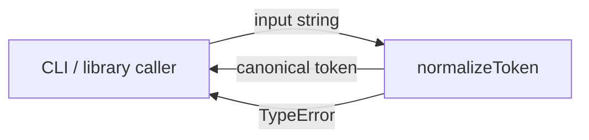
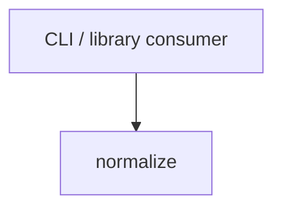

# Module: normalize

<!--SECTION:SPEC_ID-->
TOKEN-NORMALIZE
<!--/SECTION:SPEC_ID-->

<!--SECTION:MODULE_VISION-->
## Module Vision
Модуль `normalize` владеет единственной ответственностью скоупа [`token`](../token.spec.md): детерминированным преобразованием входной ASCII-строки в канонический токен. Соседних модулей в скоупе нет, дочерних модулей нет; публичный результат модуля потребляют CLI и библиотечные клиенты скоупа.
<!--/SECTION:MODULE_VISION-->

<!--SECTION:OVERVIEW-->
## Overview


_Один проход нормализации: канонический токен или отказ TypeError — NOR-REQ-1, NOR-REQ-2._
<!--/SECTION:OVERVIEW-->

<!--SECTION:MODULE_USAGE_EXAMPLE-->
## Module Usage Example
Изолированное использование модуля в TypeScript: импорт единственной функции, штатный вызов и минимальная обработка нештатного входа. Соседние модули и инфраструктура не требуются.

```ts
import { normalizeToken } from "./normalize";

normalizeToken("  Foo__BAR  ");
// "foo-bar"

try {
  normalizeToken("");
} catch (error) {
  // error is TypeError
}
```
<!--/SECTION:MODULE_USAGE_EXAMPLE-->

<!--SECTION:MODULE_REQUIREMENTS-->
## Requirements
### NOR-REQ-1 [должен]
**Когда** передана ASCII-строка, **нормализатор должен** обрезать крайние ASCII-пробелы, привести ASCII-буквы к нижнему регистру и свернуть последовательности пробелов, underscore и hyphen в один hyphen.

> Уточняет TOK-REQ-1 для этого модуля: единый канонический вид токена — единственный результат, на который опираются CLI и библиотечные потребители.

### NOR-REQ-2 [должен · нештатная]
**Если** входная строка пустая, состоит только из разделителей или содержит не-ASCII символы, **то нормализатор должен** выбросить TypeError без ввода-вывода.

> Уточняет TOK-REQ-2: недопустимый вход нельзя маскировать корректным токеном, поэтому отказ должен быть явным и не сопровождаться побочными эффектами.

| Input | Outcome |
|---|---|
| `"  Foo__BAR  "` | `"foo-bar"` |
| `""` | `TypeError` |
<!--/SECTION:MODULE_REQUIREMENTS-->

<!--SECTION:INTER_MODULE_DEPENDENCIES-->
## Inter-Module Dependencies
- **Depends on:** none — `normalize` is the only module in the `token` scope.
- **Scope Reference (cross-scope):** none — the module is pure and consumes no cross-scope interface.
- **Provides to:** external CLI and library consumers of the `token` scope; no sibling modules consume it.


_Внешние потребители вызывают единственный модуль скоупа; внутренних рёбер нет — NOR-REQ-1, NOR-REQ-2._
<!--/SECTION:INTER_MODULE_DEPENDENCIES-->

<!--SECTION:ENTITY_INVENTORY-->
## Entity Inventory
_Это полный список сущностей модуля. Любое введение сущности execution-агентом помимо этого списка считается drift'ом и требует обновления spec._

| Name | Type | Purpose |
|------|------|---------|
| `normalizeToken` | Function | Нормализует ASCII-токен и владеет отказом TypeError |

Ошибки: throw → `normalizeToken`.

ER-набросок не требуется: в инвентаре одна сущность, связывать нечего.
<!--/SECTION:ENTITY_INVENTORY-->

<!--SECTION:ENTITY_SURFACES-->
## Entity Surfaces
Публичная поверхность модуля — одна функция `normalizeToken`; полное описание ниже.

<details>
<summary>Полные поверхности сущностей</summary>

### `normalizeToken`
- **Type:** Function
- **Purpose:** Преобразует допустимую ASCII-строку в канонический hyphen-токен или отказывает с TypeError.
- **Public Properties:** N/A
- **Public Operations:** `normalizeToken(input)` — возвращает канонический токен; на недопустимом входе выбрасывает TypeError.
- **Lifecycle:** Создаётся импортом модуля; экземпляров и состояния нет, каждый вызов независим.
- **Events Emitted:** N/A
- **Errors & Degradation:** `TypeError` через throw для пустого, разделительного и не-ASCII входа; обработку ошибки выполняет вызывающая сторона.
- **Consumers:**
  - Internal: none
  - External: CLI and library consumers of the `token` scope
- **Usage Waiver (external: CLI and library consumers):** Публичная точка входа модуля; вся его поверхность намеренно состоит из этой функции.

</details>
<!--/SECTION:ENTITY_SURFACES-->

<!--SECTION:MODULE_CONTRACTS-->
## Module Contracts
Ports: нет; Adapters: нет; Services: `normalizeToken`. Модуль реализуется одной чистой функцией, потому что вариативность и отдельный тестовый шов не подтверждены.

Граф не рисуется: в модуле нет Port/Adapter, только Service `normalizeToken`.

Цепочка вызовов не рисуется: в модуле одна абстракция — `normalizeToken`.

<details>
<summary>Контракты DbC</summary>

### Services

#### Service: `normalizeToken`
- **Purpose:** Детерминированно нормализовать ASCII-токен и явно отказать на недопустимом входе.
- **Consumers:** external — CLI and library consumers of the `token` scope.
- **Runtime Backing:** `not-implemented`
- **Verification Levels:** `contract`, `unit`
- **Deferred Runtime Scope:** Вся заявленная нормализация: реализации в этом изменении нет.

**Contract (DbC)**
- `normalizeToken`:
  - Pre: `input` — строка, непустая, не состоящая только из разделителей и не содержащая не-ASCII символов.
  - Post: возвращает канонический токен: без крайних ASCII-пробелов, с ASCII-буквами в нижнем регистре и одиночными hyphen вместо последовательностей пробелов, underscore и hyphen.
  - On pre-violation: выбрасывает TypeError и не выполняет ввода-вывода.

**Invariants:** Результат детерминирован для одного и того же входа; функция не хранит состояние и не выполняет ввода-вывода.

</details>
<!--/SECTION:MODULE_CONTRACTS-->

<!--SECTION:PUBLIC_OPTIONS-->
## Public Options & Policies
Публичных опций и политик нет: API состоит из одной функции без флагов и конфигурации.

<details>
<summary>Опции и политики</summary>

Нет опций, флагов или политик, наблюдаемых снаружи. Политика недопустимого входа зафиксирована в NOR-REQ-2 и не настраивается.

</details>
<!--/SECTION:PUBLIC_OPTIONS-->

<!--SECTION:FILE_STRUCTURE-->
## File Structure
```
src/token/normalize/
└── normalize.ts
```

**File Mapping:**
- `src/token/normalize/normalize.ts`: `normalizeToken` implementation
<!--/SECTION:FILE_STRUCTURE-->

<!--SECTION:RESEARCH-->
## Research
Ресёрч-документов нет: модуль выведен из [`token`](../token.spec.md) и TOK-REQ-1–2, регистрировать нечего.
<!--/SECTION:RESEARCH-->

<!--SECTION:MODULE_DECISION_LOG-->
## Module Decision Log
Зафиксировано одно решение: нормализация реализуется чистой функцией без Port/Adapter.

<details>
<summary>Полные записи Decision Log</summary>

NOR-DL-1 2026-10-23 — `normalizeToken` реализуется чистой функцией без Port/Adapter (почему: одна реализация, подтверждённой вариативности и отдельного тестового шва нет; отвергнуто: Port ради симметрии — лишняя абстракция).

</details>
<!--/SECTION:MODULE_DECISION_LOG-->

<!--SECTION:HANDOFF-->
## Handoff to Tasks
- **Implementation files to be created:** `src/token/normalize/normalize.ts`
- **Test files to be created:** `src/token/normalize/normalize.test.ts`
- **Stack dependencies:**
  - Language: `typescript` (resolves to `ai/directives/coding/typescript-rules.xml`)
  - Test framework: `node-test` (resolves to `ai/directives/testing/node-test.xml`)
- **Module Rules Additions:** None

  | Rule | Category | Source |
  |------|----------|--------|
  | None | — | — |

- **Open risks & validation needs:** Реализации и тестов нет, поэтому поведение не проверено. Поведение ASCII-символов, не являющихся буквами, пробелами, `_` или `-`, брифом не задано и требует решения перед реализацией.
- **Authoring status:** pending-operator — approval, tickets and execution are not claimed.
<!--/SECTION:HANDOFF-->

<!--SECTION:IMPLEMENTATION_INSIGHTS-->
## Implementation Insights
Не применимо: реализации ещё нет, пост-имплементационных наблюдений нет.

<details>
<summary>Заметки по реализации</summary>

Наблюдений нет, потому что модуль ещё не реализован.

</details>
<!--/SECTION:IMPLEMENTATION_INSIGHTS-->
