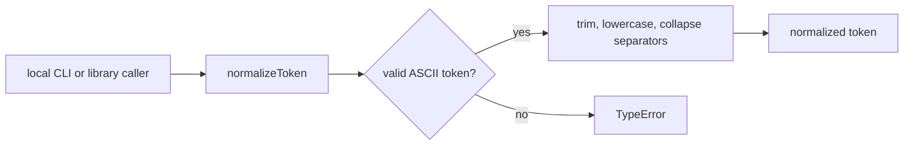
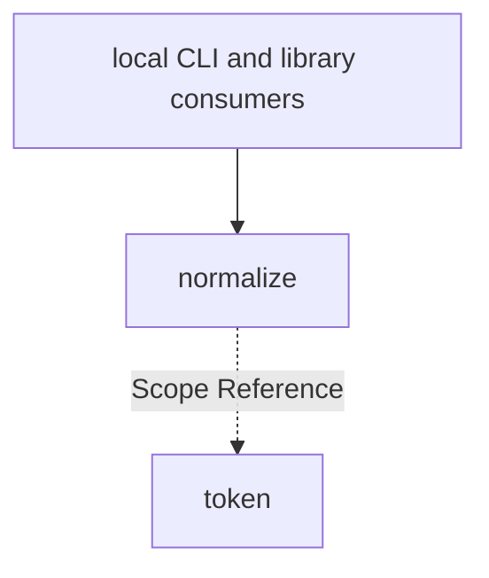

# Module: normalize

<!--SECTION:SPEC_ID-->
TOKEN-NORMALIZE
<!--/SECTION:SPEC_ID-->

<!--SECTION:MODULE_VISION-->
## Module Vision

`normalize` owns deterministic ASCII token normalization inside the [token scope](../token.spec.md): it turns one input string into a canonical hyphenated token and rejects invalid input before any work. It is the scope's only module; no sibling, parent or child modules exist.

<!--/SECTION:MODULE_VISION-->

<!--SECTION:OVERVIEW-->
## Overview



_Нормализация ASCII-токена и отказ на пустом, разделительном или не-ASCII входе — NOR-REQ-1, NOR-REQ-2._
<!--/SECTION:OVERVIEW-->

<!--SECTION:MODULE_USAGE_EXAMPLE-->
## Module Usage Example

The module is a pure library import; there is no initialization or configuration.

```ts
import { normalizeToken } from "./normalize";

const token = normalizeToken("  Foo__BAR  ");

try {
  normalizeToken("");
} catch (error) {
  if (!(error instanceof TypeError)) {
    throw error;
  }
}
```

The happy path yields `"foo-bar"`; the error path catches the `TypeError` that invalid input raises before any I/O.
<!--/SECTION:MODULE_USAGE_EXAMPLE-->

<!--SECTION:MODULE_REQUIREMENTS-->
## Requirements

### NOR-REQ-1 [должен]
**Когда** передана непустая ASCII-строка, содержащая хотя бы один не-разделитель, **нормализатор должен** обрезать крайние ASCII-пробелы, привести ASCII-буквы к нижнему регистру и свернуть серии пробелов, underscore и hyphen в один hyphen.

> Это модульное уточнение TOK-REQ-1: канонический вид токена нужен CLI и библиотечным потребителям.

### NOR-REQ-2 [должен · нештатная]
**Если** входная строка пустая, состоит только из разделителей или содержит не-ASCII символы, **то нормализатор должен** выбросить TypeError без ввода-вывода.

> Это модульное уточнение TOK-REQ-2: ошибочный вход нельзя маскировать пустым корректным токеном.

| Input | Outcome |
|---|---|
| `"  Foo__BAR  "` | `"foo-bar"` |
| `""` | `TypeError` |
<!--/SECTION:MODULE_REQUIREMENTS-->

<!--SECTION:INTER_MODULE_DEPENDENCIES-->
## Inter-Module Dependencies
- **Depends on:** No sibling modules within this scope.
- **Scope Reference (cross-scope):** None for runtime behavior; the parent [token scope](../token.spec.md) references [infra-base](../../infra-base/infra-base.spec.md) for authoring tooling only.
- **Provides to:** No sibling modules; the public API serves local CLI and library consumers.


_Модуль предоставляет нормализацию потребителям и не зависит от соседних модулей._
<!--/SECTION:INTER_MODULE_DEPENDENCIES-->

<!--SECTION:ENTITY_INVENTORY-->
## Entity Inventory

_Это полный список сущностей модуля. Любое введение сущности execution-агентом помимо этого списка считается drift'ом и требует обновления spec._

| Name | Type | Purpose |
|------|------|---------|
| `normalizeToken` | Function | Чистая нормализация одного ASCII-токена |

Ошибки: throw → `normalizeToken` (TypeError на пустом, разделительном или не-ASCII входе).

ER-эскиз не рисуется: в инвентаре одна сущность, связей между сущностями нет.
<!--/SECTION:ENTITY_INVENTORY-->

<!--SECTION:ENTITY_SURFACES-->
## Entity Surfaces

Одна публичная функция без состояния; полная поверхность свёрнута.

<details>
<summary>Полные поверхности сущностей</summary>

### `normalizeToken`
- **Type:** Function
- **Purpose:** Преобразует одну ASCII-строку в канонический hyphen-токен или выбрасывает TypeError.
- **Public Properties:** N/A
- **Public Operations:** Normalize an ASCII token; reject empty, separator-only and non-ASCII input with TypeError.
- **Lifecycle:** Создаётся при импорте модуля, не хранит состояния и не имеет завершения.
- **Events Emitted:** N/A
- **Errors & Degradation:** `TypeError` via throw, raised by `normalizeToken`; the caller handles it.
- **Consumers:**
  - Internal: `src/token/normalize/normalize.ts`
  - External: local CLI and library consumers

</details>
<!--/SECTION:ENTITY_SURFACES-->

<!--SECTION:MODULE_CONTRACTS-->
## Module Contracts

Один чистый Function-контракт; Port и Adapter не вводятся, потому что вариативности и тестового шва нет.

Граф не рисуется: в модуле нет Port/Adapter, только Function `normalizeToken`.

Call Chain не рисуется: в инвентаре одна абстракция — Function `normalizeToken`.

<details>
<summary>Контракты DbC</summary>

### Services

#### Service: `normalizeToken`
- **Purpose:** Детерминированно нормализовать ASCII-токен и отклонять недопустимый вход.
- **Consumers:** internal: `src/token/normalize/normalize.ts`; external: local CLI and library consumers
- **Runtime Backing:** `not-implemented`
- **Verification Levels:** `contract`, `unit`
- **Deferred Runtime Scope:** Всё объявленное поведение не имеет runtime: реализация не запрашивалась.

**Contract (DbC)**
- `normalizeToken(input)`:
  - Pre: `input` — строка, непустая, содержит хотя бы один не-разделитель и только ASCII-символы.
  - Post: возвращается строка без крайних ASCII-пробелов, с ASCII-буквами в нижнем регистре и сериями пробелов, underscore и hyphen, свёрнутыми в один hyphen.
  - On pre-violation: выбрасывается TypeError; ввод-вывод не выполняется.

**Invariants:** Функция чистая и детерминированная: одинаковый вход даёт одинаковый результат, состояние и ввод-вывод отсутствуют.

</details>
<!--/SECTION:MODULE_CONTRACTS-->

<!--SECTION:PUBLIC_OPTIONS-->
## Public Options & Policies

Публичных опций и политик нет: единственный вход — строковый аргумент `normalizeToken`.

<details>
<summary>Опции и политики</summary>

Модуль не принимает флагов, настроек или конфигурации; правила нормализации фиксированы в `NOR-REQ-1` и `NOR-REQ-2`.

</details>
<!--/SECTION:PUBLIC_OPTIONS-->

<!--SECTION:FILE_STRUCTURE-->
## File Structure
```text
src/token/normalize/
├── normalize.ts
└── normalize.test.ts
```

**File Mapping:**
- `src/token/normalize/normalize.ts`: pure `normalizeToken` export
- `src/token/normalize/normalize.test.ts`: contract and unit tests for valid and invalid input
<!--/SECTION:FILE_STRUCTURE-->

<!--SECTION:RESEARCH-->
## Research

No research documents for this module. The bounded deterministic draft relies on the parent [token scope](../token.spec.md) and the [token contract](../../../docs/token-contract.md); no external research is registered.
<!--/SECTION:RESEARCH-->

<!--SECTION:MODULE_DECISION_LOG-->
## Module Decision Log

Одна запись: чистая Function без Port/Adapter; полная запись свёрнута.

<details>
<summary>Полные записи Decision Log</summary>

NOR-DL-1 2026-10-23 — оставить нормализацию чистой Function без Port/Adapter (почему: детерминированная трансформация без вариативности и состояния; отвергнуто: Port или Adapter — не добавляет тестового шва; риск: нет).

</details>
<!--/SECTION:MODULE_DECISION_LOG-->

<!--SECTION:HANDOFF-->
## Handoff to Tasks
- **Implementation files to be created:** `src/token/normalize/normalize.ts`
- **Test files to be created:** `src/token/normalize/normalize.test.ts`
- **Stack dependencies:**
  - Language: `typescript` (resolves to `ai/directives/coding/typescript-rules.xml`)
  - Test framework: `node-test` (resolves to `ai/directives/testing/node-test.xml`)
- **Module Rules Additions:** None; the scope-wide baseline applies.

- **Open risks & validation needs:** Non-ASCII rejection needs an explicit character-class check; separator-only input must be distinguished from a valid token after trimming. Implementation, tickets and operator approval remain pending.
<!--/SECTION:HANDOFF-->

<!--SECTION:IMPLEMENTATION_INSIGHTS-->
## Implementation Insights

Not applicable — no implementation has run, so no post-implementation learnings exist.

<details>
<summary>Заметки по реализации</summary>

Not applicable: this appendix is populated only after implementation and audit-cycle compaction.

</details>
<!--/SECTION:IMPLEMENTATION_INSIGHTS-->
