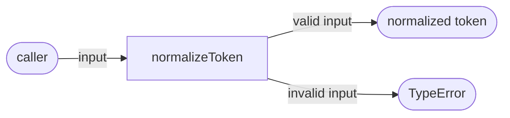
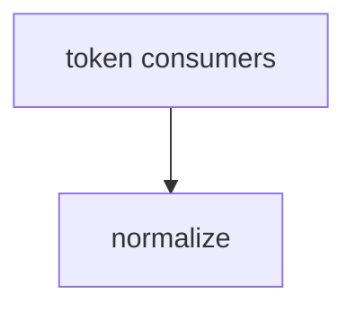

# Module: normalize

<!--SECTION:SPEC_ID-->
TOKEN-NORMALIZE
<!--/SECTION:SPEC_ID-->

<!--SECTION:MODULE_VISION-->
## Module Vision

Модуль `normalize` владеет единственной операцией: детерминированной нормализацией одного токена в каноническую форму. Он не выполняет ввод-вывод, не хранит состояние и не знает о CLI-обвязке. Родительский scope: [token](../token.spec.md). Соседних и дочерних модулей в текущем черновике scope нет.
<!--/SECTION:MODULE_VISION-->

<!--SECTION:OVERVIEW-->
## Overview


_Нормализация валидного входа и отклонение недопустимого — NOR-REQ-1, NOR-REQ-2._
<!--/SECTION:OVERVIEW-->

<!--SECTION:MODULE_USAGE_EXAMPLE-->
## Module Usage Example

Модуль не требует инициализации, конфигурации или внешних зависимостей. Вызывающий передаёт строку и получает нормализованный токен либо `TypeError`.

```ts
import { normalizeToken } from "./normalize.js";

const token = normalizeToken("  Foo__BAR  ");
console.log(token);

try {
  normalizeToken("");
} catch (error) {
  console.error(error instanceof TypeError ? "invalid token" : "unexpected error");
}
```
<!--/SECTION:MODULE_USAGE_EXAMPLE-->

<!--SECTION:MODULE_REQUIREMENTS-->
## Requirements

### NOR-REQ-1 [должен]
**Когда** передана непустая ASCII-строка, не состоящая только из разделителей, **нормализатор должен** обрезать крайние ASCII-пробелы, привести ASCII-буквы к нижнему регистру и свернуть каждую последовательность пробелов, underscore и hyphen в один hyphen.

> Уточняет TOK-REQ-1: модуль фиксирует точную операцию нормализации одного токена; без неё CLI и библиотечные потребители получат разные формы одного и того же токена.

### NOR-REQ-2 [должен · нештатная]
**Если** строка пустая, состоит только из разделителей или содержит не-ASCII символы, **то нормализатор должен** выбросить TypeError без ввода-вывода.

> Уточняет TOK-REQ-2: ошибка входа не должна маскироваться пустым или искажённым токеном, а отказ должен быть наблюдаемым на границе функции.

| Input | Outcome |
|---|---|
| `"  Foo__BAR  "` | `"foo-bar"` |
| `""` | `TypeError` |
<!--/SECTION:MODULE_REQUIREMENTS-->

<!--SECTION:INTER_MODULE_DEPENDENCIES-->
## Inter-Module Dependencies
- **Depends on:** None within scope `token`.
- **Scope Reference (cross-scope):** None.
- **Provides to:** No sibling modules; CLI and library consumers of scope `token` use `normalizeToken` through the scope public API.


_Потребители scope token вызывают единственный модуль normalize._
<!--/SECTION:INTER_MODULE_DEPENDENCIES-->

<!--SECTION:ENTITY_INVENTORY-->
## Entity Inventory

_Это полный список сущностей модуля. Любое введение сущности execution-агентом помимо этого списка считается drift'ом и требует обновления spec._

| Name | Type | Purpose |
|------|------|---------|
| `normalizeToken` | Function | Чистая нормализация одного токена в каноническую форму |

Ошибки: throw `TypeError` → владелец `normalizeToken`.

ER-набросок не рисуется: в инвентаре одна сущность, связывать нечего.
<!--/SECTION:ENTITY_INVENTORY-->

<!--SECTION:ENTITY_SURFACES-->
## Entity Surfaces

<details>
<summary>Полные поверхности сущностей</summary>

### `normalizeToken`
- **Type:** Function
- **Purpose:** Преобразует один непустой ASCII-токен в каноническую форму.
- **Public Properties:** N/A
- **Public Operations:** Нормализовать один токен; отклонить недопустимый вход через TypeError.
- **Lifecycle:** Stateless; вызывающий передаёт вход, функция возвращает результат или выбрасывает ошибку и не удерживает ресурсы.
- **Events Emitted:** N/A
- **Errors & Degradation:** `TypeError` через throw; обработка принадлежит вызывающему потребителю, частичный результат не возвращается.
- **Consumers:**
  - Internal: `src/token/normalize/normalize.ts`
  - External: CLI и библиотечные потребители scope token
- **Usage Waiver (external: token scope consumers):** Единственная публичная операция модуля; её вызывают все потребители scope token.

</details>
<!--/SECTION:ENTITY_SURFACES-->

<!--SECTION:MODULE_CONTRACTS-->
## Module Contracts

Модуль реализует единственную чистую функцию `normalizeToken`; Ports и Adapters не вводятся.

_Граф не рисуется: в модуле нет Port/Adapter, только Service `normalizeToken` (чистая функция)._

_Цепочка вызовов не рисуется: в инвентаре одна абстракция, последовательность вызовов отсутствует._

<details>
<summary>Контракты DbC</summary>

#### Service: `normalizeToken`
- **Purpose:** Детерминированно нормализовать один ASCII-токен.
- **Consumers:** Internal: `src/token/normalize/normalize.ts`; External: CLI и библиотечные потребители scope token.
- **Runtime Backing:** `not-implemented`
- **Verification Levels:** `contract`, `unit`
- **Deferred Runtime Scope:** Весь объявленный контракт: реализация не входит в этот черновик.

**Contract (DbC)**
- `normalizeToken`:
  - Pre: Вход — непустая ASCII-строка, содержащая хотя бы один символ, отличный от ASCII-пробела, underscore и hyphen.
  - Post: Крайние ASCII-пробелы удалены; ASCII-буквы приведены к нижнему регистру; каждая максимальная последовательность ASCII-пробелов, underscore и hyphen заменена одним hyphen.
  - On pre-violation: Выбрасывается TypeError без ввода-вывода и без частичного результата.

**Invariants:** Функция детерминирована и не выполняет ввод-вывод; результат не содержит ASCII-букв в верхнем регистре и не содержит идущих подряд разделителей.

</details>
<!--/SECTION:MODULE_CONTRACTS-->

<!--SECTION:PUBLIC_OPTIONS-->
## Public Options & Policies

No public options or policies: `normalizeToken` has no configuration, flags or policy knobs.
<!--/SECTION:PUBLIC_OPTIONS-->

<!--SECTION:FILE_STRUCTURE-->
## File Structure
```text
src/token/normalize/
└── normalize.ts
test/token/normalize/
└── normalize.test.ts
```

**File Mapping:**
- `src/token/normalize/normalize.ts`: exports `normalizeToken`.
- `test/token/normalize/normalize.test.ts`: contract and unit tests for `normalizeToken`.
<!--/SECTION:FILE_STRUCTURE-->

<!--SECTION:RESEARCH-->
## Research

No research documents for this bounded deterministic draft.
<!--/SECTION:RESEARCH-->

<!--SECTION:MODULE_DECISION_LOG-->
## Module Decision Log

Зафиксировано одно решение: чистая функция без Port/Adapter.

<details>
<summary>Полные записи Decision Log</summary>

NOR-DL-1 2026-10-23 — не вводить Port/Adapter для чистой функции (почему: одна детерминированная реализация без подтверждённой вариативности и без внешнего ввода-вывода; отвергнуто: Port с единственным адаптером — лишний слой без тестового шва) [verdict: pending-operator].

</details>
<!--/SECTION:MODULE_DECISION_LOG-->

<!--SECTION:HANDOFF-->
## Handoff to Tasks
- **Implementation files to be created:** `src/token/normalize/normalize.ts`
- **Test files to be created:** `test/token/normalize/normalize.test.ts`
- **Stack dependencies:**
  - Language: `typescript` (resolves to `ai/directives/coding/typescript-rules.xml`)
  - Test framework: `node-test` (resolves to `ai/directives/testing/node-test.xml`)
- **Module Rules Additions:** None.
- **Open risks & validation needs:** Operator approval is pending. Intent does not define handling of ASCII punctuation outside the three separators; this draft leaves such characters unchanged rather than rejecting them. No runtime implementation or test execution is claimed.
<!--/SECTION:HANDOFF-->

<!--SECTION:IMPLEMENTATION_INSIGHTS-->
## Implementation Insights

Not applicable: no implementation exists, so there are no post-implementation learnings.
<!--/SECTION:IMPLEMENTATION_INSIGHTS-->
