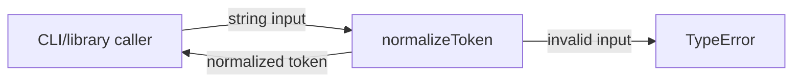
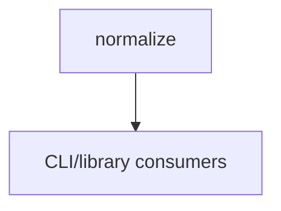

# Module: Normalize

<!--SECTION:SPEC_ID-->
TOKEN-NORMALIZE
<!--/SECTION:SPEC_ID-->

<!--SECTION:MODULE_VISION-->
## Module Vision

Модуль `normalize` владеет детерминированной нормализацией строкового токена для локальных CLI- и библиотечных потребителей. Родительская спецификация — [token](../token.spec.md). Соседних модулей нет: скоуп `token` состоит из этого одного плоского модуля. Дочерних модулей также нет. Модуль не владеет вводом-выводом, сетью, персистентностью или конфигурацией.

<!--/SECTION:MODULE_VISION-->

<!--SECTION:OVERVIEW-->
## Overview



_Нормализация входа и отказ на недопустимом токене — NOR-REQ-1, NOR-REQ-2._
<!--/SECTION:OVERVIEW-->

<!--SECTION:MODULE_USAGE_EXAMPLE-->
## Module Usage Example

```ts
import { normalizeToken } from "./normalize.js";

// Настройка не нужна: функция локальна и не имеет состояния.
const token = normalizeToken("  Foo__BAR  ");
console.log(token); // "foo-bar"

// Минимальный путь ошибки: недопустимый вход отвергается до любых операций ввода-вывода.
try {
  normalizeToken("");
} catch (error) {
  if (error instanceof TypeError) {
    console.error("invalid token input");
  }
}
```

<!--/SECTION:MODULE_USAGE_EXAMPLE-->

<!--SECTION:MODULE_REQUIREMENTS-->
## Requirements

### NOR-REQ-1 [должен]
**Когда** передана ASCII-строка с токеном, **normalizeToken должен** обрезать ведущие и замыкающие ASCII-пробелы, привести ASCII-буквы к нижнему регистру и свернуть каждый прогон пробелов, underscore и hyphen в один hyphen.

> Уточняет TOK-REQ-1: модуль фиксирует локальную границу нормализации и точный результат для потребителя.

### NOR-REQ-2 [должен · нештатная]
**Если** входная строка пустая, состоит только из разделителей или содержит не-ASCII символ, **то normalizeToken должен** выбросить TypeError без операций ввода-вывода.

> Уточняет TOK-REQ-2: недопустимый вход нельзя маскировать пустым или искажённым токеном.

| Input | Outcome |
|---|---|
| `"  Foo__BAR  "` | `"foo-bar"` |
| `""` | `TypeError` |

<!--/SECTION:MODULE_REQUIREMENTS-->

<!--SECTION:INTER_MODULE_DEPENDENCIES-->
## Inter-Module Dependencies
- **Depends on:** нет — в скоупе `token` нет других модулей.
- **Scope Reference (cross-scope):** нет.
- **Provides to:** CLI- и библиотечные потребители скоупа `token`.


_Единственный модуль скоупа отдаёт результат внешним потребителям._
<!--/SECTION:INTER_MODULE_DEPENDENCIES-->

<!--SECTION:ENTITY_INVENTORY-->
## Entity Inventory

_Это полный список сущностей модуля. Любое введение сущности execution-агентом помимо этого списка считается drift'ом и требует обновления spec._

| Name | Type | Purpose |
|------|------|---------|
| `normalizeToken` | Function | Детерминированно нормализует строковый токен и отвергает недопустимый вход |

Ошибки: throw TypeError → `normalizeToken`.

ER-эскиз не рисуется: в инвентаре одна сущность, связывать нечего.

<!--/SECTION:ENTITY_INVENTORY-->

<!--SECTION:ENTITY_SURFACES-->
## Entity Surfaces

Модуль экспортирует одну функцию `normalizeToken`; её публичная поверхность полностью описана ниже.

<details>
<summary>Полные поверхности сущностей</summary>

### `normalizeToken`
- **Type:** Function
- **Purpose:** Детерминированно нормализует входной токен и сообщает об ошибке через TypeError.
- **Public Properties:** N/A
- **Public Operations:** Нормализовать строку; выбросить TypeError на недопустимом входе.
- **Lifecycle:** Вызывается потребителем и завершается возвратом результата или исключением; состояния не сохраняет.
- **Events Emitted:** N/A
- **Errors & Degradation:** `TypeError` через throw; владелец — `normalizeToken`, исключение передаётся вызывающему коду.
- **Consumers:**
  - Internal: N/A — единственный экспорт модуля.
  - External: CLI- и библиотечные потребители скоупа `token`.
- **Usage Waiver (external: CLI/library consumers):** Единственная публичная точка входа модуля — сам нормализатор.

</details>
<!--/SECTION:ENTITY_SURFACES-->

<!--SECTION:MODULE_CONTRACTS-->
## Module Contracts

Модуль реализует одну чистую функцию; Port, Adapter и состояние отсутствуют.

Граф не рисуется: в модуле нет Port/Adapter, только Service-форма `normalizeToken` для чистой функции.

Call Chain не рисуется: в инвентаре одна абстракция, последовательности вызовов между сущностями нет.

<details>
<summary>Контракты DbC</summary>

### Services

#### Service: `normalizeToken`
- **Purpose:** Детерминированно нормализовать строковый токен.
- **Consumers:** CLI- и библиотечные потребители скоупа `token`.
- **Runtime Backing:** `not-implemented`
- **Verification Levels:** `contract`, `unit`
- **Deferred Runtime Scope:** Реализация и исполнение не входят в эту authoring-задачу.

**Contract (DbC)**
- `normalizeToken`:
  - Pre: `input` — непустая ASCII-строка, содержащая хотя бы один символ вне разделителей (пробел, underscore, hyphen).
  - Post: Возвращённая строка не имеет ведущих и замыкающих ASCII-пробелов, ASCII-буквы приведены к нижнему регистру, каждый прогон разделителей заменён одним hyphen.
  - On pre-violation: Выбрасывается `TypeError` без операций ввода-вывода.

**Invariants:** Результат зависит только от `input`; функция не сохраняет состояние и не выполняет ввод-вывод.

</details>
<!--/SECTION:MODULE_CONTRACTS-->

<!--SECTION:PUBLIC_OPTIONS-->
## Public Options & Policies

Модуль не имеет публично настраиваемых опций или политик.

<details>
<summary>Опции и политики</summary>

Нет: `normalizeToken` не принимает флагов, конфигурации или политик; поведение полностью задано требованиями NOR-REQ-1 и NOR-REQ-2.

</details>
<!--/SECTION:PUBLIC_OPTIONS-->

<!--SECTION:FILE_STRUCTURE-->
## File Structure
```
normalize/
├── normalize.ts
└── normalize.test.ts
```

**File Mapping:**
- `normalize/normalize.ts`: реализация `normalizeToken`.
- `normalize/normalize.test.ts`: проверки нормализации и отказа на недопустимом входе.
<!--/SECTION:FILE_STRUCTURE-->

<!--SECTION:RESEARCH-->
## Research

Нет ресёрч-документов: модуль полностью определён брифингом и `docs/token-contract.md`.

<!--/SECTION:RESEARCH-->

<!--SECTION:MODULE_DECISION_LOG-->
## Module Decision Log

Одно решение: чистая функция без слоя Port/Adapter.

<details>
<summary>Полные записи Decision Log</summary>

NOR-DL-1 2026-10-23 — `normalizeToken` реализуется чистой функцией без Port/Adapter; где: specs/token/normalize/normalize.spec.md#module-contracts (почему: подтверждённой вариативности и отдельного тестового шва нет) [verdict: pending-operator].

</details>
<!--/SECTION:MODULE_DECISION_LOG-->

<!--SECTION:HANDOFF-->
## Handoff to Tasks
- **Implementation files to be created:** `normalize/normalize.ts`.
- **Test files to be created:** `normalize/normalize.test.ts`.
- **Stack dependencies:**
  - Language: `TypeScript` (resolves to `ai/directives/coding/typescript-rules.xml`)
  - Test framework: `node-test` (resolves to `ai/directives/testing/node-test.xml`)
- **Module Rules Additions:** None.
- **Open risks & validation needs:** Реализация не запрошена и не выполнялась; поведение не исполнялось. Operator approval не получено — handoff остаётся pending. Runtime-проверка TypeError и отсутствия I/O остаётся будущей задачей.
<!--/SECTION:HANDOFF-->

<!--SECTION:IMPLEMENTATION_INSIGHTS-->
## Implementation Insights

Not applicable: реализация и post-implementation learnings в этой authoring-задаче отсутствуют.

<details>
<summary>Заметки по реализации</summary>

Нет заметок: код не реализован и audit-cycle compaction не выполнялся.

</details>
<!--/SECTION:IMPLEMENTATION_INSIGHTS-->
