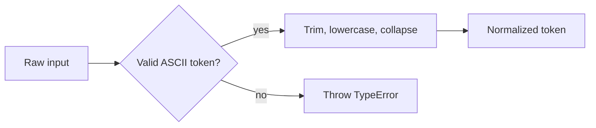
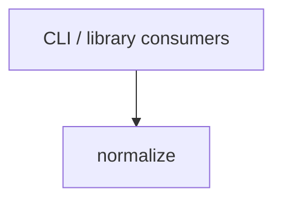

# Module: normalize

<!--SECTION:SPEC_ID-->
TOKEN-NORMALIZE
<!--/SECTION:SPEC_ID-->

<!--SECTION:MODULE_VISION-->
## Module Vision

Модуль отвечает за детерминированную нормализацию ASCII-токена для [скоупа token](../token.spec.md) и уточняет его требования TOK-REQ-1 и TOK-REQ-2. Исходный контракт зафиксирован в [token-contract.md](../../../docs/token-contract.md). Соседних и дочерних модулей нет; реализация в этой задаче не заявляется.
<!--/SECTION:MODULE_VISION-->

<!--SECTION:OVERVIEW-->
## Overview


_Путь нормализации от входа до результата или TypeError — NOR-REQ-1, NOR-REQ-2._
<!--/SECTION:OVERVIEW-->

<!--SECTION:MODULE_USAGE_EXAMPLE-->
## Module Usage Example

Настройка не требуется: функция чистая и поставляется как единственный экспорт модуля.

```ts
import { normalizeToken } from "./normalize";

// Happy path: no setup, no state, no I/O.
const token = normalizeToken("  Foo__BAR  ");
// token === "foo-bar"

// Minimal error path: invalid input is rejected, not silently normalized.
try {
  normalizeToken("");
} catch (error) {
  // error instanceof TypeError
}
```
<!--/SECTION:MODULE_USAGE_EXAMPLE-->

<!--SECTION:MODULE_REQUIREMENTS-->
## Requirements

### NOR-REQ-1 [должен]
**Когда** на вход передана строка, состоящая только из ASCII-символов и содержащая хотя бы один символ, отличный от ASCII-пробела, underscore и hyphen, **нормализатор должен** удалить крайние ASCII-пробелы, привести ASCII-буквы к нижнему регистру и заменить каждую максимальную серию ASCII-пробелов, underscore и hyphen одним hyphen.

> Уточняет TOK-REQ-1: модуль фиксирует точный порядок преобразований и сохраняет прочие ASCII-символы, чтобы потребители получали один стабильный формат токена.

### NOR-REQ-2 [должен · нештатная]
**Если** вход пуст, состоит только из ASCII-пробелов, underscore и hyphen или содержит не-ASCII символ, **то нормализатор должен** выбросить TypeError без сетевого и дискового ввода-вывода.

> Уточняет TOK-REQ-2: невалидный вход нельзя маскировать пустым или частично нормализованным токеном; ошибка должна быть явной для CLI и библиотечного потребителя.

| Input | Outcome |
|---|---|
| `"  Foo__BAR  "` | `"foo-bar"` |
| `""` | `TypeError` |
<!--/SECTION:MODULE_REQUIREMENTS-->

<!--SECTION:INTER_MODULE_DEPENDENCIES-->
## Inter-Module Dependencies
- **Depends on:** None.
- **Scope Reference (cross-scope):** None.
- **Provides to:** None within this scope; external CLI and library consumers use the public function.


_Зависимость идёт от внешних потребителей к модулю; рёбер к соседним модулям нет._
<!--/SECTION:INTER_MODULE_DEPENDENCIES-->

<!--SECTION:ENTITY_INVENTORY-->
## Entity Inventory

_Это полный список сущностей модуля. Любое введение сущности execution-агентом помимо этого списка считается drift'ом и требует обновления spec._

| Name | Type | Purpose |
|------|------|---------|
| `normalizeToken` | Function | Нормализует валидный ASCII-токен и явно отвергает невалидный вход. |

Ошибки: throw (`TypeError`) → `normalizeToken`

ER-эскиз не рисуется: в инвентаре одна сущность, связывать нечего.
<!--/SECTION:ENTITY_INVENTORY-->

<!--SECTION:ENTITY_SURFACES-->
## Entity Surfaces

Одна публичная сущность — чистая функция `normalizeToken`; отдельного состояния или событий нет.

<details>
<summary>Полные поверхности сущностей</summary>

### `normalizeToken`
- **Type:** Function
- **Purpose:** Преобразует валидный ASCII-токен в детерминированную нормализованную форму.
- **Public Properties:** N/A
- **Public Operations:** Нормализация входной строки: обрезка крайних ASCII-пробелов, приведение ASCII-букв к нижнему регистру и свёртка серий пробелов, underscore и hyphen в один hyphen.
- **Lifecycle:** Не хранит состояние; вызывающий импортирует функцию и вызывает её на каждый вход.
- **Events Emitted:** N/A
- **Errors & Degradation:** `TypeError` через throw при пустом, состоящем только из разделителей или не-ASCII входе; обработка и показ ошибки — у вызывающего.
- **Consumers:**
  - Internal: N/A
  - External: local CLI and library consumers
- **Usage Waiver (external: local CLI and library consumers):** единственная публичная точка входа модуля; существует для внешних потребителей, а не для повторного внутреннего использования.

</details>
<!--/SECTION:ENTITY_SURFACES-->

<!--SECTION:MODULE_CONTRACTS-->
## Module Contracts

Модуль содержит одну чистую функцию; Port и Adapter не вводятся.

Граф не рисуется: в модуле нет Port/Adapter, только Function `normalizeToken`.

Цепочка вызовов не рисуется: в модуле одна абстракция, сценарий не требует ≥2 участников.

<details>
<summary>Контракты DbC</summary>

### Services

#### Service: `normalizeToken`
- **Purpose:** Нормализовать валидный ASCII-токен и отвергнуть невалидный вход.
- **Consumers:** local CLI and library consumers
- **Runtime Backing:** `not-implemented`
- **Verification Levels:** `contract`, `unit`
- **Deferred Runtime Scope:** Вся заявленная нормализация; реализация не входит в эту авторскую задачу.

**Contract (DbC)**
- `normalizeToken`:
  - Pre: вход — непустая строка, состоящая только из ASCII-символов и содержащая хотя бы один символ, отличный от ASCII-пробела, underscore и hyphen.
  - Post: крайние ASCII-пробелы удалены; ASCII-буквы приведены к нижнему регистру; каждая максимальная серия ASCII-пробелов, underscore и hyphen заменена одним hyphen; остальные ASCII-символы сохранены в исходном порядке.
  - On pre-violation: выбрасывается `TypeError` без сетевого или дискового ввода-вывода.

**Invariants:** функция не хранит состояние между вызовами и не выполняет ввод-вывод.

</details>
<!--/SECTION:MODULE_CONTRACTS-->

<!--SECTION:PUBLIC_OPTIONS-->
## Public Options & Policies

Публичных опций и политик нет: поведение функции фиксировано и не настраивается.

<details>
<summary>Опции и политики</summary>

Не применимо: `normalizeToken` не принимает параметров конфигурации; поведение задано требованиями NOR-REQ-1 и NOR-REQ-2.

</details>
<!--/SECTION:PUBLIC_OPTIONS-->

<!--SECTION:FILE_STRUCTURE-->
## File Structure
```
normalize/
├── normalize.ts
└── normalize.test.ts
```

**File Mapping:**
- `normalize/normalize.ts`: планируемая реализация `normalizeToken`; в этой авторской задаче не создаётся.
- `normalize/normalize.test.ts`: планируемые unit-тесты happy path и TypeError-сценариев; в этой авторской задаче не создаются.
<!--/SECTION:FILE_STRUCTURE-->

<!--SECTION:RESEARCH-->
## Research

No research documents for this module.
<!--/SECTION:RESEARCH-->

<!--SECTION:MODULE_DECISION_LOG-->
## Module Decision Log

Решений уровня модуля сверх контракта родительского скоупа не записано.

<details>
<summary>Полные записи Decision Log</summary>

Не применимо: эта авторская задача не принимала решений, требующих отдельной записи; действуют решения скоупа `token`.

</details>
<!--/SECTION:MODULE_DECISION_LOG-->

<!--SECTION:HANDOFF-->
## Handoff to Tasks
- **Implementation files to be created:** `normalize/normalize.ts`
- **Test files to be created:** `normalize/normalize.test.ts`
- **Stack dependencies:**
  - Language: `TypeScript` (resolves to `ai/directives/coding/typescript-rules.xml`)
  - Test framework: `node:test` (resolves to `ai/directives/testing/node-test.xml`)
- **Module Rules Additions:** None.

- **Open risks & validation needs:**
  - Реализация и тесты не созданы; runtime-проверка не выполнялась.
  - Кодовый корень пакета не задан родительским скоупом; путь `normalize/` — планируемая раскладка.
  - Передача оператору остаётся `pending-operator`; одобрение не получено.
<!--/SECTION:HANDOFF-->

<!--SECTION:IMPLEMENTATION_INSIGHTS-->
## Implementation Insights

Not applicable: реализация не выполнялась, поэтому пост-имплементационных наблюдений нет.
<!--/SECTION:IMPLEMENTATION_INSIGHTS-->
