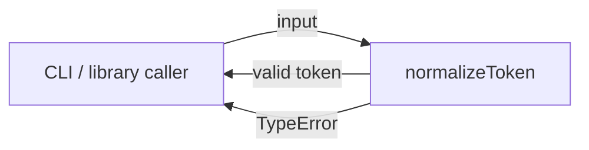
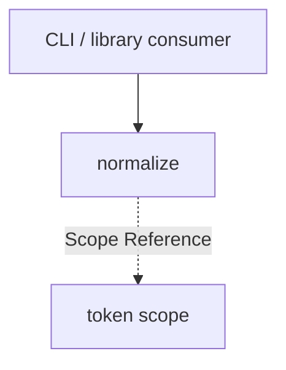

# Module: normalize

<!--SECTION:SPEC_ID-->
TOKEN-NORMALIZE
<!--/SECTION:SPEC_ID-->

<!--SECTION:MODULE_VISION-->
## Module Vision

`normalize` owns one deterministic operation inside the `token` scope: turning one ASCII token into its canonical form by trimming outer ASCII spaces, lowercasing ASCII letters, and collapsing runs of spaces, underscores, and hyphens into one hyphen. Empty, separator-only, and non-ASCII input are rejected with `TypeError`; the module never performs I/O and keeps no state.

Parent scope: [token](../token.spec.md). Source contract: [docs/token-contract.md](../../../docs/token-contract.md). This module has no sibling modules and no child modules — it is flat.
<!--/SECTION:MODULE_VISION-->

<!--SECTION:OVERVIEW-->
## Overview


_Один детерминированный проход нормализации токена — TOK-REQ-1, TOK-REQ-2._
<!--/SECTION:OVERVIEW-->

<!--SECTION:MODULE_USAGE_EXAMPLE-->
## Module Usage Example

```ts
import { normalizeToken } from './normalize';

// Happy path: surrounding spaces disappear and the mixed separators collapse.
const token = normalizeToken('  Foo__BAR  ');
console.log(token); // "foo-bar"

// Invalid input fails explicitly instead of producing an empty token.
try {
  normalizeToken('---');
} catch (error) {
  console.error(error instanceof TypeError); // true
}
```

The snippet demonstrates this module in isolation: no setup, no configuration, and no neighboring-module composition.
<!--/SECTION:MODULE_USAGE_EXAMPLE-->

<!--SECTION:MODULE_REQUIREMENTS-->
## Requirements

No module-specific requirements. Implements parent requirements: TOK-REQ-1, TOK-REQ-2.

| Input | Outcome |
|---|---|
| `"  Foo__BAR  "` | `"foo-bar"` |
| `""` | `TypeError` |
<!--/SECTION:MODULE_REQUIREMENTS-->

<!--SECTION:INTER_MODULE_DEPENDENCIES-->
## Inter-Module Dependencies

- **Depends on:** none — `normalize` is the only module in the `token` scope.
- **Scope Reference (cross-scope):** none.
- **Provides to:** no sibling modules; the public function is consumed by external CLI and library callers.


_Модуль автономен: sibling- и cross-scope-зависимостей нет._
<!--/SECTION:INTER_MODULE_DEPENDENCIES-->

<!--SECTION:ENTITY_INVENTORY-->
## Entity Inventory

_Это полный список сущностей модуля. Любое введение сущности execution-агентом помимо этого списка считается drift'ом и требует обновления spec._

| Name | Type | Purpose |
|------|------|---------|
| `normalizeToken` | Function | Нормализует ASCII-токен и отклоняет недопустимый ввод |

Ошибки: throw `TypeError` → `normalizeToken`

ER-эскиз не рисуется: в инвентаре одна сущность, связывать нечего.
<!--/SECTION:ENTITY_INVENTORY-->

<!--SECTION:ENTITY_SURFACES-->
## Entity Surfaces

Одна публичная сущность — чистая функция `normalizeToken` без состояния и событий.

<details>
<summary>Полные поверхности сущностей</summary>

### `normalizeToken`
- **Type:** Function
- **Purpose:** Приводит ASCII-токен к каноническому виду и отклоняет недопустимый ввод.
- **Public Properties:** N/A
- **Public Operations:** `normalizeToken(input)` — normalize one ASCII token
- **Lifecycle:** Stateless; available on module import; no termination step.
- **Events Emitted:** N/A
- **Errors & Degradation:** `TypeError` via throw; owned by `normalizeToken`; no silent fallback and no I/O.
- **Consumers:**
  - Internal: `src/token/normalize/normalize.ts`
  - External: CLI and library consumers
- **Usage Waiver (external: CLI and library consumers):** Public entry point of the module; it exists for external callers of the token scope.

</details>
<!--/SECTION:ENTITY_SURFACES-->

<!--SECTION:MODULE_CONTRACTS-->
## Module Contracts

The module defines one pure Service function, `normalizeToken`, with no Port or Adapter.

Граф не рисуется: в модуле нет Port/Adapter, только Service `normalizeToken`.
Call Chain не рисуется: в инвентаре одна абстракция (`normalizeToken`), последовательности вызовов нет.

<details>
<summary>Контракты DbC</summary>

### Services

#### Service: `normalizeToken`
- **Purpose:** Нормализует один ASCII-токен и отклоняет недопустимый ввод.
- **Consumers:** CLI and library consumers
- **Runtime Backing:** `not-implemented`
- **Verification Levels:** `contract` | `unit`
- **Deferred Runtime Scope:** Вся заявленная нормализация — реализация не входит в эту авторскую задачу.

**Contract (DbC)** — one block per operation:
- `normalizeToken`:
  - Pre: `input` is a string of ASCII characters that contains at least one character other than an ASCII space, underscore, or hyphen.
  - Post: returns `input` with leading and trailing ASCII spaces removed, ASCII letters lowercased, and every run of ASCII spaces, underscores, or hyphens replaced by exactly one hyphen.
  - On pre-violation: throws `TypeError` and performs no I/O.

**Invariants** (omit when none): The result depends only on `input`, `input` is never mutated, and no operation performs I/O.

</details>
<!--/SECTION:MODULE_CONTRACTS-->

<!--SECTION:PUBLIC_OPTIONS-->
## Public Options & Policies

Публичных опций нет: модуль предоставляет одну функцию с фиксированным поведением.

<details>
<summary>Опции и политики</summary>

No configurable flags, options, or policies exist in v1. The fixed transformation is intentional: the brief requests one deterministic ASCII normalization contract and no configuration surface.

</details>
<!--/SECTION:PUBLIC_OPTIONS-->

<!--SECTION:FILE_STRUCTURE-->
## File Structure

```
src/token/normalize/
├── normalize.ts
└── normalize.test.ts
```

**File Mapping:**
- `src/token/normalize/normalize.ts`: implementation of `normalizeToken`
- `src/token/normalize/normalize.test.ts`: unit tests for the normal path, empty input, separator-only input, and non-ASCII input
<!--/SECTION:FILE_STRUCTURE-->

<!--SECTION:RESEARCH-->
## Research

No research documents back this module. Its contract comes from the brief and [docs/token-contract.md](../../../docs/token-contract.md); the `specs/token/research/` registry is empty, so no document is left unregistered.
<!--/SECTION:RESEARCH-->

<!--SECTION:MODULE_DECISION_LOG-->
## Module Decision Log

Одна запись: чистая функция без Port/Adapter; ожидает решения оператора.

<details>
<summary>Полные записи Decision Log</summary>

NORM-DL-1 2026-10-23 — no Port/Adapter for `normalizeToken`; где: specs/token/normalize/normalize.spec.md#module-contracts (почему: a single pure deterministic transform has no confirmed variability or test seam) [verdict: pending-operator]

</details>
<!--/SECTION:MODULE_DECISION_LOG-->

<!--SECTION:HANDOFF-->
## Handoff to Tasks

- **Status:** pending-operator — Approval #1 has not been given, and no tickets or execution are approved.
- **Implementation files to be created:** `src/token/normalize/normalize.ts`
- **Test files to be created:** `src/token/normalize/normalize.test.ts`
- **Stack dependencies:**
  - Language: `typescript` (resolves to `ai/directives/coding/typescript-rules.xml`)
  - Test framework: `node-test` (resolves to `ai/directives/testing/node-test.xml`)
- **Module Rules Additions:** None
- **Open risks & validation needs:** No runtime implementation exists in this authoring task; the DbC must be verified by a future execution phase. The `TypeError` boundary for non-ASCII input and separator-only input remains untested until then.
<!--/SECTION:HANDOFF-->

<!--SECTION:IMPLEMENTATION_INSIGHTS-->
## Implementation Insights

Not applicable: this authoring task produces no implementation, so no post-implementation learnings exist.

<details>
<summary>Заметки по реализации</summary>

Not applicable — no implementation exists yet.

</details>
<!--/SECTION:IMPLEMENTATION_INSIGHTS-->
