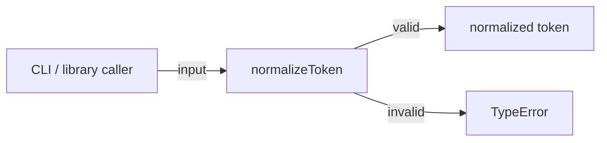
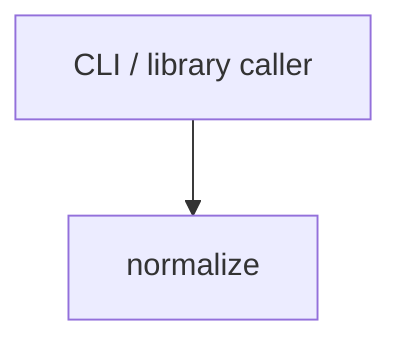

# Module: normalize

<!--SECTION:SPEC_ID-->
TOKEN-NORMALIZE
<!--/SECTION:SPEC_ID-->

<!--SECTION:MODULE_VISION-->
## Module Vision
Модуль `normalize` владеет единственной локальной операцией нормализации токена в scope [token](../token.spec.md): чистым детерминированным преобразованием строки без сети, состояния и персистентности. Соседних модулей внутри scope нет, дочерних модулей нет; публичная поверхность ограничена `normalizeToken`.
<!--/SECTION:MODULE_VISION-->

<!--SECTION:OVERVIEW-->
## Overview


_Один вход даёт детерминированный токен или TypeError — NOR-REQ-1, NOR-REQ-2._
<!--/SECTION:OVERVIEW-->

<!--SECTION:MODULE_USAGE_EXAMPLE-->
## Module Usage Example
```ts
import { normalizeToken } from "./normalize.js";

const token = normalizeToken("  Foo__BAR  ");
if (token !== "foo-bar") {
  throw new Error("unexpected token");
}

try {
  normalizeToken("");
} catch (error) {
  if (!(error instanceof TypeError)) {
    throw error;
  }
}
```
Настройка не требуется: вызов чистый, а невалидный вход завершается `TypeError` без ввода-вывода.
<!--/SECTION:MODULE_USAGE_EXAMPLE-->

<!--SECTION:MODULE_REQUIREMENTS-->
## Requirements
### NOR-REQ-1 [должен]
**Когда** передана непустая ASCII-строка, **normalizeToken должен** обрезать крайние ASCII-пробелы, привести ASCII-буквы к нижнему регистру и свернуть каждый непрерывный участок ASCII-пробелов, underscore и hyphen в один hyphen.

> Уточняет TOK-REQ-1 для модуля: задаёт единственный наблюдаемый результат локального преобразования без состояния и ввода-вывода.

### NOR-REQ-2 [должен · нештатная]
**Если** вход пустой, состоит только из разделителей или содержит не-ASCII символ, **то normalizeToken должен** выбросить TypeError без ввода-вывода.

> Уточняет TOK-REQ-2: ошибка входа не маскируется пустым или искажённым токеном.

Примеры наблюдаемого результата:

| Input | Outcome |
|---|---|
| `"  Foo__BAR  "` | `"foo-bar"` |
| `""` | `TypeError` |
<!--/SECTION:MODULE_REQUIREMENTS-->

<!--SECTION:INTER_MODULE_DEPENDENCIES-->
## Inter-Module Dependencies
- **Depends on:** none within this scope.
- **Scope Reference (cross-scope):** None; the module consumes no foreign interface.
- **Provides to:** no sibling modules; exposed to CLI and library callers through the scope public API.


_Нет зависимостей внутри scope: вызывающий код входит в normalize._
<!--/SECTION:INTER_MODULE_DEPENDENCIES-->

<!--SECTION:ENTITY_INVENTORY-->
## Entity Inventory

_Это полный список сущностей модуля. Любое введение сущности execution-агентом помимо этого списка считается drift'ом и требует обновления spec._

| Name | Type | Purpose |
|------|------|---------|
| `normalizeToken` | Function | Нормализует токен детерминированно и без ввода-вывода |

Ошибки: throw → `normalizeToken`

ER-набросок не рисуется: в инвентаре одна сущность, связывать нечего.
<!--/SECTION:ENTITY_INVENTORY-->

<!--SECTION:ENTITY_SURFACES-->
## Entity Surfaces
Одна публичная функция `normalizeToken`; полная поверхность ниже.

<details>
<summary>Полные поверхности сущностей</summary>

### `normalizeToken`
- **Type:** Function
- **Purpose:** Преобразует входную строку в детерминированный токен или выбрасывает TypeError.
- **Public Properties:** N/A
- **Public Operations:** принять строку и вернуть нормализованный токен; на недопустимом входе выбросить TypeError.
- **Lifecycle:** не хранит состояние; создаётся вызовом и завершается возвратом результата или исключением.
- **Events Emitted:** N/A
- **Errors & Degradation:** `TypeError` выбрасывается самим `normalizeToken`; обработка остаётся у вызывающего кода, ввод-вывод не выполняется.
- **Consumers:**
  - Internal: no other module in this scope
  - External: CLI / library caller

</details>
<!--/SECTION:ENTITY_SURFACES-->

<!--SECTION:MODULE_CONTRACTS-->
## Module Contracts
Один Service `normalizeToken`; Port и Adapter не вводятся, потому что вариативность и отдельный тестовый seam не подтверждены.

Граф не рисуется: в модуле нет Port/Adapter, только Service `normalizeToken`.

Цепочка вызовов не рисуется: в модуле одна абстракция, вызывающий код напрямую входит в `normalizeToken`.

<details>
<summary>Контракты DbC</summary>

### Services

#### Service: `normalizeToken`
- **Purpose:** Детерминированно нормализовать валидный ASCII-токен и отклонить недопустимый вход.
- **Consumers:** CLI / library caller through the scope public API.
- **Runtime Backing:** `not-implemented`
- **Verification Levels:** `contract`, `unit`
- **Deferred Runtime Scope:** Реализация и runtime-проверка отложены до scaffold/execution; эта спека не заявляет ни того, ни другого.

**Contract (DbC)**
- `normalizeToken`:
  - Pre: на вход подана строка, содержащая хотя бы один ASCII-символ, отличный от ASCII-пробела, underscore и hyphen, и не содержащая не-ASCII символов.
  - Post: возвращает строку с обрезанными крайними ASCII-пробелами, ASCII-буквами в нижнем регистре и каждым непрерывным участком ASCII-пробелов, underscore и hyphen, свёрнутым в один hyphen.
  - On pre-violation: выбрасывает TypeError; ввод-вывод не выполняется.

**Invariants:** Операция детерминирована, не мутирует вход и не имеет побочных эффектов; одинаковый вход даёт одинаковый результат или TypeError.

</details>
<!--/SECTION:MODULE_CONTRACTS-->

<!--SECTION:PUBLIC_OPTIONS-->
## Public Options & Policies
Публичных опций нет: поведение фиксировано контрактом.

<details>
<summary>Опции и политики</summary>

В v1 нет флагов, настроек или политик; дополнительных публично наблюдаемых опций не объявлено.

</details>
<!--/SECTION:PUBLIC_OPTIONS-->

<!--SECTION:FILE_STRUCTURE-->
## File Structure
```text
normalize/
├── normalize.ts
└── normalize.test.ts
```

**File Mapping:**
- `normalize/normalize.ts`: pure `normalizeToken` implementation.
- `normalize/normalize.test.ts`: contract tests for the happy path and TypeError behavior.
<!--/SECTION:FILE_STRUCTURE-->

<!--SECTION:RESEARCH-->
## Research
Ресёрч не требуется: поведение ограничено локальным детерминированным преобразованием, внешних источников или нерешённых вопросов нет.
<!--/SECTION:RESEARCH-->

<!--SECTION:MODULE_DECISION_LOG-->
## Module Decision Log
Записанных решений нет: граница модуля следует TOK-REQ-1 и TOK-REQ-2 без отклонений.

<details>
<summary>Полные записи Decision Log</summary>

Записей нет.

</details>
<!--/SECTION:MODULE_DECISION_LOG-->

<!--SECTION:HANDOFF-->
## Handoff to Tasks
- **Status:** pending-operator
- **Operator decision:** pending
- **Implementation files to be created:** `normalize/normalize.ts`
- **Test files to be created:** `normalize/normalize.test.ts`
- **Stack dependencies:**
  - Language: `TypeScript` (resolves to `ai/directives/coding/typescript-rules.xml`)
  - Test framework: `node:test` (resolves to `ai/directives/testing/node-test.xml`)
- **Module Rules Additions:** None — no module-specific additions beyond the baseline.
- **Open risks & validation needs:** Scaffold and execution are pending; no implementation, runtime verification or operator approval is claimed by this draft.
<!--/SECTION:HANDOFF-->

<!--SECTION:IMPLEMENTATION_INSIGHTS-->
## Implementation Insights
Пост-реализационных наблюдений нет: реализация этим черновиком не запрашивается.

<details>
<summary>Заметки по реализации</summary>

Раздел станет содержательным после execution; сейчас он пуст по построению.

</details>
<!--/SECTION:IMPLEMENTATION_INSIGHTS-->
