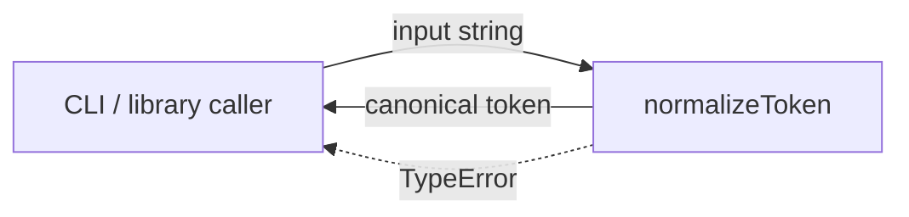
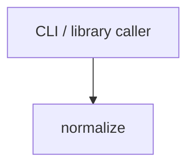

# Module: normalize

<!--SECTION:SPEC_ID-->
TOKEN-PIPELINE-NORMALIZE
<!--/SECTION:SPEC_ID-->

<!--SECTION:MODULE_VISION-->
## Module Vision

Модуль `pipeline/normalize` владеет единственной обязанностью внутри скоупа `token`: детерминированной нормализацией входной строки в каноничный токен для CLI и библиотечных потребителей. Состояния, сети и персистентности у модуля нет.

- Parent scope: [token](../../token.spec.md).
- Sibling modules: none — в Module Map скоупа объявлен только этот модуль.
- Child modules: none.
<!--/SECTION:MODULE_VISION-->

<!--SECTION:OVERVIEW-->
## Overview


_Один чистый вызов нормализует строку либо отказывает с TypeError — NOR-REQ-1, NOR-REQ-2._
<!--/SECTION:OVERVIEW-->

<!--SECTION:MODULE_USAGE_EXAMPLE-->
## Module Usage Example

```ts
import { normalizeToken } from "./normalize.js";

const token = normalizeToken("  Foo__BAR  ");
console.log(token);

try {
  normalizeToken("");
} catch (error) {
  if (error instanceof TypeError) {
    console.error("invalid token");
  }
}
```
<!--/SECTION:MODULE_USAGE_EXAMPLE-->

<!--SECTION:MODULE_REQUIREMENTS-->
## Requirements

### NOR-REQ-1 [должен]

**Когда** модуль получает строку из ASCII-символов, **нормализатор должен** обрезать крайние ASCII-пробелы, привести ASCII-буквы к нижнему регистру и свернуть любую последовательность пробелов, underscore и hyphen в один hyphen.

> Уточняет TOK-REQ-1 на границе модуля `pipeline/normalize`: каноничный токен формируется одним чистым вызовом.

### NOR-REQ-2 [должен · нештатная]

**Если** вход пустой, состоит только из разделителей или содержит не-ASCII символы, **то нормализатор должен** выбросить `TypeError`, не выполняя ввода-вывода.

> Уточняет TOK-REQ-2 на границе модуля `pipeline/normalize`: недопустимый вход не маскируется пустым токеном.

| Input | Outcome |
|---|---|
| `"  Foo__BAR  "` | `"foo-bar"` |
| `""` | `TypeError` |
<!--/SECTION:MODULE_REQUIREMENTS-->

<!--SECTION:INTER_MODULE_DEPENDENCIES-->
## Inter-Module Dependencies

- **Depends on:** none — в скоупе `token` нет соседних модулей.
- **Scope Reference (cross-scope):** None — модуль чистый и не потребляет контрактов других скоупов.
- **Provides to:** CLI и библиотечных потребителей через публичную поверхность скоупа.


_Модуль вызывается потребителем напрямую и не имеет рёбер к соседним модулям._
<!--/SECTION:INTER_MODULE_DEPENDENCIES-->

<!--SECTION:ENTITY_INVENTORY-->
## Entity Inventory

_Это полный список сущностей модуля. Любое введение сущности execution-агентом помимо этого списка считается drift'ом и требует обновления spec._

| Name | Type | Purpose |
|------|------|---------|
| `normalizeToken` | Function | Нормализует строку в каноничный токен и владеет отказом TypeError |

Ошибки: throw TypeError → `normalizeToken`

ER-скетч не рисуется: инвентарь содержит одну сущность, связывать её не с чем.
<!--/SECTION:ENTITY_INVENTORY-->

<!--SECTION:ENTITY_SURFACES-->
## Entity Surfaces

Одна функция `normalizeToken`: чистый вход-выход и единственный механизм ошибки — throw `TypeError`.

<details>
<summary>Полные поверхности сущностей</summary>

### `normalizeToken`

- **Type:** Function
- **Purpose:** Преобразует входную строку в каноничный токен либо отказывает с TypeError.
- **Public Properties:** N/A
- **Public Operations:** нормализовать переданную строку
- **Lifecycle:** существует как экспорт модуля; состояния нет, завершение не применимо.
- **Events Emitted:** N/A
- **Errors & Degradation:** `TypeError` через throw для пустого входа, входа только из разделителей и не-ASCII входа; владелец — `normalizeToken`; обработка у вызывающей стороны.
- **Consumers:**
  - Internal: none
  - External: CLI и библиотечные потребители
- **Usage Waiver (external: CLI и библиотечные потребители):** единственный публичный вход модуля; без него модуль не выполняет свою обязанность.

</details>
<!--/SECTION:ENTITY_SURFACES-->

<!--SECTION:MODULE_CONTRACTS-->
## Module Contracts

Одна чистая функция без Port/Adapter; контракт DbC описан на Service-форме.

Граф не рисуется: в модуле нет Port/Adapter, только Service `normalizeToken`.

Call Chain не рисуется: в инвентаре одна абстракция — `normalizeToken`.

<details>
<summary>Контракты DbC</summary>

### Services

#### Service: `normalizeToken`

- **Purpose:** Детерминированно нормализовать строку в каноничный токен.
- **Consumers:** внешние CLI и библиотечные потребители.
- **Runtime Backing:** `not-implemented`
- **Verification Levels:** `contract`, `unit`
- **Deferred Runtime Scope:** реализация не создаётся этим артефактом; runtime-поведение не заявлено.

**Contract (DbC)** — один блок на операцию:
- `normalize`:
  - Pre: вход — строка, содержит только ASCII-символы и хотя бы один не-разделитель.
  - Post: возвращён каноничный токен: крайние ASCII-пробелы обрезаны, ASCII-буквы в нижнем регистре, любая последовательность пробелов, underscore и hyphen заменена одним hyphen.
  - On pre-violation: выброшен `TypeError`; ввод-вывод не выполняется.

**Invariants:** вызов чистый и детерминированный — одинаковый вход даёт одинаковый результат, состояние и I/O отсутствуют.

</details>
<!--/SECTION:MODULE_CONTRACTS-->

<!--SECTION:PUBLIC_OPTIONS-->
## Public Options & Policies

Публичных опций нет: набор разделителей и приведение регистра фиксированы требованием NOR-REQ-1.

<details>
<summary>Опции и политики</summary>

Публично наблюдаемых флагов, опций и политик нет. Поведение разделителей и регистра задано NOR-REQ-1 и NOR-REQ-2, отдельных настроек не предусмотрено.

</details>
<!--/SECTION:PUBLIC_OPTIONS-->

<!--SECTION:FILE_STRUCTURE-->
## File Structure

```
pipeline/normalize/
└── normalize.ts
```

**File Mapping:**
- `pipeline/normalize/normalize.ts`: чистая функция `normalizeToken` и её экспорт.
<!--/SECTION:FILE_STRUCTURE-->

<!--SECTION:RESEARCH-->
## Research

Ресёрч-документов для этого ограниченного детерминированного модуля нет.
<!--/SECTION:RESEARCH-->

<!--SECTION:MODULE_DECISION_LOG-->
## Module Decision Log

Решений уровня модуля не зафиксировано: границы заданы родительским скоупом и не требуют отдельного выбора.

<details>
<summary>Полные записи Decision Log</summary>

Записей нет. Отсутствие Port/Adapter следует из чистоты операции и не является отдельным решением; реализация и одобрение оператора не заявлены.

</details>
<!--/SECTION:MODULE_DECISION_LOG-->

<!--SECTION:HANDOFF-->
## Handoff to Tasks

- **Implementation files to be created:** `pipeline/normalize/normalize.ts`
- **Test files to be created:** `pipeline/normalize/normalize.test.ts`
- **Stack dependencies:**
  - Language: `typescript` (resolves to `ai/directives/coding/typescript-rules.xml`)
  - Test framework: `node-test` (resolves to `ai/directives/testing/node-test.xml`)
- **Module Rules Additions:** None — действует scope-wide baseline.

  | Rule | Category | Source |
  |------|----------|--------|
  | None | — | — |

- **Open risks & validation needs:** реализация и тесты ещё не созданы; поведение только специфицировано. Одобрение оператора отсутствует, тикеты не созданы, выполнение не начато.
<!--/SECTION:HANDOFF-->

<!--SECTION:IMPLEMENTATION_INSIGHTS-->
## Implementation Insights

Не применимо: реализация ещё не создана, пост-имплементационных наблюдений нет.

<details>
<summary>Заметки по реализации</summary>

Раздел остаётся пустым до появления реализации и последующего audit-cycle compaction.
</details>
<!--/SECTION:IMPLEMENTATION_INSIGHTS-->
