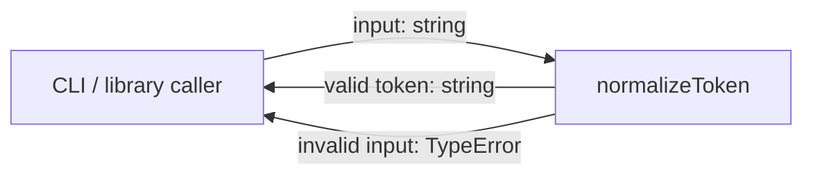
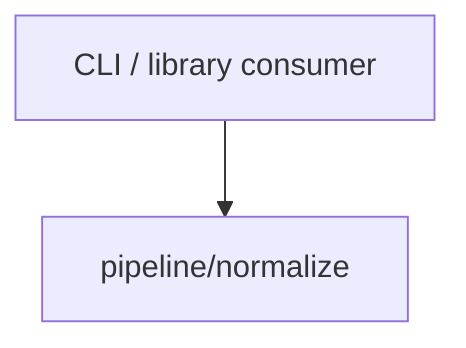

# Module: Normalize

<!--SECTION:SPEC_ID-->
TOKEN-PIPELINE-NORMALIZE
<!--/SECTION:SPEC_ID-->

<!--SECTION:MODULE_VISION-->
## Module Vision
This module owns the deterministic normalization of a single ASCII token string inside the [`token` scope](../../token.spec.md). It exposes one pure function, `normalizeToken`, which trims outer ASCII spaces, lowercases ASCII letters, and collapses runs of spaces, underscores, and hyphens into a single hyphen. The module has no parent or child modules and no siblings; its behavior is fixed by the scope requirements and by the seeded [token contract](../../../docs/token-contract.md). It performs no network, file, or persistent-state access.
<!--/SECTION:MODULE_VISION-->

<!--SECTION:OVERVIEW-->
## Overview

_Главный поток нормализации одного токена — NOR-REQ-1, NOR-REQ-2._
<!--/SECTION:OVERVIEW-->

<!--SECTION:MODULE_USAGE_EXAMPLE-->
## Module Usage Example
No initialization or configuration is required. The module is imported as a plain function and used on the happy path and on the minimal error path.

```ts
import { normalizeToken } from "./normalize";

const token = normalizeToken("  Foo__BAR  ");
console.log(token);

try {
  normalizeToken("");
} catch (error) {
  if (error instanceof TypeError) {
    console.error(error.message);
  }
}
```
<!--/SECTION:MODULE_USAGE_EXAMPLE-->

<!--SECTION:MODULE_REQUIREMENTS-->
## Requirements
### NOR-REQ-1 [должен]
**Когда** на вход подана непустая ASCII-строка, не состоящая только из разделителей, **функция нормализации должна** обрезать ведущие и завершающие ASCII-пробелы, привести ASCII-буквы к нижнему регистру, свернуть каждый участок из ASCII-пробелов, underscore и hyphen в один hyphen и вернуть полученный токен.

> Уточняет TOK-REQ-1 для модуля `pipeline/normalize`: задаёт единственный канонический вид токена, который получают CLI и библиотечные потребители.

### NOR-REQ-2 [должен · нештатная]
**Если** входная строка пустая, состоит только из разделителей (ASCII-пробелов, underscore или hyphen) или содержит не-ASCII символ, **то функция нормализации должна** выбросить `TypeError` без файлового, сетевого или иного ввода-вывода.

> Уточняет TOK-REQ-2: ошибка входа не маскируется пустым или искажённым токеном, а потребитель получает явный сигнал о недопустимых данных.

| Input | Outcome |
|---|---|
| `"  Foo__BAR  "` | `"foo-bar"` |
| `""` | `TypeError` |
<!--/SECTION:MODULE_REQUIREMENTS-->

<!--SECTION:INTER_MODULE_DEPENDENCIES-->
## Inter-Module Dependencies
- **Depends on:** none within this scope.
- **Scope Reference (cross-scope):** none at runtime.
- **Provides to:** none within this scope; the public `normalizeToken` function is available to CLI and library consumers outside the scope.


_Единственный потребитель модуля и отсутствие зависимостей внутри скоупа._
<!--/SECTION:INTER_MODULE_DEPENDENCIES-->

<!--SECTION:ENTITY_INVENTORY-->
## Entity Inventory
_Это полный список сущностей модуля. Любое введение сущности execution-агентом помимо этого списка считается drift'ом и требует обновления spec._

| Name | Type | Purpose |
|------|------|---------|
| `normalizeToken` | Function | Нормализует ASCII-токен в нижний регистр с одним hyphen между частями и отвергает недопустимый вход. |

Ошибки: throw (TypeError) → normalizeToken

ER-эскиз не требуется: в инвентаре одна сущность, связывать нечего.
<!--/SECTION:ENTITY_INVENTORY-->

<!--SECTION:ENTITY_SURFACES-->
## Entity Surfaces
Модуль предоставляет одну публичную функцию; её полная поверхность описана ниже.

<details>
<summary>Полные поверхности сущностей</summary>

### `normalizeToken`
- **Type:** Function
- **Purpose:** Детерминированно приводит допустимую ASCII-строку к каноническому токену.
- **Public Properties:** N/A
- **Public Operations:** `normalizeToken(input)` — нормализует строку и возвращает токен; на недопустимом входе выбрасывает `TypeError`.
- **Lifecycle:** Создаётся при импорте модуля; экземпляров не имеет; живёт в течение процесса потребителя.
- **Events Emitted:** N/A
- **Errors & Degradation:** `TypeError` через `throw`; ошибку формирует и владеет ею `normalizeToken`, обработка и отображение остаются за вызывающим потребителем. Ввода-вывода при ошибке нет.
- **Consumers:**
  - Internal: none in this scope
  - External: CLI and library consumers of the `token` scope
- **Usage Waiver (external: CLI and library consumers):** Публичная точка входа модуля по назначению; внешний потребитель — единственный вызывающий, внутренних вызовов в односоставном скоупе нет.

</details>
<!--/SECTION:ENTITY_SURFACES-->

<!--SECTION:MODULE_CONTRACTS-->
## Module Contracts
Модуль определяет одну чистую функцию `normalizeToken`; Port, Adapter и паттерны здесь не вводятся.

Граф не рисуется: в модуле нет Port/Adapter, только Service `normalizeToken`. Call Chain также не рисуется: абстракция одна.

<details>
<summary>Контракты DbC</summary>

### Services

#### Service: `normalizeToken`
- **Purpose:** Детерминированно нормализовать допустимый ASCII-токен без состояния и ввода-вывода.
- **Consumers:** External: CLI and library consumers of the `token` scope.
- **Runtime Backing:** `not-implemented`
- **Verification Levels:** `contract`, `unit`
- **Deferred Runtime Scope:** Всё поведение отложено: эта авторская задача не создаёт реализацию и не заявляет runtime.

**Contract (DbC)**
- `normalizeToken`:
  - Pre: `input` — строка; она не пустая, не состоит только из ASCII-пробелов, underscore или hyphen и не содержит не-ASCII символов.
  - Post: возвращённая строка не содержит ведущих и завершающих ASCII-пробелов, все ASCII-буквы приведены к нижнему регистру, каждый максимальный участок из ASCII-пробелов, underscore и hyphen заменён одним hyphen; результат не пустой.
  - On pre-violation: выбрасывается `TypeError`; файловый, сетевой и иной ввод-вывод не выполняется.

**Invariants:** Функция чистая и детерминированная: одинаковый вход даёт одинаковый выход; она не читает и не изменяет внешнее состояние; единственное исключение для недопустимого входа — `TypeError`.

</details>
<!--/SECTION:MODULE_CONTRACTS-->

<!--SECTION:PUBLIC_OPTIONS-->
## Public Options & Policies
Публичных опций и политик нет: поведение нормализации фиксировано.

<details>
<summary>Опции и политики</summary>

Модуль не принимает флаги, режимы или конфигурацию. Набор допустимых разделителей и правило нижнего регистра заданы контрактом `normalizeToken`; они не настраиваются в v1.

</details>
<!--/SECTION:PUBLIC_OPTIONS-->

<!--SECTION:FILE_STRUCTURE-->
## File Structure
Планируемая структура модуля (файлы не создаются этой авторской задачей):

```
normalize/
├── normalize.ts
└── normalize.test.ts
```

**File Mapping:**
- `normalize/normalize.ts`: реализация `normalizeToken` и его контрактного поведения.
- `normalize/normalize.test.ts`: контрактные и unit-тесты нормализации и отказа.
<!--/SECTION:FILE_STRUCTURE-->

<!--SECTION:RESEARCH-->
## Research
Ресёрч-документов для этого модуля нет: поведение ограничено и задано скоупом, README и `docs/token-contract.md`.
<!--/SECTION:RESEARCH-->

<!--SECTION:MODULE_DECISION_LOG-->
## Module Decision Log
Записано одно решение: нормализация остаётся чистой функцией без Port/Adapter.

<details>
<summary>Полные записи Decision Log</summary>

NOR-DL-1 2026-10-23 — нормализация остаётся одной чистой функцией `normalizeToken` без Port и Adapter (почему: нет подтверждённой вариативности и ввода-вывода; отвергнуто: Port с единственной реализацией — лишняя абстракция; риск: при появлении второй платформы потребуется отдельный рефакторинг)

</details>
<!--/SECTION:MODULE_DECISION_LOG-->

<!--SECTION:HANDOFF-->
## Handoff to Tasks
- **Implementation files to be created:** `normalize/normalize.ts` (planned; not created by this authoring task)
- **Test files to be created:** `normalize/normalize.test.ts` (planned; not created by this authoring task)
- **Stack dependencies:**
  - Language: `TypeScript` (resolves to `ai/directives/coding/typescript-rules.xml`)
  - Test framework: `Vitest` (resolves to `ai/directives/testing/vitest-rules.xml`)
- **Module Rules Additions:** None

  | Rule | Category | Source |
  |------|----------|--------|
  | None | — | — |

- **Open risks & validation needs:** Owner approval is pending; no implementation, tickets, or runtime validation exist. The ASCII-only boundary and the rejection of separator-only and non-ASCII input still need execution-level test confirmation.
<!--/SECTION:HANDOFF-->

<!--SECTION:IMPLEMENTATION_INSIGHTS-->
## Implementation Insights
Не применимо: реализация ещё не выполнялась, поэтому пост-реализационных наблюдений нет.

<details>
<summary>Заметки по реализации</summary>

Нет записей. Раздел заполняется только после цикла реализации и аудита.
</details>
<!--/SECTION:IMPLEMENTATION_INSIGHTS-->
