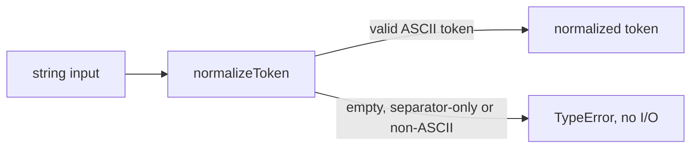
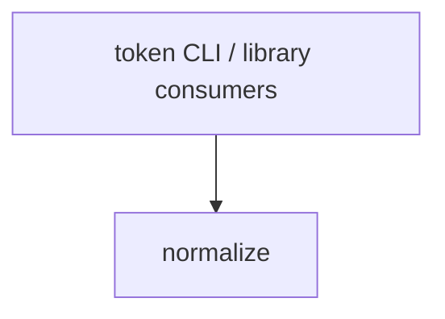

# Module: normalize

<!--SECTION:SPEC_ID-->
TOKEN-PIPELINE-NORMALIZE
<!--/SECTION:SPEC_ID-->

<!--SECTION:MODULE_VISION-->
## Module Vision

Owns the deterministic transformation of one input string into the token format defined by the [token scope](../../token.spec.md): trim outer ASCII spaces, lowercase ASCII letters, and collapse runs of spaces, underscore and hyphen into one hyphen. It also owns rejection of empty, separator-only and non-ASCII input.

This is the only module currently listed in the scope Module Map. There are no parent, child or sibling module specifications to link.

<!--/SECTION:MODULE_VISION-->

<!--SECTION:OVERVIEW-->
## Overview


_Один проход нормализации строки с явной ошибкой на недопустимом входе — NOR-REQ-1, NOR-REQ-2._

<!--/SECTION:OVERVIEW-->

<!--SECTION:MODULE_USAGE_EXAMPLE-->
## Module Usage Example

```ts
import { normalizeToken } from "./normalize.js";

const token = normalizeToken("  Foo__BAR  ");
console.log(token); // "foo-bar"

try {
  normalizeToken("");
} catch (error) {
  console.error(error instanceof TypeError); // true
}
```

<!--/SECTION:MODULE_USAGE_EXAMPLE-->

<!--SECTION:MODULE_REQUIREMENTS-->
## Requirements

### NOR-REQ-1 [должен]

**Когда** `normalizeToken` получает непустую ASCII-строку, содержащую хотя бы один не-разделитель, **то нормализатор должен** обрезать ведущие и замыкающие ASCII-пробелы, привести ASCII-буквы к нижнему регистру и свернуть каждый непрерывный ряд пробелов, `_` и `-` в один `-`. Это модульное уточнение [TOK-REQ-1](../../token.spec.md#requirements-constraints).

### NOR-REQ-2 [должен · нештатная]

**Если** вход пуст, состоит только из разделителей (` `, `_`, `-`) или содержит не-ASCII символ, **то нормализатор должен** выбросить `TypeError` и не выполнять ввод-вывод. Это модульное уточнение [TOK-REQ-2](../../token.spec.md#requirements-constraints).

| Input | Outcome |
|---|---|
| `"  Foo__BAR  "` | `"foo-bar"` |
| `""` | `TypeError` |

<!--/SECTION:MODULE_REQUIREMENTS-->

<!--SECTION:INTER_MODULE_DEPENDENCIES-->
## Inter-Module Dependencies

- **Depends on:** none — this module has no sibling module dependency.
- **Scope Reference (cross-scope):** none — the transformation is local and deterministic; the scope-level infra-base prerequisite is authoring infrastructure, not a runtime dependency of this module.
- **Provides to:** none — no other module in scope `token` consumes this module.


_Внешние потребители входят в normalize; рёбер к соседним модулям нет._

<!--/SECTION:INTER_MODULE_DEPENDENCIES-->

<!--SECTION:ENTITY_INVENTORY-->
## Entity Inventory

_Это полный список сущностей модуля. Любое введение сущности execution-агентом помимо этого списка считается drift'ом и требует обновления spec._

| Name | Type | Purpose |
|------|------|---------|
| `normalizeToken` | Function | Детерминированная нормализация ASCII-строки в единый формат токена |

Ошибки: throw `TypeError` → `normalizeToken`

ER-эскиз не рисуется: инвентарь состоит из одной сущности, связывать нечего.

<!--/SECTION:ENTITY_INVENTORY-->

<!--SECTION:ENTITY_SURFACES-->
## Entity Surfaces

Одна публичная функция `normalizeToken`: вход-строка, выход-строка, ошибка входа — `TypeError`.

<details>
<summary>Полные поверхности сущностей</summary>

### `normalizeToken`

- **Type:** Function
- **Purpose:** Преобразует допустимую ASCII-строку в нормализованный токен и отвергает недопустимый вход.
- **Public Properties:** N/A
- **Public Operations:** `normalizeToken(input: string): string`
- **Lifecycle:** Создаётся при импорте модуля; не хранит состояния; завершается возвратом результата или выбросом `TypeError`.
- **Events Emitted:** N/A
- **Errors & Degradation:** `TypeError` выбрасывается самим `normalizeToken`; обработка ошибки принадлежит вызывающему потребителю.
- **Consumers:**
  - Internal: none — у модуля нет внутренних потребителей или соседних модулей.
  - External: token CLI and library consumers
- **Usage Waiver (external: token CLI and library consumers):** Единственный публичный экспорт модуля; его ценность задаётся внешним контрактом, а не числом внутренних вызовов.

</details>

<!--/SECTION:ENTITY_SURFACES-->

<!--SECTION:MODULE_CONTRACTS-->
## Module Contracts

No Ports or Adapters are defined; one pure Function `normalizeToken` owns both normalization and input rejection.

Граф не рисуется: в модуле нет Port/Adapter, только Function `normalizeToken`.

Call Chain не рисуется: в инвентаре одна абстракция (`normalizeToken`), порог ≥2 не достигнут.

<details>
<summary>Контракты DbC</summary>

### Services

#### Service: `normalizeToken`

- **Purpose:** Детерминированно нормализовать допустимую ASCII-строку в токен и отвергнуть недопустимый вход.
- **Consumers:** External: token CLI and library consumers.
- **Runtime Backing:** `not-implemented`
- **Verification Levels:** `contract`
- **Deferred Runtime Scope:** Вся реализация и исполняемые проверки отложены; этот черновик не заявляет runtime.

**Contract (DbC)**

- `normalizeToken`:
  - Pre: Вход является ASCII-строкой, непустой и содержит хотя бы один символ, не являющийся пробелом, `_` или `-`.
  - Post: Возвращённая строка не имеет ведущих и замыкающих ASCII-пробелов; ASCII-буквы приведены к нижнему регистру; каждый непрерывный ряд пробелов, `_` и `-` заменён одним `-`.
  - On pre-violation: Выбрасывается `TypeError`; ввод-вывод не выполняется.

**Invariants:** Функция чистая: результат зависит только от входа, состояние не хранится, ввод-вывод отсутствует.

</details>

<!--/SECTION:MODULE_CONTRACTS-->

<!--SECTION:PUBLIC_OPTIONS-->
## Public Options & Policies

No public options, flags or configurable policies in v1; the only public input is the string argument.

<details>
<summary>Опции и политики</summary>

Опций нет. Любое расширение публичной поверхности потребует отдельного решения и обновления контракта.

</details>

<!--/SECTION:PUBLIC_OPTIONS-->

<!--SECTION:FILE_STRUCTURE-->
## File Structure

```
normalize/
├── normalize.ts
└── index.ts
```

**File Mapping:**
- `normalize/normalize.ts`: реализация `normalizeToken` (будущий ticket; в этом черновике код не создаётся)
- `normalize/index.ts`: публичный экспорт модуля (будущий ticket; в этом черновике код не создаётся)

<!--/SECTION:FILE_STRUCTURE-->

<!--SECTION:RESEARCH-->
## Research

Not applicable: для этого ограниченного детерминированного модуля нет research-документов, поэтому реестр пуст и `SDD_RESEARCH_UNREGISTERED` не возникает.

<!--/SECTION:RESEARCH-->

<!--SECTION:MODULE_DECISION_LOG-->
## Module Decision Log

Recorded: one boundary decision — a single pure function without Port/Adapter.

<details>
<summary>Полные записи Decision Log</summary>

NOR-DL-1 2026-10-23 — одна чистая функция `normalizeToken` без Port/Adapter; где: specs/token/pipeline/normalize/normalize.spec.md#module-contracts (почему: одна реализация без подтверждённой вариативности или test seam) [verdict: pending-operator]

</details>

<!--/SECTION:MODULE_DECISION_LOG-->

<!--SECTION:HANDOFF-->
## Handoff to Tasks

- **Implementation files to be created:** `normalize/normalize.ts`, `normalize/index.ts` (future tickets; none created by this draft)
- **Test files to be created:** `normalize/normalize.test.ts` (future ticket; none created by this draft)
- **Stack dependencies:**
  - Language: `typescript` (target coding directive to be resolved at scaffold time)
  - Test framework: not selected in this draft (deferred to scaffold)
- **Module Rules Additions:** None

  | Rule | Category | Source |
  |------|----------|--------|
  | None | — | — |

- **Open risks & validation needs:** Реализация и тесты не созданы; runtime не заявлен. Operator handoff остаётся pending.
- **Status:** pending-operator — no operator approval; no tickets created or execution approved.

<!--/SECTION:HANDOFF-->

<!--SECTION:IMPLEMENTATION_INSIGHTS-->
## Implementation Insights

Not applicable: реализация ещё не существует; appendix заполняется после audit-cycle compaction.

<details>
<summary>Заметки по реализации</summary>

Заметок нет: раздел неприменим на стадии authoring.

</details>

<!--/SECTION:IMPLEMENTATION_INSIGHTS-->
