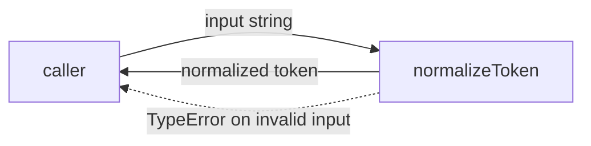
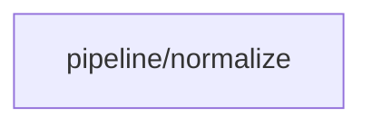

# Module: pipeline/normalize

<!--SECTION:SPEC_ID-->
TOKEN-PIPELINE-NORMALIZE
<!--/SECTION:SPEC_ID-->

<!--SECTION:MODULE_VISION-->
## Module Vision

`pipeline/normalize` владеет одной ответственностью внутри скоупа [token](../../token.spec.md): детерминированной нормализацией токена. Модуль реализует центральную операцию scope `normalizeToken`, не дублируя остальную спецификацию `token`; соседних и дочерних модулей у него нет.
<!--/SECTION:MODULE_VISION-->

<!--SECTION:OVERVIEW-->
## Overview


_Главный путь нормализации токена — NOR-REQ-1._
<!--/SECTION:OVERVIEW-->

<!--SECTION:MODULE_USAGE_EXAMPLE-->
## Module Usage Example

```ts
import { normalizeToken } from "./normalize";

const token = normalizeToken("  Foo__BAR  ");
// token === "foo-bar"

try {
  normalizeToken("");
} catch (error) {
  // error instanceof TypeError — invalid input is rejected, not normalized
}
```

Модуль не требует инициализации, конфигурации или ввода-вывода: вызывающий код передаёт строку и получает нормализованный токен либо `TypeError`.
<!--/SECTION:MODULE_USAGE_EXAMPLE-->

<!--SECTION:MODULE_REQUIREMENTS-->
## Requirements

### NOR-REQ-1 [должен]
**Когда** передана непустая ASCII-строка, **normalizeToken должен** обрезать крайние ASCII-пробелы, привести ASCII-буквы к нижнему регистру и свернуть последовательности пробелов, underscore и hyphen в один hyphen.

> Уточняет TOK-REQ-1: один детерминированный формат токена нужен локальным CLI и библиотечным потребителям без сети и состояния.

### NOR-REQ-2 [должен · нештатная]
**Если** строка пустая, состоит только из разделителей (ASCII-пробелов, underscore или hyphen) либо содержит не-ASCII символы, **то normalizeToken должен** выбросить `TypeError` без ввода-вывода.

> Уточняет TOK-REQ-2: ошибку входа нельзя маскировать пустым или частично нормализованным токеном.

| Input | Outcome |
|---|---|
| `"  Foo__BAR  "` | `"foo-bar"` |
| `""` | `TypeError` |
<!--/SECTION:MODULE_REQUIREMENTS-->

<!--SECTION:INTER_MODULE_DEPENDENCIES-->
## Inter-Module Dependencies

- **Depends on:** none — модуль не использует другие модули скоупа.
- **Scope Reference (cross-scope):** none — скоуп `token` имеет тип `library`, а не `interface`.
- **Provides to:** none — модуль не объявляет публичный интерфейс для соседних модулей.


_Внешних связей у модуля нет._
<!--/SECTION:INTER_MODULE_DEPENDENCIES-->

<!--SECTION:ENTITY_INVENTORY-->
## Entity Inventory

_Это полный список сущностей модуля. Любое введение сущности execution-агентом помимо этого списка считается drift'ом и требует обновления spec._

| Name | Type | Purpose |
|------|------|---------|
| `normalizeToken` | Function | Детерминированная нормализация строки в токен |

Ошибки: throw → `normalizeToken`

ER-скетч не рисуется: в инвентаре одна сущность, связывать нечего.
<!--/SECTION:ENTITY_INVENTORY-->

<!--SECTION:ENTITY_SURFACES-->
## Entity Surfaces

Одна публичная функция `normalizeToken`; полная поверхность и обработка ошибок — ниже.

<details>
<summary>Полные поверхности сущностей</summary>

### `normalizeToken`
- **Type:** Function
- **Purpose:** Приводит допустимую ASCII-строку к одному каноническому токену.
- **Public Properties:** N/A
- **Public Operations:** нормализовать входную строку в токен
- **Lifecycle:** создаётся как модульный экспорт при загрузке модуля; вызывается потребителем; состояния не хранит и не завершается.
- **Events Emitted:** N/A
- **Errors & Degradation:** `TypeError` механизмом throw для пустой строки, строки только из разделителей и любого не-ASCII входа; владелец — `normalizeToken`, вызывающий код не получает частичный результат.
- **Consumers:**
  - Internal: `normalize.ts`
  - External: локальные CLI- и библиотечные потребители
- **Usage Waiver (external: local CLI and library consumers):** Публичная точка входа скоупа `token`; существует ради внешних потребителей и не имеет внутренних вызовов до реализации.

</details>
<!--/SECTION:ENTITY_SURFACES-->

<!--SECTION:MODULE_CONTRACTS-->
## Module Contracts

Одна чистая Service-функция `normalizeToken`; Port и Adapter не вводятся.

Граф не рисуется: в модуле нет Port/Adapter, только Service `normalizeToken`.

Call Chain не рисуется: в модуле одна абстракция — Service `normalizeToken`.

<details>
<summary>Контракты DbC</summary>

### Services

#### Service: `normalizeToken`
- **Purpose:** Детерминированно нормализовать допустимую ASCII-строку в токен.
- **Consumers:** external: локальные CLI- и библиотечные потребители
- **Runtime Backing:** `not-implemented`
- **Verification Levels:** `contract`, `unit`
- **Deferred Runtime Scope:** Всё объявленное поведение не имеет реального рантайма: реализация не запрошена.

**Contract (DbC)** — одна операция:
- `normalizeToken`:
  - Pre: Вход — ASCII-строка, содержащая хотя бы один символ, не являющийся ASCII-пробелом, underscore или hyphen.
  - Post: Крайние ASCII-пробелы удалены; ASCII-буквы приведены к нижнему регистру; каждая максимальная последовательность ASCII-пробелов, underscore и hyphen заменена одним hyphen; остальные ASCII-символы сохранены без изменений.
  - On pre-violation: Для пустой строки, строки только из разделителей или любого не-ASCII входа выбрасывается `TypeError` до любого ввода-вывода и без частичного результата.

**Invariants:** Функция чистая и детерминированная: одинаковый вход даёт одинаковый результат, состояние не хранится, ввод-вывод не выполняется.

</details>
<!--/SECTION:MODULE_CONTRACTS-->

<!--SECTION:PUBLIC_OPTIONS-->
## Public Options & Policies

Публично настраиваемых опций нет; поведение фиксировано NOR-REQ-1 и NOR-REQ-2.

<details>
<summary>Опции и политики</summary>

Опции и политики не потребляются в v1: модуль не принимает флагов, конфигурации или параметров режима. Любое изменение политики нормализации требует изменения спецификации.

</details>
<!--/SECTION:PUBLIC_OPTIONS-->

<!--SECTION:FILE_STRUCTURE-->
## File Structure

```
normalize/
└── normalize.ts
```

**File Mapping:**
- `normalize.ts`: чистая функция `normalizeToken` и проверка входа на соответствие NOR-REQ-1 и NOR-REQ-2
<!--/SECTION:FILE_STRUCTURE-->

<!--SECTION:RESEARCH-->
## Research

Исследовательские документы для этого модуля не использовались: поведение полностью задано родительскими требованиями TOK-REQ-1 и TOK-REQ-2.
<!--/SECTION:RESEARCH-->

<!--SECTION:MODULE_DECISION_LOG-->
## Module Decision Log

Записано одно решение — отсутствие Port/Adapter у единственной чистой функции.

<details>
<summary>Полные записи Decision Log</summary>

NOR-DL-1 2026-10-23 — чистая функция `normalizeToken` без Port/Adapter; где: `specs/token/pipeline/normalize/normalize.spec.md#module-contracts` (почему: одна детерминированная реализация без подтверждённой вариативности не оправдывает абстракцию) [verdict: pending-operator]

</details>
<!--/SECTION:MODULE_DECISION_LOG-->

<!--SECTION:HANDOFF-->
## Handoff to Tasks

- **Implementation files to be created:** `normalize.ts`
- **Test files to be created:** `normalize.test.ts`
- **Stack dependencies:**
  - Language: `typescript` (resolves to `ai/directives/coding/typescript-rules.xml`)
  - Test framework: `node-test` (resolves to `ai/directives/testing/node-test.xml`)
- **Module Rules Additions:** None

- **Open risks & validation needs:** Реализация не создана, рантайм не подтверждён. При реализации нужно проверить, что проверка не-ASCII выполняется по кодовым точкам, а не по локали, и что `TypeError` возникает до любого ввода-вывода. Спецификация ожидает operator approval; тикеты не созданы.
<!--/SECTION:HANDOFF-->

<!--SECTION:IMPLEMENTATION_INSIGHTS-->
## Implementation Insights

Not applicable: реализации ещё нет, поэтому пост-имплементационных наблюдений нет.

<details>
<summary>Заметки по реализации</summary>

Раздел не применим до появления реализации и прохождения audit-cycle; добавление заметок сейчас было бы вымыслом.
</details>
<!--/SECTION:IMPLEMENTATION_INSIGHTS-->
