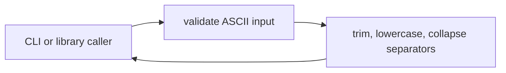
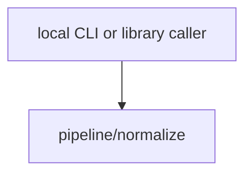

# Module: Token normalization

<!--SECTION:SPEC_ID-->
TOKEN-PIPELINE-NORMALIZE
<!--/SECTION:SPEC_ID-->

<!--SECTION:MODULE_VISION-->
## Module Vision
Owns the deterministic transformation of one ASCII token into its canonical form inside the `token` scope. It exposes the public `normalizeToken` surface to the parent scope, has no sibling modules, and delegates nothing to other modules.

Родительский скоуп: [token](../../token.spec.md). Соседних модулей нет.
<!--/SECTION:MODULE_VISION-->

<!--SECTION:OVERVIEW-->
## Overview


_Путь нормализации одного токена — TOK-REQ-1, TOK-REQ-2._
<!--/SECTION:OVERVIEW-->

<!--SECTION:MODULE_USAGE_EXAMPLE-->
## Module Usage Example
Отдельного setup нет: функция импортируется напрямую, без сети и без конфигурации.

```ts
import { normalizeToken } from "./normalize.ts";

const token = normalizeToken("  Foo__BAR  ");
console.log(token);

try {
  normalizeToken("");
} catch (error) {
  if (!(error instanceof TypeError)) throw error;
  console.log("invalid token");
}
```

Успешный вызов показывает канонический токен `foo-bar`; второй вызов демонстрирует отказ на пустом вводе через `TypeError`.
<!--/SECTION:MODULE_USAGE_EXAMPLE-->

<!--SECTION:MODULE_REQUIREMENTS-->
## Requirements
No module-specific requirements. Implements parent requirements: TOK-REQ-1, TOK-REQ-2.

| Input | Outcome |
|---|---|
| `"  Foo__BAR  "` | `"foo-bar"` |
| `""` | `TypeError` |
<!--/SECTION:MODULE_REQUIREMENTS-->

<!--SECTION:INTER_MODULE_DEPENDENCIES-->
## Inter-Module Dependencies
- **Depends on:** no sibling modules inside the `token` scope.
- **Scope Reference (cross-scope):** none at module runtime; the parent scope lists [infra-base](../../../infra-base/infra-base.spec.md) only as authoring infrastructure.
- **Provides to:** no sibling modules; the module is the public normalization surface of the scope.


_Потребители модуля и отсутствие соседних зависимостей._
<!--/SECTION:INTER_MODULE_DEPENDENCIES-->

<!--SECTION:ENTITY_INVENTORY-->
## Entity Inventory
_Это полный список сущностей модуля. Любое введение сущности execution-агентом помимо этого списка считается drift'ом и требует обновления spec._

| Name | Type | Purpose |
|------|------|---------|
| `normalizeToken` | Function | Чистая функция нормализации ASCII-токена |

Ошибки: throw TypeError → `normalizeToken`.

Одна сущность без связей; ER-эскиз не рисуется.
<!--/SECTION:ENTITY_INVENTORY-->

<!--SECTION:ENTITY_SURFACES-->
## Entity Surfaces
Модуль содержит одну публичную функцию `normalizeToken`; её полная поверхность раскрыта ниже.

<details>
<summary>Полные поверхности сущностей</summary>

### `normalizeToken`
- **Type:** Function
- **Purpose:** Приводит ASCII-токен к канонической форме или отклоняет недопустимый ввод.
- **Public Properties:** N/A
- **Public Operations:** `normalizeToken` — нормализует один строковый токен.
- **Lifecycle:** Создаётся при загрузке модуля; не хранит состояния; существует до завершения процесса.
- **Events Emitted:** N/A
- **Errors & Degradation:** `TypeError` через throw; владелец — `normalizeToken`, ошибка передаётся внешнему вызывающему.
- **Consumers:**
  - Internal: нет; модуль является корнем своей ответственности.
  - External: local CLI and library callers
- **Usage Waiver (external: local CLI and library consumers):** единственная публичная точка модуля; потребители находятся вне его границ.

</details>
<!--/SECTION:ENTITY_SURFACES-->

<!--SECTION:MODULE_CONTRACTS-->
## Module Contracts
Один чистый Service без Port и Adapter; контракт операции раскрыт ниже.

Граф не рисуется: в модуле нет Port/Adapter, только Service `normalizeToken`.
Call Chain не рисуется: одна сущность — Service `normalizeToken`.

<details>
<summary>Контракты DbC</summary>

### Services

#### Service: `normalizeToken`
- **Purpose:** Детерминированно нормализует один ASCII-токен.
- **Consumers:** external: local CLI and library callers
- **Runtime Backing:** `not-implemented`
- **Verification Levels:** `contract`, `unit`
- **Deferred Runtime Scope:** Весь объявленный функционал — реализация не запрошена.

**Contract (DbC)** — one block per operation:
- `normalizeToken`:
  - Pre: `input` — строка, все символы которой ASCII, и после удаления крайних пробелов она содержит хотя бы один символ, не являющийся пробелом, underscore или hyphen.
  - Post: возвращает строку без крайних ASCII-пробелов, с ASCII-буквами в нижнем регистре и с каждым непрерывным рядом пробелов, underscore и hyphen, заменённым одним hyphen.
  - On pre-violation: для пустой строки, строки только из разделителей или строки с не-ASCII символом выбрасывает `TypeError` без ввода-вывода.

**Invariants**: функция не выполняет ввод-вывод и не хранит состояние между вызовами; одинаковый валидный ввод даёт одинаковый результат.

</details>
<!--/SECTION:MODULE_CONTRACTS-->

<!--SECTION:PUBLIC_OPTIONS-->
## Public Options & Policies
Модуль не предоставляет публичных флагов, опций или политик в v1.

<details>
<summary>Опции и политики</summary>

Ничего не настраивается; отложенных публичных опций не объявлено.

</details>
<!--/SECTION:PUBLIC_OPTIONS-->

<!--SECTION:FILE_STRUCTURE-->
## File Structure
```
pipeline/normalize/
├── normalize.ts
└── normalize.test.ts
```

**File Mapping:**
- `normalize.ts`: реализация `normalizeToken`
- `normalize.test.ts`: unit-тесты нормализации и отказов
<!--/SECTION:FILE_STRUCTURE-->

<!--SECTION:RESEARCH-->
## Research
No research documents feed this module.
<!--/SECTION:RESEARCH-->

<!--SECTION:MODULE_DECISION_LOG-->
## Module Decision Log
Записано одно решение: отсутствие Port/Adapter для чистой функции.

<details>
<summary>Полные записи Decision Log</summary>

NOR-DL-1 2026-10-23 — чистая функция реализуется как Service без Port и Adapter (почему: нет подтверждённой вариативности и внешней зависимости; отвергнуто: отдельный Port ради тестового шва — избыточен для одной детерминированной операции; риск: смена границы потребует нового решения) [verdict: pending-operator]

</details>
<!--/SECTION:MODULE_DECISION_LOG-->

<!--SECTION:HANDOFF-->
## Handoff to Tasks
- **Implementation files to be created:** `normalize.ts` (not created by this authoring pass)
- **Test files to be created:** `normalize.test.ts`
- **Stack dependencies:**
  - Language: `typescript` (resolves to `ai/directives/coding/typescript-rules.xml`)
  - Test framework: `node-test` (resolves to `ai/directives/testing/node-test.xml`)
- **Module Rules Additions:** None.
- **Open risks & validation needs:** Операторское одобрение отсутствует; реализация не запрошена, поэтому поведение и runtime не проверены.
<!--/SECTION:HANDOFF-->

<!--SECTION:IMPLEMENTATION_INSIGHTS-->
## Implementation Insights
Not applicable: no implementation has been performed, so there are no post-implementation insights.
<!--/SECTION:IMPLEMENTATION_INSIGHTS-->
