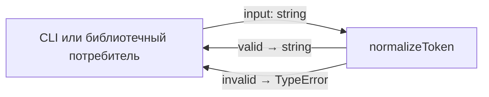
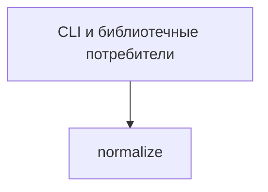

# Module: normalize

<!--SECTION:SPEC_ID-->
TOKEN-PIPELINE-NORMALIZE
<!--/SECTION:SPEC_ID-->

<!--SECTION:MODULE_VISION-->
## Module Vision

Модуль `normalize` владеет единственной ответственностью — детерминированным преобразованием ASCII-токена. Он реализует контракт родительского скоупа [`token`](../../token.spec.md) и не имеет дочерних или соседних модулей в этом скоупе. Исходный контракт зафиксирован в [`docs/token-contract.md`](../../../../docs/token-contract.md).

Границы модуля: только чистое преобразование строки в строку и отказ `TypeError` на некорректном входе. Сеть, файлы, конфигурация и хранение состояния не входят в модуль.
<!--/SECTION:MODULE_VISION-->

<!--SECTION:OVERVIEW-->
## Overview


_Основной поток: нормализация корректного ASCII-входа или явный отказ — NOR-REQ-1, NOR-REQ-2._
<!--/SECTION:OVERVIEW-->

<!--SECTION:MODULE_USAGE_EXAMPLE-->
## Module Usage Example

Целевой язык — TypeScript. Фрагмент показывает изолированный вызов модуля; реализация не создаётся этой задачей.

```ts
import { normalizeToken } from "./normalize.js";

const token = normalizeToken("  Foo__BAR  ");
console.log(token);

try {
  normalizeToken("");
} catch (error) {
  console.error(error instanceof TypeError ? "TypeError" : "unexpected error");
}
```

Счастливый путь получает нормализованный токен `foo-bar`; нештатный путь получает синхронный `TypeError` без побочных эффектов.
<!--/SECTION:MODULE_USAGE_EXAMPLE-->

<!--SECTION:MODULE_REQUIREMENTS-->
## Requirements

### NOR-REQ-1 [должен]
**Когда** на вход передана непустая ASCII-строка, **нормализатор должен** обрезать крайние ASCII-пробелы, привести ASCII-буквы к нижнему регистру и свернуть серии пробелов, подчёркиваний и дефисов в один дефис.

> Уточняет TOK-REQ-1: модуль фиксирует точный детерминированный формат токена, который используют CLI и библиотечные потребители.

### NOR-REQ-2 [должен · нештатная]
**Если** входная строка пустая, состоит только из разделителей или содержит не-ASCII символ, **то нормализатор должен** выбросить `TypeError` без ввода-вывода.

> Уточняет TOK-REQ-2: явный отказ не позволяет маскировать некорректный ввод пустым корректным токеном.

Проверочные примеры:

| Input | Outcome |
|---|---|
| `"  Foo__BAR  "` | `"foo-bar"` |
| `""` | `TypeError` |
<!--/SECTION:MODULE_REQUIREMENTS-->

<!--SECTION:INTER_MODULE_DEPENDENCIES-->
## Inter-Module Dependencies

- **Depends on:** None — модуль не зависит от других модулей этого скоупа.
- **Scope Reference (cross-scope):** None — runtime-зависимостей от другого скоупа нет.
- **Provides to:** CLI и библиотечные потребители; других модулей этого скоупа нет.


_У модуля нет зависимостей от соседних модулей; его вызывает только внешний потребитель._
<!--/SECTION:INTER_MODULE_DEPENDENCIES-->

<!--SECTION:ENTITY_INVENTORY-->
## Entity Inventory

_Это полный список сущностей модуля. Любое введение сущности execution-агентом помимо этого списка считается drift'ом и требует обновления spec._

| Name | Type | Purpose |
|------|------|---------|
| `normalizeToken` | Function | Детерминированная нормализация ASCII-токена |

Ошибки: throw `TypeError` → `normalizeToken`.

Одна сущность без связей — ER-эскиз не требуется: связывать нечего.
<!--/SECTION:ENTITY_INVENTORY-->

<!--SECTION:ENTITY_SURFACES-->
## Entity Surfaces

Публичная поверхность модуля состоит из одной функции; детали раскрыты ниже.

<details>
<summary>Полные поверхности сущностей</summary>

### `normalizeToken`
- **Type:** Function
- **Purpose:** Преобразует корректный ASCII-вход в нормализованный токен или выбрасывает `TypeError`.
- **Public Properties:** N/A
- **Public Operations:** `normalizeToken(input)` — принять строку и вернуть нормализованный токен; на некорректном входе выбросить `TypeError`.
- **Lifecycle:** Чистая функция без состояния; вызывается по требованию и завершается сразу после возврата или исключения.
- **Events Emitted:** N/A
- **Errors & Degradation:** `TypeError` через throw; обработку и отображение выполняет вызывающий потребитель.
- **Consumers:**
  - Internal: N/A
  - External: CLI и библиотечные потребители
- **Usage Waiver (external: CLI и библиотечные потребители):** Единственная публичная функция модуля, созданная именно для этих потребителей.

</details>
<!--/SECTION:ENTITY_SURFACES-->

<!--SECTION:MODULE_CONTRACTS-->
## Module Contracts

Модуль предоставляет одну чистую функцию; Ports и Adapters отсутствуют.

Граф не рисуется: в модуле нет Port/Adapter, только Function `normalizeToken` — NOR-REQ-1, NOR-REQ-2.

Цепочка вызовов не рисуется: в модуле одна абстракция `normalizeToken`, вызовов между абстракциями нет.

<details>
<summary>Контракты DbC</summary>

### Services

#### Service: `normalizeToken`
- **Purpose:** Детерминированно нормализовать ASCII-токен и явно отклонять некорректный вход.
- **Consumers:** CLI и библиотечные потребители.
- **Runtime Backing:** `not-implemented`
- **Verification Levels:** `contract`, `unit`
- **Deferred Runtime Scope:** Реализация и runtime не входят в эту authoring-задачу.

**Contract (DbC)** — one block per operation:
- `normalizeToken`:
  - Pre: `input` — строка, содержащая хотя бы один ASCII-символ, отличный от пробела, подчёркивания и дефиса, и не содержащая не-ASCII символов.
  - Post: Возвращается строка без крайних ASCII-пробелов, с ASCII-буквами в нижнем регистре и с каждой серией ASCII-пробелов, подчёркиваний или дефисов, заменённой одним дефисом.
  - On pre-violation: Синхронно выбрасывается `TypeError`; ввод-вывод не выполняется.

**Invariants:** Функция чистая и детерминированная: результат зависит только от входа, вход не мутируется, ввод-вывод отсутствует.

</details>
<!--/SECTION:MODULE_CONTRACTS-->

<!--SECTION:PUBLIC_OPTIONS-->
## Public Options & Policies

Публичных опций нет: модуль не принимает флагов, настроек или политик.

<details>
<summary>Опции и политики</summary>

Не применимо — единственная операция `normalizeToken` не имеет конфигурации и не читает внешних политик.
</details>
<!--/SECTION:PUBLIC_OPTIONS-->

<!--SECTION:FILE_STRUCTURE-->
## File Structure

```
normalize/
└── normalize.ts
```

**File Mapping:**
- `normalize.ts`: реализация экспортируемой функции `normalizeToken`.
<!--/SECTION:FILE_STRUCTURE-->

<!--SECTION:RESEARCH-->
## Research

Не применимо: отдельного ресёрча нет, контракт модуля выведен из TOK-REQ-1 и TOK-REQ-2 родительского скоупа.
<!--/SECTION:RESEARCH-->

<!--SECTION:MODULE_DECISION_LOG-->
## Module Decision Log

Записано одно решение: нормализация реализуется чистой функцией без Port/Adapter.

<details>
<summary>Полные записи Decision Log</summary>

NOR-DL-1 2026-10-23 — Нормализация реализуется одной чистой функцией без Port/Adapter (почему: одна реализация и нет подтверждённой вариативности; отвергнуто: Port ради тестового шва — избыточен для чистой функции; риск: нет).

</details>
<!--/SECTION:MODULE_DECISION_LOG-->

<!--SECTION:HANDOFF-->
## Handoff to Tasks

- **Implementation files to be created:** `normalize.ts`
- **Test files to be created:** `normalize.test.ts`
- **Stack dependencies:**
  - Language: `typescript` (resolves to `ai/directives/coding/typescript-rules.xml`)
  - Test framework: `node-test` (resolves to `ai/directives/testing/node-test.xml`)
- **Module Rules Additions:** None.
- **Open risks & validation needs:** Реализация и тесты не созданы; авторская граница модуля остаётся `pending-operator`, операторское одобрение не получено.
<!--/SECTION:HANDOFF-->

<!--SECTION:IMPLEMENTATION_INSIGHTS-->
## Implementation Insights

Не применимо: реализация не выполнялась, пост-имплементационных наблюдений нет.
<!--/SECTION:IMPLEMENTATION_INSIGHTS-->
