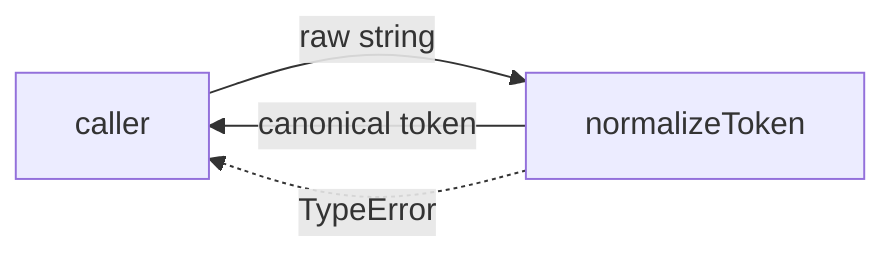
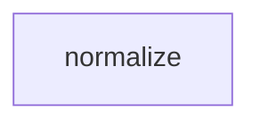

# Module: normalize

<!--SECTION:SPEC_ID-->
TOKEN-PIPELINE-NORMALIZE
<!--/SECTION:SPEC_ID-->

<!--SECTION:MODULE_VISION-->
## Module Vision

Owns the single deterministic token-normalization step of the `token` scope: turning one raw input
string into the canonical token format. This module refines [the token scope](../../token.spec.md)
and has no sibling modules and no child modules; it is the only module in `pipeline/normalize`.
The module is stateless and local — no network, persistence, or configuration is owned here.
<!--/SECTION:MODULE_VISION-->

<!--SECTION:OVERVIEW-->
## Overview


_Один чистый шаг: строка входит, нормализованный токен или TypeError выходит — NOR-REQ-1, NOR-REQ-2._
<!--/SECTION:OVERVIEW-->

<!--SECTION:MODULE_USAGE_EXAMPLE-->
## Module Usage Example

Illustrative target-language usage of the contract below; the module is **not implemented** by this
authoring pass, so this snippet defines intent only and makes no runtime claim.

```ts
import { normalizeToken } from "./normalize";

const token = normalizeToken("  Foo__BAR  ");
// happy path: "foo-bar" — surrounding spaces trimmed, ASCII letters lowercased,
// the run "__" (and any space/hyphen run) collapsed into one hyphen

try {
  normalizeToken("");
} catch (error) {
  // minimal error path: invalid input is rejected, never silently returned as ""
  // error instanceof TypeError === true
}
```
<!--/SECTION:MODULE_USAGE_EXAMPLE-->

<!--SECTION:MODULE_REQUIREMENTS-->
## Requirements

### NOR-REQ-1 [должен]
**Когда** передана непустая ASCII-строка с хотя бы одним не-разделительным символом, **нормализатор должен** обрезать ведущие и замыкающие ASCII-пробелы, привести ASCII-буквы к нижнему регистру и свернуть каждую серию пробелов, underscore и hyphen в один hyphen.

> Уточняет TOK-REQ-1: один модуль владеет точной формой канонического токена, чтобы CLI и библиотечные потребители получали одинаковый результат.

### NOR-REQ-2 [должен · нештатная]
**Если** вход пустой, состоит только из разделителей (пробелы, underscore, hyphen) или содержит не-ASCII символы, **то нормализатор должен** выбросить `TypeError` без ввода-вывода.

> Уточняет TOK-REQ-2: ошибку входа нельзя маскировать пустым или частично нормализованным токеном; отказ происходит до любого I/O.

| Input | Outcome |
|---|---|
| `"  Foo__BAR  "` | `"foo-bar"` |
| `""` | `TypeError` |
<!--/SECTION:MODULE_REQUIREMENTS-->

<!--SECTION:INTER_MODULE_DEPENDENCIES-->
## Inter-Module Dependencies

- **Depends on:** нет — у модуля нет зависимостей от соседних модулей внутри scope.
- **Scope Reference (cross-scope):** нет — [token](../../token.spec.md) — это родительский library scope, а не внешний interface scope.
- **Provides to:** нет — модуль не предоставляет поверхность соседним модулям внутри scope.


_У модуля нет рёбер к соседям: только собственная точка нормализации и родительский scope token — NOR-REQ-1, NOR-REQ-2._
<!--/SECTION:INTER_MODULE_DEPENDENCIES-->

<!--SECTION:ENTITY_INVENTORY-->
## Entity Inventory

_Это полный список сущностей модуля. Любое введение сущности execution-агентом помимо этого списка считается drift'ом и требует обновления spec._

| Name | Type | Purpose |
|------|------|---------|
| `normalizeToken` | Function | Детерминированно приводит входную строку к каноническому токену; владеет отказом `TypeError`. |

Ошибки: throw `TypeError` → владелец `normalizeToken`.

Инвентарь содержит одну сущность без связей; ER-набросок не рисуется.
<!--/SECTION:ENTITY_INVENTORY-->

<!--SECTION:ENTITY_SURFACES-->
## Entity Surfaces

Одна публичная сущность — чистая функция `normalizeToken`; полная поверхность ниже.

<details>
<summary>Полные поверхности сущностей</summary>

### `normalizeToken`
- **Type:** Function
- **Purpose:** Обрезает ASCII-пробелы, приводит ASCII-буквы к нижнему регистру и сворачивает серии пробелов, underscore и hyphen в один hyphen.
- **Public Properties:** N/A
- **Public Operations:** нормализовать строку в канонический токен
- **Lifecycle:** создаётся при импорте модуля; вызывается потребителем на каждый вход; состояния между вызовами не сохраняет.
- **Events Emitted:** N/A
- **Errors & Degradation:** `TypeError` через `throw` для пустого входа, входа только из разделителей и не-ASCII входа; обрабатывается вызывающим кодом, модуль ошибку не проглатывает.
- **Consumers:**
  - Internal: `specs/token/pipeline/normalize/normalize.ts`
  - External: CLI и библиотечные потребители scope `token`
- **Usage Waiver (external: token CLI and library consumers):** Модуль является единственной публичной точкой нормализации scope; один вызов на токен — ожидаемый контракт, а не дублирование.

</details>
<!--/SECTION:ENTITY_SURFACES-->

<!--SECTION:MODULE_CONTRACTS-->
## Module Contracts

Модуль содержит один Service (`normalizeToken`) и не вводит Port или Adapter: вариативности
реализации нет, поэтому абстракция не нужна. Контракт операции — ниже.

Граф не рисуется: в модуле нет Port/Adapter, только Service `normalizeToken`.

**Call Chain (main scenario):** модуль содержит одну абстракцию, поэтому цепочка вызовов
описывается одной строкой: `caller → normalizeToken → caller`.

<details>
<summary>Контракты DbC</summary>

### Services

#### Service: `normalizeToken`
- **Purpose:** Детерминированно приводит входную строку к каноническому токену.
- **Consumers:** internal `specs/token/pipeline/normalize/normalize.ts` · external CLI и библиотечные потребители
- **Runtime Backing:** `not-implemented`
- **Verification Levels:** `contract`, `unit`
- **Deferred Runtime Scope:** Вся реализация отложена до scaffold/execute; этот артефакт описывает только контракт.

**Contract (DbC)** — одна операция:
- `normalizeToken(input)`:
  - Pre: `input` — строка, состоящая только из ASCII-символов, и содержит хотя бы один не-разделительный символ (не пробел, не `_`, не `-`).
  - Post: ведущие и замыкающие ASCII-пробелы удалены; ASCII-буквы приведены к нижнему регистру; каждая серия пробелов, underscore и hyphen заменена одним hyphen.
  - On pre-violation: выбрасывается `TypeError`; ввод-вывод не выполняется, частичный результат не возвращается.

**Invariants:** Функция не сохраняет состояние между вызовами и не выполняет ввод-вывод; одинаковый вход даёт одинаковый результат.

</details>
<!--/SECTION:MODULE_CONTRACTS-->

<!--SECTION:PUBLIC_OPTIONS-->
## Public Options & Policies

Not applicable: модуль не имеет публично наблюдаемых флагов, опций или политик; единственная
поверхность — сигнатура `normalizeToken(input: string): string`.

<details>
<summary>Опции и политики</summary>

Опций нет. Любая будущая опция (например, настраиваемый набор разделителей) должна быть явно
добавлена в контракт выше или помечена `deferred / not consumed in v1` со ссылкой на активирующий
ticket.

</details>
<!--/SECTION:PUBLIC_OPTIONS-->

<!--SECTION:FILE_STRUCTURE-->
## File Structure

```
specs/token/pipeline/normalize/
├── normalize.ts
└── normalize.test.ts
```

**File Mapping:**
- `normalize.ts`: реализация `normalizeToken` (Function)
- `normalize.test.ts`: unit-тесты контракта `NOR-REQ-1`, `NOR-REQ-2`
<!--/SECTION:FILE_STRUCTURE-->

<!--SECTION:RESEARCH-->
## Research

Not applicable: у scope `token` нет каталога `specs/token/research/`, и для этого ограниченного
детерминированного черновика ресёрч не проводился.

| Документ | Что ресёрчили | Что дал для спеки |
|---|---|---|
| — | Ресёрч не проводился | — |
<!--/SECTION:RESEARCH-->

<!--SECTION:MODULE_DECISION_LOG-->
## Module Decision Log

Одно решение: почему модуль остаётся чистым Service без Port/Adapter.

<details>
<summary>Полные записи Decision Log</summary>

NOR-DL-1 2026-10-23 — оставить `normalizeToken` единственным чистым Service без Port и Adapter; где: `specs/token/pipeline/normalize/normalize.spec.md#module-contracts` (почему: вариативности реализации и тестового seam нет; отвергнуто: Port ради единой реализации — лишний слой).

</details>
<!--/SECTION:MODULE_DECISION_LOG-->

<!--SECTION:HANDOFF-->
## Handoff to Tasks

- **Implementation files to be created:** `pipeline/normalize/normalize.ts` — планируемый артефакт; в этом authoring-проходе не создаётся и не исполняется.
- **Test files to be created:** `pipeline/normalize/normalize.test.ts`
- **Stack dependencies:**
  - Language: `TypeScript` (resolves to `ai/directives/coding/typescript-rules.xml`)
  - Test framework: `Vitest` (resolves to `ai/directives/testing/vitest-rules.xml`)
- **Module Rules Additions:** `None` — модуль не добавляет правил сверх scope-wide baseline.

- **Open risks & validation needs:** Реализация и тесты отсутствуют; контракт NOR-REQ-1 и NOR-REQ-2 не проверен исполнением. Authoring не утверждён оператором: статус `pending-operator`, тикеты не созданы, выполнение не начиналось.
<!--/SECTION:HANDOFF-->
