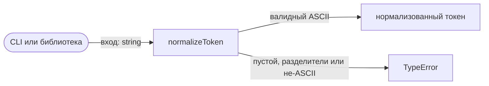
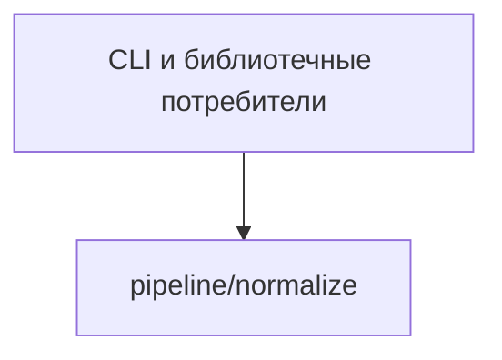

# Module: normalize

<!--SECTION:SPEC_ID-->
TOKEN-PIPELINE-NORMALIZE
<!--/SECTION:SPEC_ID-->

<!--SECTION:MODULE_VISION-->
## Module Vision
Модуль `pipeline/normalize` владеет единственной детерминированной операцией нормализации ASCII-токена в скоупе [token](../../token.spec.md). Он не зависит от других модулей скоупа и не владеет CLI-интерфейсом: CLI и библиотечные потребители вызывают его как чистую функцию.
<!--/SECTION:MODULE_VISION-->

<!--SECTION:OVERVIEW-->
## Overview


_Поток нормализации токена и отклонения недопустимого входа — NOR-REQ-1, NOR-REQ-2._
<!--/SECTION:OVERVIEW-->

<!--SECTION:MODULE_USAGE_EXAMPLE-->
## Module Usage Example
```ts
import { normalizeToken } from './normalize.js';

const token = normalizeToken('  Foo__BAR  ');
// token === 'foo-bar'

try {
  normalizeToken('');
} catch (error) {
  // error instanceof TypeError: недопустимый вход
}
```
Модуль не требует настройки и не обращается к сети или хранилищу. Счастливый путь возвращает канонический токен, а минимальная обработка ошибки показывает, что недопустимый вход отклоняется исключением.
<!--/SECTION:MODULE_USAGE_EXAMPLE-->

<!--SECTION:MODULE_REQUIREMENTS-->
## Requirements
### NOR-REQ-1 [должен]
**Когда** передана непустая ASCII-строка с хотя бы одним не-разделителем, **нормализатор должен** удалить ведущие и хвостовые ASCII-пробелы, привести ASCII-буквы к нижнему регистру и заменить каждую серию ASCII-пробелов, underscore и hyphen внутри строки одним hyphen.

> Уточняет родительское требование TOK-REQ-1: задаёт точную нормализацию, которую реализует этот модуль.

### NOR-REQ-2 [должен · нештатная]
**Если** вход пустой, состоит только из разделителей или содержит не-ASCII символ, **то нормализатор должен** выбросить TypeError без ввода-вывода.

> Уточняет родительское требование TOK-REQ-2: недопустимый вход нельзя маскировать пустым корректным токеном.

| Input | Outcome |
|---|---|
| `"  Foo__BAR  "` | `"foo-bar"` |
| `""` | `TypeError` |
<!--/SECTION:MODULE_REQUIREMENTS-->

<!--SECTION:INTER_MODULE_DEPENDENCIES-->
## Inter-Module Dependencies
- **Depends on:** нет модулей этого скоупа.
- **Scope Reference (cross-scope):** None.
- **Provides to:** нет модулей этого скоупа; единственный потребитель — внешний CLI или библиотечный код.


_Единственная связь модуля — вызов из внешнего потребителя._
<!--/SECTION:INTER_MODULE_DEPENDENCIES-->

<!--SECTION:ENTITY_INVENTORY-->
## Entity Inventory
_Это полный список сущностей модуля. Любое введение сущности execution-агентом помимо этого списка считается drift'ом и требует обновления spec._

| Name | Type | Purpose |
|---|---|---|
| `normalizeToken` | Function | Детерминированно нормализует ASCII-токен |

Ошибки: throw `TypeError` → `normalizeToken`

ER-эскиз не рисуется: в инвентаре одна сущность без связей.
<!--/SECTION:ENTITY_INVENTORY-->

<!--SECTION:ENTITY_SURFACES-->
## Entity Surfaces
Одна публичная функция `normalizeToken`; её полная поверхность раскрыта ниже.

<details>
<summary>Полные поверхности сущностей</summary>

### `normalizeToken`
- **Type:** Function
- **Purpose:** Детерминированно преобразует ASCII-токен в канонический вид.
- **Public Properties:** N/A
- **Public Operations:** `normalizeToken(input: string): string`
- **Lifecycle:** Состояния нет; функция доступна на протяжении времени жизни процесса потребителя.
- **Events Emitted:** N/A
- **Errors & Degradation:** `TypeError` через throw для пустого, разделительного или не-ASCII входа; ошибку обрабатывает вызывающий код.
- **Consumers:**
  - Internal: нет внутренних потребителей
  - External: CLI и библиотечные потребители
- **Usage Waiver (external: CLI и библиотечные потребители):** Единственная публичная операция модуля.

</details>
<!--/SECTION:ENTITY_SURFACES-->

<!--SECTION:MODULE_CONTRACTS-->
## Module Contracts
Модуль предоставляет одну чистую функцию `normalizeToken`; Port и Adapter отсутствуют.

Граф не рисуется: в модуле нет Port/Adapter, только Service `normalizeToken`.

Call Chain не рисуется: в инвентаре одна абстракция, это ниже порога ≥2.

<details>
<summary>Контракты DbC</summary>

### Services

#### Service: `normalizeToken`
- **Purpose:** Нормализует непустой ASCII-токен по правилам скоупа.
- **Consumers:** CLI и библиотечные потребители.
- **Runtime Backing:** `not-implemented`
- **Verification Levels:** `contract`, `unit`
- **Deferred Runtime Scope:** Реализация и тесты не созданы в этой authoring-задаче.
- **Usage Waiver (external: CLI и библиотечные потребители):** Единственная публичная операция модуля.

**Contract (DbC)**
- `normalizeToken`:
  - Pre: Вход — строка, непустая, состоящая только из ASCII-символов и содержащая хотя бы один не-разделитель.
  - Post: Ведущие и хвостовые ASCII-пробелы удалены, ASCII-буквы переведены в нижний регистр, каждая серия ASCII-пробелов, `_` и `-` внутри строки заменена одним `-`.
  - On pre-violation: Пустой вход, вход только из разделителей или вход с не-ASCII символом приводят к `TypeError` через throw без ввода-вывода.

**Invariants:** Операция не выполняет ввод-вывод, не хранит состояние и детерминированно возвращает один и тот же результат для одного и того же входа.

</details>
<!--/SECTION:MODULE_CONTRACTS-->

<!--SECTION:PUBLIC_OPTIONS-->
## Public Options & Policies
Нет публичных опций: операция `normalizeToken` не принимает флагов или политик.

<details>
<summary>Опции и политики</summary>

Публичных флагов, опций и политик в v1 нет. Поведение полностью задано контрактом `normalizeToken`.

</details>
<!--/SECTION:PUBLIC_OPTIONS-->

<!--SECTION:FILE_STRUCTURE-->
## File Structure
```
src/token/pipeline/normalize/
├── normalize.ts
└── normalize.test.ts
```

**File Mapping:**
- `src/token/pipeline/normalize/normalize.ts`: реализация функции `normalizeToken`
- `src/token/pipeline/normalize/normalize.test.ts`: контрактные тесты функции `normalizeToken`
<!--/SECTION:FILE_STRUCTURE-->

<!--SECTION:RESEARCH-->
## Research
Ресёрч-документов нет: поведение задано контрактом скоупа и документом `docs/token-contract.md`.
<!--/SECTION:RESEARCH-->

<!--SECTION:MODULE_DECISION_LOG-->
## Module Decision Log
Зафиксировано одно решение: отсутствие Port/Adapter при одной чистой функции.

<details>
<summary>Полные записи Decision Log</summary>

NOR-DL-1 2026-10-23 — Модуль остаётся одной чистой функцией без Port/Adapter; где: specs/token/pipeline/normalize/normalize.spec.md#module-contracts (почему: подтверждённой вариативности и тестового шва нет) [verdict: pending-operator]

</details>
<!--/SECTION:MODULE_DECISION_LOG-->

<!--SECTION:HANDOFF-->
## Handoff to Tasks
- **Status:** pending-operator — операторское одобрение не получено.
- **Implementation files to be created:** `src/token/pipeline/normalize/normalize.ts`
- **Test files to be created:** `src/token/pipeline/normalize/normalize.test.ts`
- **Stack dependencies:**
  - Language: `typescript` (resolves to `ai/directives/coding/typescript-rules.xml`)
  - Test framework: `node-test` (resolves to `ai/directives/testing/node-test.xml`)
- **Module Rules Additions:** None.
- **Open risks & validation needs:** Реализация и тесты отсутствуют; runtime-поведение не проверялось.
<!--/SECTION:HANDOFF-->

<!--SECTION:IMPLEMENTATION_INSIGHTS-->
## Implementation Insights
Не применимо: реализация не выполнялась, пост-имплементационных наблюдений нет.

<details>
<summary>Заметки по реализации</summary>

Не применимо: раздел заполняется только после появления нетривиальных пост-имплементационных наблюдений.

</details>
<!--/SECTION:IMPLEMENTATION_INSIGHTS-->
