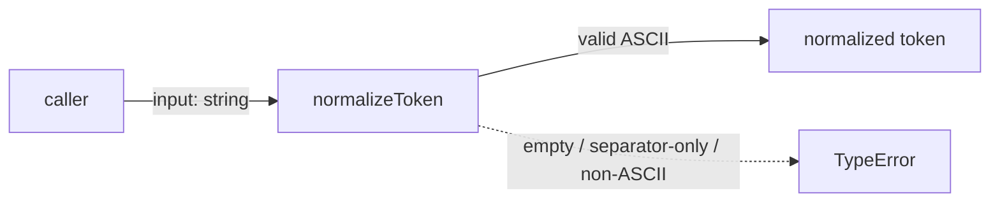
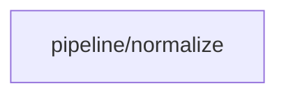

# Module: Normalize

<!--SECTION:SPEC_ID-->
TOKEN-PIPELINE-NORMALIZE
<!--/SECTION:SPEC_ID-->

<!--SECTION:MODULE_VISION-->
## Module Vision
Модуль `pipeline/normalize` владеет единственной операцией нормализации ASCII-токена в скоупе [`token`](../../token.spec.md). Других модулей в этом скоупе нет; дочерних модулей у `pipeline/normalize` тоже нет.
<!--/SECTION:MODULE_VISION-->

<!--SECTION:OVERVIEW-->
## Overview

_Нормализация допустимого ASCII-токена и отказ на недопустимом вводе — NOR-REQ-1, NOR-REQ-2._
<!--/SECTION:OVERVIEW-->

<!--SECTION:MODULE_USAGE_EXAMPLE-->
## Module Usage Example
Импорт единственной функции не требует настройки. Ниже изолированно показаны happy-path и отказ на пустом вводе.

```ts
import { normalizeToken } from "./normalize.ts";

const canonical = normalizeToken("  Foo__BAR  ");
console.log(canonical);

try {
  normalizeToken("");
} catch (error) {
  console.error(error instanceof TypeError);
}
```
<!--/SECTION:MODULE_USAGE_EXAMPLE-->

<!--SECTION:MODULE_REQUIREMENTS-->
## Requirements
### NOR-REQ-1 [должен]
**Когда** передана непустая ASCII-строка, содержащая хотя бы один символ вне ASCII-пробела, underscore и hyphen, **normalizeToken должен** обрезать крайние ASCII-пробелы, привести ASCII-буквы к нижнему регистру и свернуть каждую серию ASCII-пробелов, underscore и hyphen в один hyphen.

> Уточняет TOK-REQ-1: модуль фиксирует единственный детерминированный формат токена для CLI и библиотечных потребителей.

### NOR-REQ-2 [должен · нештатная]
**Если** входная строка пустая, состоит только из ASCII-пробелов, underscore и hyphen или содержит не-ASCII символ, **то normalizeToken должен** синхронно выбросить TypeError без ввода-вывода и не возвращать токен.

> Уточняет TOK-REQ-2: ошибку входа нельзя маскировать пустым или искажённым токеном.

Проверочные примеры:

| Input | Outcome |
|---|---|
| `"  Foo__BAR  "` | `"foo-bar"` |
| `""` | `TypeError` |
<!--/SECTION:MODULE_REQUIREMENTS-->

<!--SECTION:INTER_MODULE_DEPENDENCIES-->
## Inter-Module Dependencies
- **Depends on:** None — в скоупе `token` нет других модулей.
- **Scope Reference (cross-scope):** None — модуль не ссылается на межскоуповый интерфейс.
- **Provides to:** None — других модулей-потребителей внутри скоупа нет.


_Единственный модуль скоупа token без межуровневых зависимостей._
<!--/SECTION:INTER_MODULE_DEPENDENCIES-->

<!--SECTION:ENTITY_INVENTORY-->
## Entity Inventory
_Это полный список сущностей модуля. Любое введение сущности execution-агентом помимо этого списка считается drift'ом и требует обновления spec._

| Name | Type | Purpose |
|------|------|---------|
| `normalizeToken` | Function | Чистая нормализация ASCII-строки в канонический токен |

Ошибки: throw TypeError → `normalizeToken`

ER-скетч не рисуется: в инвентаре одна сущность, связывать нечего.
<!--/SECTION:ENTITY_INVENTORY-->

<!--SECTION:ENTITY_SURFACES-->
## Entity Surfaces
Одна публичная сущность — чистая функция `normalizeToken`; подробности ниже.

<details>
<summary>Полные поверхности сущностей</summary>

### `normalizeToken`
- **Type:** Function
- **Purpose:** Преобразует допустимую ASCII-строку в канонический токен.
- **Public Properties:** N/A
- **Public Operations:** нормализовать входную строку в канонический токен.
- **Lifecycle:** Stateless; вызывается по требованию и не имеет создания или завершения.
- **Events Emitted:** N/A
- **Errors & Degradation:** `TypeError` через синхронный `throw` для пустого, separator-only или не-ASCII ввода; владелец — `normalizeToken`, без I/O.
- **Consumers:**
  - Internal: `normalize.ts`
  - External: CLI и библиотечные потребители скоупа `token`
- **Usage Waiver (external: CLI и библиотечные потребители):** единственная публичная операция модуля, ради которой он существует.

</details>
<!--/SECTION:ENTITY_SURFACES-->

<!--SECTION:MODULE_CONTRACTS-->
## Module Contracts
Модуль содержит только чистую Function `normalizeToken`; Port и Adapter не вводятся.

Граф не рисуется: в модуле нет Port/Adapter, только Function `normalizeToken`.

Call Chain не рисуется: в модуле одна абстракция — Function `normalizeToken`.

<details>
<summary>Контракты DbC</summary>

### Function

#### Function: `normalizeToken`
- **Purpose:** Вернуть канонический токен для допустимого ASCII-ввода или отказать на недопустимом.
- **Consumers:** external: CLI и библиотечные потребители скоупа `token`; internal: none
- **Runtime Backing:** `not-implemented`
- **Verification Levels:** `contract`, `unit`
- **Deferred Runtime Scope:** Все заявленные поведения: реализация не запрошена.

**Contract (DbC)**
- `normalizeToken`:
  - Pre: вход — строка, содержащая только ASCII-символы и хотя бы один символ вне ASCII-пробела, underscore и hyphen.
  - Post: возвращает строку с обрезанными крайними ASCII-пробелами, ASCII-буквами в нижнем регистре и каждой серией ASCII-пробелов, underscore и hyphen, заменённой одним hyphen; остальные ASCII-символы сохраняются без изменений.
  - On pre-violation: синхронно выбрасывает TypeError, не выполняет ввода-вывода и не возвращает токен.

**Invariants:** для одного и того же входа результат всегда один и тот же; функция не хранит состояние и не выполняет ввода-вывода.

</details>
<!--/SECTION:MODULE_CONTRACTS-->

<!--SECTION:PUBLIC_OPTIONS-->
## Public Options & Policies
Публичных опций и политик нет: сигнатура фиксирована.

<details>
<summary>Опции и политики</summary>

Нет флагов, настроек или политик; ничего не отложено до будущей версии.
</details>
<!--/SECTION:PUBLIC_OPTIONS-->

<!--SECTION:FILE_STRUCTURE-->
## File Structure
```text
normalize/
├── normalize.ts
└── normalize.test.ts
```

**File Mapping:**
- `normalize.ts`: чистая функция `normalizeToken` и её контракт.
- `normalize.test.ts`: unit-тесты допустимой нормализации и отказов.
<!--/SECTION:FILE_STRUCTURE-->

<!--SECTION:RESEARCH-->
## Research
No research documents. The contract follows the parent [token scope](../../token.spec.md) and [token contract](../../../../docs/token-contract.md).
<!--/SECTION:RESEARCH-->

<!--SECTION:MODULE_DECISION_LOG-->
## Module Decision Log
Зафиксировано одно решение: чистая Function без Port/Adapter.

<details>
<summary>Полные записи Decision Log</summary>

NOR-DL-1 2026-10-23 — нормализатор остаётся чистой Function `normalizeToken` без Port/Adapter (почему: одна детерминированная реализация без подтверждённой вариативности; отвергнуто: Port/Adapter слой — добавил бы косвенность без тестового шва; риск: нет)

</details>
<!--/SECTION:MODULE_DECISION_LOG-->

<!--SECTION:HANDOFF-->
## Handoff to Tasks
- **Implementation files to be created:** `normalize.ts`
- **Test files to be created:** `normalize.test.ts`
- **Stack dependencies:**
  - Language: `typescript` (resolves to `ai/directives/coding/typescript-rules.xml`)
  - Test framework: `node-test` (resolves to `ai/directives/testing/node-test.xml`)
- **Module Rules Additions:** None.
- **Open risks & validation needs:** Operator approval is pending; no implementation, test run or runtime verification exists for this draft.
- **Status:** pending-operator — authoring only; no ticket or execution.
<!--/SECTION:HANDOFF-->

<!--SECTION:IMPLEMENTATION_INSIGHTS-->
## Implementation Insights
Not applicable: no implementation has been performed, so there are no post-implementation learnings.

<details>
<summary>Заметки по реализации</summary>

Not applicable for the same reason: this draft stops at the contract boundary.
</details>
<!--/SECTION:IMPLEMENTATION_INSIGHTS-->
