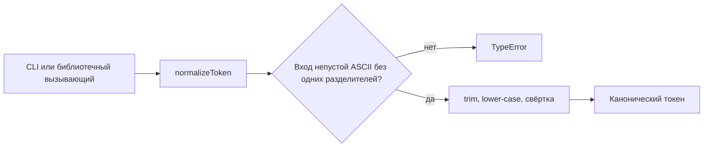
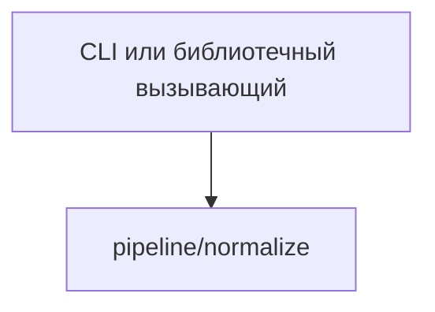

# Module: pipeline/normalize

<!--SECTION:SPEC_ID-->
TOKEN-PIPELINE-NORMALIZE
<!--/SECTION:SPEC_ID-->

<!--SECTION:MODULE_VISION-->
## Module Vision
Модуль владеет детерминированной нормализацией одного токена внутри скоупа [token](../../token.spec.md): он проверяет вход, убирает крайние ASCII-пробелы, приводит ASCII-буквы к нижнему регистру и сводит разделители к одному hyphen. Исходный контракт — [token contract](../../../docs/token-contract.md). Соседних и дочерних модулей у `pipeline/normalize` нет, поэтому граница модуля совпадает с единственной операцией нормализации.
<!--/SECTION:MODULE_VISION-->

<!--SECTION:OVERVIEW-->
## Overview

_Путь нормализации от входа до канонического токена — NOR-REQ-1, NOR-REQ-2._
<!--/SECTION:OVERVIEW-->

<!--SECTION:MODULE_USAGE_EXAMPLE-->
## Module Usage Example
Инициализация не нужна: модуль даёт чистую функцию, которая либо возвращает токен, либо выбрасывает `TypeError`. Пример показывает успешный путь и минимальную обработку ошибки без обращения к другим модулям.

```ts
import { normalizeToken } from "./normalize";

const token = normalizeToken("  Foo__BAR  ");
// token === "foo-bar"

try {
  normalizeToken("");
} catch (error) {
  if (error instanceof TypeError) {
    // The caller owns reporting for empty, separator-only, or non-ASCII input.
    console.error("invalid token input");
  }
}
```
<!--/SECTION:MODULE_USAGE_EXAMPLE-->

<!--SECTION:MODULE_REQUIREMENTS-->
## Requirements
### NOR-REQ-1 [должен]
**Когда** `normalizeToken` получает ASCII-строку, **функция должна** обрезать крайние ASCII-пробелы, привести ASCII-буквы к нижнему регистру и свернуть каждую серию пробелов, underscore и hyphen в один hyphen.

> Уточняет TOK-REQ-1 на границе модуля: вызывающий получает один канонический вид токена без собственной предобработки.

### NOR-REQ-2 [должен · нештатная]
**Если** вход пустой, состоит только из пробелов, underscore и hyphen или содержит не-ASCII символ, **то функция должна** выбросить TypeError до нормализации и не выполнять ввод-вывод.

> Уточняет TOK-REQ-2: молчаливый пустой токен скрыл бы ошибку входа от CLI и библиотечного вызывающего.

| Input | Outcome |
|---|---|
| `"  Foo__BAR  "` | `"foo-bar"` |
| `""` | `TypeError` |
<!--/SECTION:MODULE_REQUIREMENTS-->

<!--SECTION:INTER_MODULE_DEPENDENCIES-->
## Inter-Module Dependencies
- **Depends on:** нет модулей внутри скоупа token.
- **Scope Reference (cross-scope):** нет: модуль не использует контракты infra-base или другого интерфейсного скоупа.
- **Provides to:** нет модулей-потребителей внутри скоупа token; результат получают CLI и библиотечные вызывающие через скоуп token.


_Модуль вызывается снаружи и не зависит от соседних модулей._
<!--/SECTION:INTER_MODULE_DEPENDENCIES-->

<!--SECTION:ENTITY_INVENTORY-->
## Entity Inventory
_Это полный список сущностей модуля. Любое введение сущности execution-агентом помимо этого списка считается расхождением со спекой и требует обновления spec._

| Name | Type | Purpose |
|------|------|---------|
| `normalizeToken` | Function | Единственная публичная операция: проверка входа и возврат канонического токена |

Ошибки: throw TypeError → `normalizeToken`

ER-скетч не рисуется: в инвентаре одна сущность, связывать нечего.
<!--/SECTION:ENTITY_INVENTORY-->

<!--SECTION:ENTITY_SURFACES-->
## Entity Surfaces
Поверхность одна: чистая функция `normalizeToken` без состояния и свойств.

<details>
<summary>Полные поверхности сущностей</summary>

### `normalizeToken`
- **Type:** Function
- **Purpose:** Проверяет вход и возвращает канонический токен либо выбрасывает TypeError.
- **Public Properties:** Нет.
- **Public Operations:** `normalizeToken` — принимает входную строку и возвращает канонический токен либо выбрасывает TypeError.
- **Lifecycle:** Не хранит состояние: вызывается на каждый вход и завершается вместе с вызовом. Диаграмма не нужна: переходов жизненного цикла нет.
- **Events Emitted:** Нет.
- **Errors & Degradation:** TypeError через throw при пустом входе, входе только из разделителей или не-ASCII символе; вызывающий владеет обработкой. Ввод-вывод не выполняется.
- **Consumers:**
  - Internal: Нет.
  - External: CLI и библиотечные вызывающие скоупа token.
- **Usage Waiver (external: CLI и библиотечные потребители):** единственная публичная операция модуля, других точек входа нет.

</details>
<!--/SECTION:ENTITY_SURFACES-->

<!--SECTION:MODULE_CONTRACTS-->
## Module Contracts
Модуль определяет только Function `normalizeToken`; Ports и Adapters не нужны, потому что реализация одна и внешней зависимости нет.

Граф не рисуется: в модуле нет Port/Adapter, только Function `normalizeToken`.

Цепочка вызовов не рисуется: в модуле одна абстракция — Function `normalizeToken` без вызываемых зависимостей.

<details>
<summary>Контракты DbC</summary>

### Services

#### Service: `normalizeToken`
- **Purpose:** Возвращает канонический токен для валидного ASCII-входа и отвергает невалидный вход без ввода-вывода.
- **Consumers:** внешние: CLI и библиотечные вызывающие скоупа token.
- **Runtime Backing:** `not-implemented`
- **Verification Levels:** `contract`, `unit`
- **Deferred Runtime Scope:** реализация и тесты не запрошены; поведение заявлено только контрактом.

**Contract (DbC)**
- `normalizeToken`:
  - Pre: вход — строка ASCII, содержащая хотя бы один символ вне ASCII-пробела, underscore и hyphen.
  - Post: возвращает строку без крайних ASCII-пробелов, с ASCII-буквами в нижнем регистре и каждой серией ASCII-пробелов, underscore и hyphen, заменённой одним hyphen.
  - On pre-violation: выбрасывает TypeError до нормализации и не выполняет ввод-вывод.

**Invariants:** функция чистая: не хранит состояние, не меняет вход и не выполняет ввод-вывод.

</details>
<!--/SECTION:MODULE_CONTRACTS-->

<!--SECTION:PUBLIC_OPTIONS-->
## Public Options & Policies
Опций и политик нет: сигнатура и правила нормализации фиксированы.

<details>
<summary>Опции и политики</summary>

Настраиваемых флагов, режимов или политик нет; всё поведение задано контрактом `normalizeToken`.

</details>
<!--/SECTION:PUBLIC_OPTIONS-->

<!--SECTION:FILE_STRUCTURE-->
## File Structure
Планируемая структура; файлов ещё нет, потому что реализация не запрошена.
```
pipeline/normalize/
├── normalize.ts
└── normalize.test.ts
```

**File Mapping:**
- `pipeline/normalize/normalize.ts`: функция `normalizeToken`, единственная публичная операция модуля.
- `pipeline/normalize/normalize.test.ts`: unit-тесты контракта нормализации и отказов.
<!--/SECTION:FILE_STRUCTURE-->

<!--SECTION:RESEARCH-->
## Research
Исследовательских документов нет: поведение задано [token contract](../../../docs/token-contract.md) и скоупом token.
<!--/SECTION:RESEARCH-->

<!--SECTION:MODULE_DECISION_LOG-->
## Module Decision Log
Записана одна архитектурная граница: чистая функция без Port/Adapter.

<details>
<summary>Полные записи Decision Log</summary>

NOR-DL-1 2026-10-23 — нормализация остаётся чистой функцией без Port/Adapter (почему: одна реализация и нет внешней зависимости; отвергнуто: Port ради тестового шва — изменчивости нет; риск: вторая реализация потребует выделить Port).

</details>
<!--/SECTION:MODULE_DECISION_LOG-->

<!--SECTION:HANDOFF-->
## Handoff to Tasks
- **Implementation files to be created:** `pipeline/normalize/normalize.ts`
- **Test files to be created:** `pipeline/normalize/normalize.test.ts`
- **Stack dependencies:**
  - Language: `typescript` (resolves to `ai/directives/coding/typescript-rules.xml`)
  - Test framework: `node-test` (resolves to `ai/directives/testing/node-test.xml`)
- **Module Rules Additions:** None.
- **Status:** pending-operator
- **Open risks & validation needs:** реализация и тесты не созданы, выполнение не заявляется; границы входа для пустой строки, одних разделителей и не-ASCII символов проверяются будущими unit-тестами; подтверждение оператора не получено.
<!--/SECTION:HANDOFF-->

<!--SECTION:IMPLEMENTATION_INSIGHTS-->
## Implementation Insights
Не применимо: реализации нет, пост-имплементационных наблюдений нет.
<!--/SECTION:IMPLEMENTATION_INSIGHTS-->
