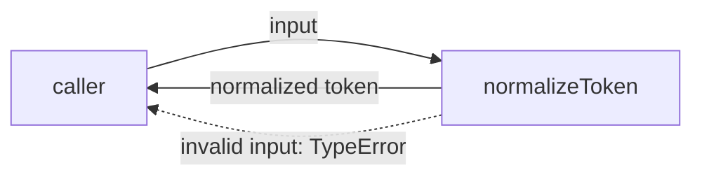
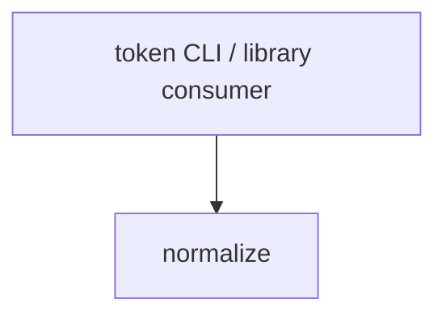

# Module: Normalize

<!--SECTION:SPEC_ID-->
TOKEN-PIPELINE-NORMALIZE
<!--/SECTION:SPEC_ID-->

<!--SECTION:MODULE_VISION-->
## Module Vision

Модуль `normalize` владеет одной чистой операцией: нормализацией ASCII-токена для локальных CLI- и библиотечных потребителей. Входит в скоуп [token](../../token.spec.md); вышестоящий модуль и дочерние модули отсутствуют, соседних модулей в скоупе нет. Опорный контракт — [token-contract.md](../../../../docs/token-contract.md).
<!--/SECTION:MODULE_VISION-->

<!--SECTION:OVERVIEW-->
## Overview


_Главный путь нормализации и явный отказ на недопустимом входе — NOR-REQ-1, NOR-REQ-2._
<!--/SECTION:OVERVIEW-->

<!--SECTION:MODULE_USAGE_EXAMPLE-->
## Module Usage Example

```ts
import { normalizeToken } from "./normalize";

// Happy path: surrounding spaces are trimmed, letters are lowercased,
// and separator runs collapse into one hyphen.
normalizeToken("  Foo__BAR  "); // "foo-bar"

// Minimal error path: invalid input fails loudly, without I/O or fallback.
try {
  normalizeToken("");
} catch (error) {
  if (!(error instanceof TypeError)) throw error;
}
```
<!--/SECTION:MODULE_USAGE_EXAMPLE-->

<!--SECTION:MODULE_REQUIREMENTS-->
## Requirements

### NOR-REQ-1 [должен]
**Когда** передана ASCII-строка, **normalizeToken должен** обрезать ведущие и хвостовые ASCII-пробелы, привести ASCII-буквы к нижнему регистру и свернуть последовательности пробелов, `_` и `-` в один `-`.

> Уточняет TOK-REQ-1 для единственного модуля нормализации: потребители получают один детерминированный формат токена.

### NOR-REQ-2 [должен · нештатная]
**Если** вход пуст **или** состоит только из разделителей, **или** содержит не-ASCII символ, **то normalizeToken должен** выбросить `TypeError` без ввода-вывода.

> Уточняет TOK-REQ-2: ошибку входа нельзя маскировать пустым или искажённым токеном.

| Input | Outcome |
|---|---|
| `"  Foo__BAR  "` | `"foo-bar"` |
| `""` | `TypeError` |
<!--/SECTION:MODULE_REQUIREMENTS-->

<!--SECTION:INTER_MODULE_DEPENDENCIES-->
## Inter-Module Dependencies

- **Depends on:** нет внутренних модулей.
- **Scope Reference (cross-scope):** нет; скоуп `token` зависит от `infra-base` только на уровне своей спеки.
- **Provides to:** прямые потребители скоупа `token` — CLI и библиотечные вызовы.


_Потребитель вызывает модуль напрямую; внутренних зависимостей нет._
<!--/SECTION:INTER_MODULE_DEPENDENCIES-->

<!--SECTION:ENTITY_INVENTORY-->
## Entity Inventory

_Полный список сущностей модуля. Любая иная сущность, введённая при исполнении, считается drift'ом и требует обновления спеки._

| Name | Type | Purpose |
|------|------|---------|
| `normalizeToken` | Function | Детерминированно нормализует один ASCII-токен |

Ошибки: throw → `normalizeToken`

Одна сущность — связей нет, ER-набросок не применим.
<!--/SECTION:ENTITY_INVENTORY-->

<!--SECTION:ENTITY_SURFACES-->
## Entity Surfaces

Единственная публичная поверхность — чистая функция `normalizeToken`.

<details>
<summary>Полные поверхности сущностей</summary>

### `normalizeToken`
- **Type:** Function
- **Purpose:** Нормализует один ASCII-токен и отклоняет недопустимый вход.
- **Public Properties:** N/A
- **Public Operations:** нормализация входной строки в токен.
- **Lifecycle:** Чистая функция уровня модуля; состояние не создаётся, завершение не требуется.
- **Events Emitted:** N/A
- **Errors & Degradation:** `TypeError` через throw, владелец — `normalizeToken`; ввод-вывод отсутствует.
- **Consumers:**
  - Internal: `src/token/pipeline/normalize/normalize.ts`
  - External: token CLI и библиотечные потребители
- **Usage Waiver (external: token CLI и библиотечные потребители):** единственная публичная операция модуля и есть его контракт.

</details>
<!--/SECTION:ENTITY_SURFACES-->

<!--SECTION:MODULE_CONTRACTS-->
## Module Contracts

Модуль определяет одну чистую функцию `normalizeToken`; Port и Adapter не вводятся.

Граф не рисуется: в модуле нет Port/Adapter, только Service `normalizeToken`.

Цепочка вызовов не рисуется: в инвентаре одна абстракция (`normalizeToken`), порог ≥2 не достигнут.

<details>
<summary>Контракты DbC</summary>

#### Service: `normalizeToken`
- **Purpose:** Детерминированно приводит допустимый ASCII-вход к каноническому токену.
- **Consumers:** internal `src/token/pipeline/normalize/normalize.ts`; external token CLI и библиотечные потребители.
- **Runtime Backing:** `not-implemented`
- **Verification Levels:** `contract`, `unit`
- **Deferred Runtime Scope:** Реализация не запрошена; поведение объявлено контрактом.

**Contract (DbC)** — одна операция:
- `normalizeToken`:
  - Pre: вход — строка, содержит только ASCII-символы, после обрезки не пуста и не состоит только из разделителей.
  - Post: возвращается строка без ведущих и хвостовых ASCII-пробелов, с ASCII-буквами в нижнем регистре и с одиночными `-` вместо последовательностей пробелов, `_` и `-`.
  - On pre-violation: выбрасывается `TypeError`; ввод-вывод не выполняется.

**Invariants:** Результат детерминирован для одного входа; модуль не хранит состояние и не выполняет ввод-вывод.

</details>
<!--/SECTION:MODULE_CONTRACTS-->

<!--SECTION:PUBLIC_OPTIONS-->
## Public Options & Policies

Нет публичных опций: модуль предоставляет единственную функцию без конфигурации.

<details>
<summary>Опции и политики</summary>

Не применимо: параметров, флагов и политик конфигурации у модуля нет.
</details>
<!--/SECTION:PUBLIC_OPTIONS-->

<!--SECTION:FILE_STRUCTURE-->
## File Structure

Планируемая структура; код в рамках этой задачи не создаётся.

```
src/token/pipeline/normalize/
├── normalize.ts
└── normalize.test.ts
```

**File Mapping:**
- `src/token/pipeline/normalize/normalize.ts`: функция `normalizeToken`.
- `src/token/pipeline/normalize/normalize.test.ts`: проверки контракта и негативного пути.
<!--/SECTION:FILE_STRUCTURE-->

<!--SECTION:RESEARCH-->
## Research

Нет research-документов: контракт задан опорным документом [token-contract.md](../../../../docs/token-contract.md), отдельное исследование не требуется.
<!--/SECTION:RESEARCH-->

<!--SECTION:MODULE_DECISION_LOG-->
## Module Decision Log

Записано одно решение: чистая функция без Port/Adapter.

<details>
<summary>Полные записи Decision Log</summary>

NOR-DL-1 2026-10-23 — Port и Adapter не вводятся; где: specs/token/pipeline/normalize/normalize.spec.md#module-contracts (почему: единственная чистая операция без подтверждённой вариативности и без внешней границы) [verdict: pending-operator]

</details>
<!--/SECTION:MODULE_DECISION_LOG-->

<!--SECTION:HANDOFF-->
## Handoff to Tasks

- **Implementation files to be created:** `src/token/pipeline/normalize/normalize.ts`
- **Test files to be created:** `src/token/pipeline/normalize/normalize.test.ts`
- **Stack dependencies:**
  - Language: `typescript` (resolves to `ai/directives/coding/typescript-rules.xml`)
  - Test framework: `node-test` (resolves to `ai/directives/testing/node-test.xml`)
- **Module Rules Additions:** None.
- **Open risks & validation needs:** Approval #1 не получен, задачи и реализация не созданы. При реализации нужно закрепить проверку не-ASCII на уровне кодовых точек; runtime-поведение сейчас не заявлено.
<!--/SECTION:HANDOFF-->

<!--SECTION:IMPLEMENTATION_INSIGHTS-->
## Implementation Insights

Не применимо: реализации ещё нет; раздел заполняется после audit-cycle compaction.

<details>
<summary>Заметки по реализации</summary>

Не применимо — implementation insights отсутствуют, пока код не создан и не проверен.
</details>
<!--/SECTION:IMPLEMENTATION_INSIGHTS-->
