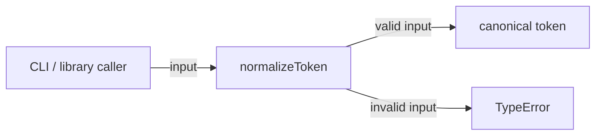
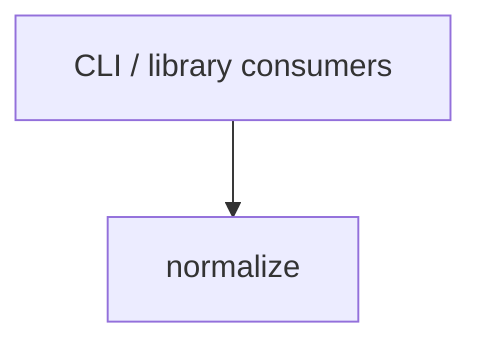

# Module: normalize

<!--SECTION:SPEC_ID-->
TOKEN-PIPELINE-NORMALIZE
<!--/SECTION:SPEC_ID-->

<!--SECTION:MODULE_VISION-->
## Module Vision

The module owns one responsibility: deterministic normalization of a single token for local CLI and library consumers. It performs no input/output and keeps no state.

Parent scope: [token](../../token.spec.md). There are no sibling, parent-module, or child-module specs yet: `pipeline/normalize` is the only module declared in the `token` scope.
<!--/SECTION:MODULE_VISION-->

<!--SECTION:OVERVIEW-->
## Overview


_Нормализация допустимого входа и отказ TypeError на недопустимом — NOR-REQ-1, NOR-REQ-2._
<!--/SECTION:OVERVIEW-->

<!--SECTION:MODULE_USAGE_EXAMPLE-->
## Module Usage Example

```ts
import { normalizeToken } from "./normalize";

// No setup: normalization is a pure synchronous call.
const token = normalizeToken("  Foo__BAR  ");
// token === "foo-bar"

try {
  normalizeToken("");
} catch (error) {
  // Invalid input is rejected instead of producing an empty token.
  if (error instanceof TypeError) {
    // The caller decides how to report the rejected input.
  }
}
```
<!--/SECTION:MODULE_USAGE_EXAMPLE-->

<!--SECTION:MODULE_REQUIREMENTS-->
## Requirements

The contract examples are named `normalize-example` and `empty-input-rejection`.

| Input | Outcome |
|---|---|
| `"  Foo__BAR  "` | `"foo-bar"` |
| `""` | `TypeError` |

### NOR-REQ-1 [должен]
**Когда** передана непустая ASCII-строка, содержащая хотя бы один символ вне ASCII-пробела, underscore и hyphen, **нормализатор должен** обрезать крайние ASCII-пробелы, привести ASCII-буквы к нижнему регистру и заменить каждый непрерывный набор ASCII-пробелов, underscore и hyphen одним hyphen.

> Модульное обязательство уточняет TOK-REQ-1: один детерминированный формат нужен CLI и библиотечным потребителям, а результат не должен зависеть от регистра и разделителей.

### NOR-REQ-2 [должен · нештатная]
**Если** вход пустой **ИЛИ** состоит только из ASCII-пробелов, underscore и hyphen **ИЛИ** содержит символ вне ASCII, **то нормализатор должен** выбросить TypeError без ввода-вывода.

> Модульное обязательство уточняет TOK-REQ-2: ошибку входа нельзя маскировать пустым или искажённым токеном; отсутствие I/O сохраняет локальную детерминированность.
<!--/SECTION:MODULE_REQUIREMENTS-->

<!--SECTION:INTER_MODULE_DEPENDENCIES-->
## Inter-Module Dependencies
- **Depends on:** None — no sibling module specs exist in the `token` scope.
- **Scope Reference (cross-scope):** None — the module uses language runtime primitives only.
- **Provides to:** None within this scope; `normalizeToken` is provided to external CLI and library consumers outside the module graph.


_Внешние потребители вызывают модуль normalize; других модулей в скоупе пока нет._
<!--/SECTION:INTER_MODULE_DEPENDENCIES-->

<!--SECTION:ENTITY_INVENTORY-->
## Entity Inventory

_Это полный список сущностей модуля. Любое введение сущности execution-агентом помимо этого списка считается drift'ом и требует обновления spec._

| Name | Type | Purpose |
|------|------|---------|
| `normalizeToken` | Function | Нормализует один токен и отклоняет недопустимый вход |

Ошибки: throw `TypeError` → `normalizeToken`

ER-скетч не рисуется: в инвентаре одна сущность, связывать нечего.
<!--/SECTION:ENTITY_INVENTORY-->

<!--SECTION:ENTITY_SURFACES-->
## Entity Surfaces

`normalizeToken` is the module's only public surface: a pure function for valid input and a `TypeError` for rejected input.

<details>
<summary>Полные поверхности сущностей</summary>

### `normalizeToken`
- **Type:** Function
- **Purpose:** Convert one valid token input into its canonical hyphenated form and reject invalid input.
- **Public Properties:** N/A
- **Public Operations:** Normalize one token input; reject empty, separator-only, or non-ASCII input.
- **Lifecycle:** Stateless function loaded with the module; it has no created or terminated state.
- **Events Emitted:** N/A
- **Errors & Degradation:** `TypeError` via throw, raised and owned by `normalizeToken`; callers decide how to report it. No I/O occurs on either path.
- **Consumers:**
  - Internal: `src/token/pipeline/normalize/normalize.ts` (implementation owner)
  - External: CLI and library consumers
- **Usage Waiver (external: CLI and library consumers):** Public entry point intended for external consumers; no internal production call sites exist yet.

</details>
<!--/SECTION:ENTITY_SURFACES-->

<!--SECTION:MODULE_CONTRACTS-->
## Module Contracts

The module exposes one Service-like pure function, `normalizeToken`; there are no Ports or Adapters because no variability or test seam is confirmed.

Граф не рисуется: в модуле нет Port/Adapter, только Service `normalizeToken`.

Цепочка вызовов не рисуется: в инвентаре одна абстракция, порог ≥2 не достигнут.

<details>
<summary>Контракты DbC</summary>

### Services

#### Service: `normalizeToken`
- **Purpose:** Produce a deterministic canonical token or reject invalid input.
- **Consumers:** external CLI and library consumers.
- **Runtime Backing:** `not-implemented`
- **Verification Levels:** `contract` | `unit`
- **Deferred Runtime Scope:** All declared normalization and rejection behavior; no implementation exists yet.

**Contract (DbC)**
- `normalizeToken`:
  - Pre: input is a string, is ASCII-only, is non-empty, and contains at least one character other than ASCII space, underscore, or hyphen.
  - Post: returns a string with leading/trailing ASCII spaces removed, ASCII letters lowercased, and every maximal run of ASCII space, underscore, or hyphen replaced by one hyphen.
  - On pre-violation: throws `TypeError` without performing I/O.

**Invariants:** The call is pure and deterministic — the same valid input yields the same output, with no I/O, network, persistence, or observable side effects.

</details>
<!--/SECTION:MODULE_CONTRACTS-->

<!--SECTION:PUBLIC_OPTIONS-->
## Public Options & Policies

No public options. The behavior is fixed by the `normalizeToken(input: string): string` signature and the requirements above.

<details>
<summary>Опции и политики</summary>

None. No flags, policies, environment variables, or configuration are part of this module.

</details>
<!--/SECTION:PUBLIC_OPTIONS-->

<!--SECTION:FILE_STRUCTURE-->
## File Structure
```
src/token/pipeline/normalize/
├── normalize.ts
└── normalize.test.ts
```

**File Mapping:**
- `src/token/pipeline/normalize/normalize.ts`: `normalizeToken` implementation (planned; not created by authoring)
- `src/token/pipeline/normalize/normalize.test.ts`: behavior tests for normalization and rejection (planned; not created by authoring)
<!--/SECTION:FILE_STRUCTURE-->

<!--SECTION:RESEARCH-->
## Research

No research documents. The local deterministic contract is fully specified by the scope requirements and needs no external research; no research registry rows apply.
<!--/SECTION:RESEARCH-->

<!--SECTION:MODULE_DECISION_LOG-->
## Module Decision Log

One decision is recorded: normalization is implemented as a pure function without Port or Adapter.

<details>
<summary>Полные записи Decision Log</summary>

NOR-DL-1 2026-10-23 — pure function owns normalization directly, without a Port or Adapter (почему: one deterministic implementation with no confirmed variability; отвергнуто: Port + Adapter layer as an unused seam; риск: future variability requires a contract change)

</details>
<!--/SECTION:MODULE_DECISION_LOG-->

<!--SECTION:HANDOFF-->
## Handoff to Tasks
- **Implementation files to be created:** `src/token/pipeline/normalize/normalize.ts`
- **Test files to be created:** `src/token/pipeline/normalize/normalize.test.ts`
- **Stack dependencies:**
  - Language: `typescript` (resolves to `ai/directives/coding/typescript-rules.xml`)
  - Test framework: `node-test` (resolves to `ai/directives/testing/node-test.xml`)
- **Module Rules Additions:** None; the module uses the scope-wide baseline only.
- **Open risks & validation needs:** No implementation exists, so TypeError rejection, separator collapse, and absence of I/O are unverified.
- **Status:** `pending-operator` — no operator decision, tickets, or execution claim.

<!--/SECTION:HANDOFF-->

<!--SECTION:IMPLEMENTATION_INSIGHTS-->
## Implementation Insights

Not applicable: no implementation has been produced, so there are no post-implementation learnings to record.

<details>
<summary>Заметки по реализации</summary>

No entries. This appendix starts only after implementation and audit-cycle compaction.

</details>
<!--/SECTION:IMPLEMENTATION_INSIGHTS-->
