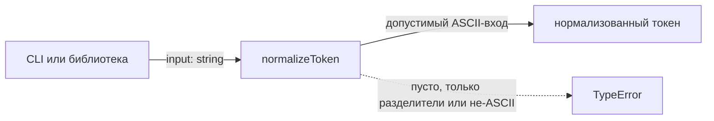
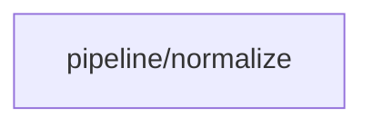

# Module: pipeline/normalize

<!--SECTION:SPEC_ID-->
TOKEN-PIPELINE-NORMALIZE
<!--/SECTION:SPEC_ID-->

<!--SECTION:MODULE_VISION-->
## Module Vision

Модуль `pipeline/normalize` владеет одной обязанностью: детерминированной нормализацией ASCII-токена для локальных CLI- и библиотечных потребителей. Он реализует обязательства скоупа [token](../../token.spec.md). Соседних и дочерних модулей у этого модуля нет.
<!--/SECTION:MODULE_VISION-->

<!--SECTION:OVERVIEW-->
## Overview


_Один детерминированный путь нормализации и явный отказ на недопустимом входе — NOR-REQ-1, NOR-REQ-2._
<!--/SECTION:OVERVIEW-->

<!--SECTION:MODULE_USAGE_EXAMPLE-->
## Module Usage Example

```ts
import { normalizeToken } from "./normalize";

// Happy path: trim, lowercase and collapse separators.
const token = normalizeToken("  Foo__BAR  ");
console.log(token); // "foo-bar"

// Minimal error path: invalid input is rejected, never silently normalized.
try {
  normalizeToken("");
} catch (error) {
  if (error instanceof TypeError) {
    console.error("invalid token input");
  }
}
```
<!--/SECTION:MODULE_USAGE_EXAMPLE-->

<!--SECTION:MODULE_REQUIREMENTS-->
## Requirements

### NOR-REQ-1 [должен]
**Когда** передана непустая ASCII-строка, **нормализатор должен** убрать ведущие и замыкающие ASCII-пробелы, привести ASCII-буквы к нижнему регистру и свернуть каждую серию ASCII-пробелов, underscore и hyphen в один hyphen.

> Уточняет TOK-REQ-1: CLI- и библиотечным потребителям нужен один детерминированный формат токена.

### NOR-REQ-2 [должен · нештатная]
**Если** строка пустая, состоит только из разделителей (ASCII-пробел, `_`, `-`) или содержит не-ASCII символ, **то нормализатор должен** выбросить `TypeError` без ввода-вывода.

> Уточняет TOK-REQ-2: ошибку входа нельзя маскировать пустым или искажённым корректным токеном.

| Input | Outcome |
|---|---|
| `"  Foo__BAR  "` | `"foo-bar"` |
| `""` | `TypeError` |
<!--/SECTION:MODULE_REQUIREMENTS-->

<!--SECTION:INTER_MODULE_DEPENDENCIES-->
## Inter-Module Dependencies

- **Depends on:** нет модулей внутри скоупа.
- **Scope Reference (cross-scope):** нет; модуль не использует интерфейсы других скоупов.
- **Provides to:** нет модулей внутри скоупа.


_Соседей по графу и внешних зависимостей нет._
<!--/SECTION:INTER_MODULE_DEPENDENCIES-->

<!--SECTION:ENTITY_INVENTORY-->
## Entity Inventory

_Это полный список сущностей модуля. Любое введение сущности execution-агентом помимо этого списка считается drift'ом и требует обновления spec._

| Name | Type | Purpose |
|------|------|---------|
| `normalizeToken` | Function | Детерминированно нормализует ASCII-токен и отклоняет недопустимый вход |

Ошибки: throw (`TypeError`) → `normalizeToken`.

ER-эскиз не рисуется: в инвентаре одна сущность, связывать нечего.
<!--/SECTION:ENTITY_INVENTORY-->

<!--SECTION:ENTITY_SURFACES-->
## Entity Surfaces

Одна публичная сущность — чистая функция `normalizeToken`; полная поверхность ниже.

<details>
<summary>Полные поверхности сущностей</summary>

### `normalizeToken`

- **Type:** Function
- **Purpose:** Преобразует ASCII-строку в нормализованный токен или выбрасывает `TypeError`.
- **Public Properties:** N/A
- **Public Operations:** нормализация токена — обрезка ASCII-пробелов, нижний регистр ASCII-букв, свёртка серий разделителей в один hyphen.
- **Lifecycle:** Создаётся импортирующим CLI или библиотечным потребителем; состояние не хранит; завершается возвратом результата или выбросом `TypeError`.
- **Events Emitted:** N/A
- **Errors & Degradation:** `TypeError` через throw для пустого, состоящего только из разделителей или не-ASCII входа; ошибку формирует и показывает `normalizeToken`, ввода-вывода нет.
- **Consumers:**
  - Internal: N/A — единственный публичный экспорт модуля.
  - External: локальные CLI- и библиотечные потребители.
- **Usage Waiver (external: локальные CLI- и библиотечные потребители):** единственная публичная точка входа модуля, предназначенная для внешнего использования.

</details>
<!--/SECTION:ENTITY_SURFACES-->

<!--SECTION:MODULE_CONTRACTS-->
## Module Contracts

Публичный контракт один: чистая функция `normalizeToken`, без Port и Adapter.

Граф не рисуется: в модуле нет Port/Adapter, только Function `normalizeToken`.

Call Chain не рисуется: в инвентаре одна абстракция, сценарий линеен и сводится к одному вызову `normalizeToken`.

<details>
<summary>Контракты DbC</summary>

#### Service: `normalizeToken`

- **Purpose:** Детерминированно нормализовать ASCII-токен и явно отклонять недопустимый вход.
- **Consumers:** локальные CLI- и библиотечные потребители.
- **Runtime Backing:** `not-implemented`
- **Verification Levels:** `contract`, `unit`
- **Deferred Runtime Scope:** реализация и тесты отсутствуют; спроектировано только поведение.

**Contract (DbC)** — операция `normalizeToken`:
- `normalizeToken`:
  - Pre: вход — строка, непустая после удаления ASCII-пробелов, не состоящая только из ASCII-пробелов, `_` и `-`, и не содержащая не-ASCII символов.
  - Post: возвращается строка без ведущих и замыкающих ASCII-пробелов, с ASCII-буквами в нижнем регистре и каждой серией ASCII-пробелов, `_` и `-`, заменённой одним `-`; остальные ASCII-символы сохраняются.
  - On pre-violation: выбрасывается `TypeError` без ввода-вывода.

**Invariants:** результат зависит только от входной строки; функция не хранит состояние и не выполняет ввода-вывода.

</details>
<!--/SECTION:MODULE_CONTRACTS-->

<!--SECTION:PUBLIC_OPTIONS-->
## Public Options & Policies

Публичных опций нет: поведение фиксировано контрактом функции.

<details>
<summary>Опции и политики</summary>

None.
</details>
<!--/SECTION:PUBLIC_OPTIONS-->

<!--SECTION:FILE_STRUCTURE-->
## File Structure
```
normalize/
├── normalize.ts
└── normalize.test.ts
```

**File Mapping:**
- `normalize/normalize.ts`: чистая функция `normalizeToken`
- `normalize/normalize.test.ts`: unit-тесты нормализации и отклонения недопустимого входа
<!--/SECTION:FILE_STRUCTURE-->

<!--SECTION:RESEARCH-->
## Research

No research documents back this module.
<!--/SECTION:RESEARCH-->

<!--SECTION:MODULE_DECISION_LOG-->
## Module Decision Log

Записано одно решение: модуль ограничен чистой функцией без Port/Adapter.

<details>
<summary>Полные записи Decision Log</summary>

NOR-DL-1 2026-10-23 — модуль ограничен одной чистой функцией без Port и Adapter; где: specs/token/pipeline/normalize/normalize.spec.md#module-contracts (почему: подтверждённой вариативности и тестового шва нет; отвергнуто: stateful-сервис — состоянию нечего хранить) [verdict: pending-operator]

</details>
<!--/SECTION:MODULE_DECISION_LOG-->

<!--SECTION:HANDOFF-->
## Handoff to Tasks
- **Implementation files to be created:** `normalize/normalize.ts`
- **Test files to be created:** `normalize/normalize.test.ts`
- **Stack dependencies:**
  - Language: `typescript` (resolves to `ai/directives/coding/typescript-rules.xml`)
  - Test framework: `node-test` (resolves to `ai/directives/testing/node-test.xml`)
- **Module Rules Additions:** None.
- **Open risks & validation needs:** оператор ещё не утвердил спеку; реализация и тесты не созданы. Поведение для прочих ASCII-управляющих символов вне заявленных правил не уточнялось.
<!--/SECTION:HANDOFF-->

<!--SECTION:IMPLEMENTATION_INSIGHTS-->
## Implementation Insights

Not applicable — реализация не выполнялась, поэтому пост-имплементационных наблюдений нет.
<!--/SECTION:IMPLEMENTATION_INSIGHTS-->
