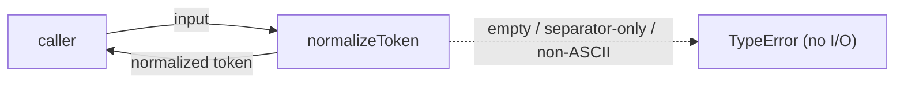
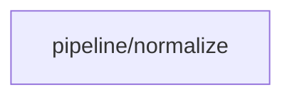

# Module: pipeline/normalize

<!--SECTION:SPEC_ID-->
TOKEN-PIPELINE-NORMALIZE
<!--/SECTION:SPEC_ID-->

<!--SECTION:MODULE_VISION-->
## Module Vision
This module owns the single local, deterministic token-normalization responsibility inside the [token scope](../../token.spec.md): converting one ASCII input string into one normalized token. It has no sibling modules in TOKEN and no child modules. Its obligations narrow TOK-REQ-1 and TOK-REQ-2.

<!--/SECTION:MODULE_VISION-->

<!--SECTION:OVERVIEW-->
## Overview
Caller passes one input string to `normalizeToken`; valid input produces one normalized token, while invalid input produces a `TypeError` without I/O.


_Нормализация токена и отказ на некорректном входе — NOR-REQ-1, NOR-REQ-2._

<!--/SECTION:OVERVIEW-->

<!--SECTION:MODULE_USAGE_EXAMPLE-->
## Module Usage Example
No initialization or setup is required; the function is imported and called directly.

```ts
import { normalizeToken } from "./normalize";

// Happy path: surrounding spaces are removed, letters are lowercased,
// and the underscore run becomes one hyphen.
const token = normalizeToken("  Foo__BAR  ");
console.log(token); // "foo-bar"

// Minimal error path: invalid input raises TypeError without I/O.
try {
  normalizeToken("");
} catch (error) {
  if (error instanceof TypeError) {
    console.error("Rejected invalid token input:", error.message);
  }
}
```

<!--/SECTION:MODULE_USAGE_EXAMPLE-->

<!--SECTION:MODULE_REQUIREMENTS-->
## Requirements
### NOR-REQ-1 [должен]
**Когда** передана допустимая ASCII-строка, **нормализатор должен** удалить крайние ASCII-пробелы, привести ASCII-буквы к нижнему регистру и заменить каждый непрерывный прогон ASCII-пробелов, underscore и hyphen одним hyphen.

> Это модульное уточнение TOK-REQ-1; без него формат токена различался бы между CLI и библиотечными потребителями. Сценарий `normalize-example` фиксирует обязательный результат.

### NOR-REQ-2 [должен · нештатная]
**Если** входная строка пуста, состоит только из ASCII-пробелов, underscore и hyphen или содержит не-ASCII символы, **то нормализатор должен** выбросить `TypeError` без выполнения ввода-вывода.

> Это модульное уточнение TOK-REQ-2; ошибка входа не должна маскироваться пустым или искажённым корректным токеном. Сценарий `empty-input-rejection` фиксирует минимальный отказ.

| Input | Outcome |
|---|---|
| `"  Foo__BAR  "` | `"foo-bar"` |
| `""` | `TypeError` |

<!--/SECTION:MODULE_REQUIREMENTS-->

<!--SECTION:INTER_MODULE_DEPENDENCIES-->
## Inter-Module Dependencies
- **Depends on:** None; TOKEN has no sibling modules.
- **Scope Reference (cross-scope):** None; normalization is local and pure, with no cross-scope interface.
- **Provides to:** None; TOKEN has no sibling modules.


_Модуль не зависит от соседних модулей TOKEN._

<!--/SECTION:INTER_MODULE_DEPENDENCIES-->

<!--SECTION:ENTITY_INVENTORY-->
## Entity Inventory
_Это полный список сущностей модуля. Любое введение сущности execution-агентом помимо этого списка считается drift'ом и требует обновления spec._

| Name | Type | Purpose |
|------|------|---------|
| `normalizeToken` | Function | Trims, lowercases and collapses an ASCII token; throws TypeError on invalid input. |

Ошибки: throw → `normalizeToken`

ER sketch not applicable: the inventory has one entity and no relations.

<!--/SECTION:ENTITY_INVENTORY-->

<!--SECTION:ENTITY_SURFACES-->
## Entity Surfaces
The module exposes one stateless function, `normalizeToken`, whose full public surface is folded below.

<details>
<summary>Полные поверхности сущностей</summary>

### `normalizeToken`
- **Type:** Function
- **Purpose:** Convert one valid ASCII input string into one normalized token and reject invalid input.
- **Public Properties:** N/A
- **Public Operations:** Normalize a single input string into a token.
- **Lifecycle:** Stateless module export; created on import, owns no resources, and has no termination step.
- **Events Emitted:** N/A
- **Errors & Degradation:** `TypeError` thrown directly for empty, separator-only or non-ASCII input; the function performs no I/O and does not swallow the error.
- **Consumers:**
  - Internal: `normalize.ts`
  - External: CLI and library consumers of TOKEN
- **Usage Waiver (external: CLI and library consumers):** Sole public operation of this module; the external API is the function's reason to exist.

</details>

<!--/SECTION:ENTITY_SURFACES-->

<!--SECTION:MODULE_CONTRACTS-->
## Module Contracts
One pure function owns the behavior. No Port or Adapter is introduced because there is no confirmed variability or external runtime to abstract.

Граф не рисуется: в модуле нет Port/Adapter, только функция `normalizeToken`.

Call Chain не рисуется: в инвентаре одна абстракция — `normalizeToken`; порог ≥2 не достигнут.

<details>
<summary>Контракты DbC</summary>

#### Service: `normalizeToken`
- **Purpose:** Produce one normalized token from one valid ASCII string or reject invalid input.
- **Consumers:** Internal `normalize.ts`; external CLI and library consumers of TOKEN.
- **Runtime Backing:** `not-implemented`
- **Verification Levels:** `contract`, `unit`
- **Deferred Runtime Scope:** All normalization behavior; no implementation is requested by this authoring task.

**Contract (DbC)**
- `normalizeToken`:
  - Pre: The input is a string that is non-empty, contains at least one character outside ASCII spaces, underscores and hyphens, and contains no non-ASCII characters.
  - Post: The returned token has leading and trailing ASCII spaces removed, ASCII letters lowercased, and every maximal run of ASCII spaces, underscores and hyphens replaced by exactly one hyphen.
  - On pre-violation: A `TypeError` is thrown; no token is returned and no I/O is performed.

**Invariants:** The function is pure and deterministic: it uses no shared state, performs no I/O, and the same input always yields the same result or the same `TypeError`.

</details>

<!--/SECTION:MODULE_CONTRACTS-->

<!--SECTION:PUBLIC_OPTIONS-->
## Public Options & Policies
None. `normalizeToken` exposes no flags, options or policies; its fixed behavior is defined in Module Contracts.

<!--/SECTION:PUBLIC_OPTIONS-->

<!--SECTION:FILE_STRUCTURE-->
## File Structure
```
pipeline/normalize/
├── normalize.ts
└── normalize.test.ts
```

No `ports/` or `adapters/` directories are planned: the module has no Port or Adapter.

**File Mapping:**
- `normalize.ts`: the pure `normalizeToken` implementation.
- `normalize.test.ts`: contract and unit tests for normalization and invalid-input rejection.

<!--/SECTION:FILE_STRUCTURE-->

<!--SECTION:RESEARCH-->
## Research
Not applicable: no research documents feed this module; its behavior comes directly from TOK-REQ-1 and TOK-REQ-2.

<!--/SECTION:RESEARCH-->

<!--SECTION:MODULE_DECISION_LOG-->
## Module Decision Log
No module-level decisions are recorded. The pure-function boundary follows the parent scope's TOK-DL-1 and introduces no new deviation.

<details>
<summary>Полные записи Decision Log</summary>

No `NOR-DL-N` entries. This module has no disputed boundary choice; its public behavior is fully specified by NOR-REQ-1 and NOR-REQ-2.

</details>

<!--/SECTION:MODULE_DECISION_LOG-->

<!--SECTION:HANDOFF-->
## Handoff to Tasks
- **Implementation files to be created:** `normalize.ts`
- **Test files to be created:** `normalize.test.ts`
- **Stack dependencies:**
  - Language: `typescript` (resolves to `ai/directives/coding/typescript-rules.xml`)
  - Test framework: `node-test` (resolves to `ai/directives/testing/node-test.xml`)
- **Module Rules Additions:** None; the scope-wide baseline applies and no module-specific rules are added.
- **Open risks & validation needs:** No operator approval has been given, and no implementation or tests exist. Validation must confirm the two required examples and rejection of empty, separator-only and non-ASCII inputs.
- **Handoff status:** pending-operator.

<!--/SECTION:HANDOFF-->

<!--SECTION:IMPLEMENTATION_INSIGHTS-->
## Implementation Insights
Not applicable: this authoring task requests no implementation, so no post-implementation learnings exist.

<!--/SECTION:IMPLEMENTATION_INSIGHTS-->
