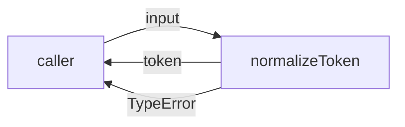
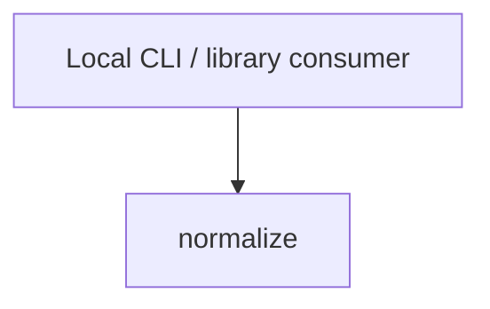

# Module: Normalize

<!--SECTION:SPEC_ID-->
TOKEN-PIPELINE-NORMALIZE
<!--/SECTION:SPEC_ID-->

<!--SECTION:MODULE_VISION-->
## Module Vision

Owns deterministic ASCII token normalization inside the `token` scope: one pure function that turns a valid input string into a canonical token or rejects invalid input. Parent scope: [token](../../token.spec.md). No sibling or child modules exist in this bounded authoring task.
<!--/SECTION:MODULE_VISION-->

<!--SECTION:OVERVIEW-->
## Overview


_Нормализация входа в токен либо явный отказ — NOR-REQ-1, NOR-REQ-2._
<!--/SECTION:OVERVIEW-->

<!--SECTION:MODULE_USAGE_EXAMPLE-->
## Module Usage Example

No initialization or setup is required: the module exposes a pure function.

```ts
import { normalizeToken } from "./normalize.js";

// Happy path: surrounding spaces are removed and separators collapse.
const token = normalizeToken("  Foo__BAR  ");
console.log(token); // "foo-bar"

// Minimal error path: invalid input is rejected explicitly.
try {
  normalizeToken("");
} catch (error) {
  if (error instanceof TypeError) {
    console.error("invalid token input");
  }
}
```
<!--/SECTION:MODULE_USAGE_EXAMPLE-->

<!--SECTION:MODULE_REQUIREMENTS-->
## Requirements

### NOR-REQ-1 [должен]
**Когда** передана непустая ASCII-строка, содержащая хотя бы один символ вне разделителей, **нормализатор должен** обрезать крайние ASCII-пробелы, привести ASCII-буквы к нижнему регистру и заменить каждый непрерывный участок ASCII-пробелов, underscore или hyphen одним hyphen. Уточняет TOK-REQ-1.

> Детерминированное представление токена нужно локальным CLI и библиотечным потребителям; без него одно и то же имя принимает разные формы.

### NOR-REQ-2 [должен · нештатная]
**Если** входная строка пустая, состоит только из ASCII-разделителей или содержит хотя бы один не-ASCII символ, **то нормализатор должен** выбросить TypeError без ввода-вывода. Уточняет TOK-REQ-2.

> Ошибочный вход нельзя маскировать пустым или искажённым токеном; явный отказ сохраняет предсказуемость контракта.

Проверяемые примеры `normalize-example` и `empty-input-rejection`:

| Input | Outcome |
|---|---|
| `"  Foo__BAR  "` | `"foo-bar"` |
| `""` | `TypeError` |
<!--/SECTION:MODULE_REQUIREMENTS-->

<!--SECTION:INTER_MODULE_DEPENDENCIES-->
## Inter-Module Dependencies

- **Depends on:** No sibling modules.
- **Scope Reference (cross-scope):** None.
- **Provides to:** No sibling modules; external local CLI and library consumers call this module directly.


_Внешние потребители вызывают единственный модуль нормализации._
<!--/SECTION:INTER_MODULE_DEPENDENCIES-->

<!--SECTION:ENTITY_INVENTORY-->
## Entity Inventory

_Это полный список сущностей модуля. Любое введение сущности execution-агентом помимо этого списка считается drift'ом и требует обновления spec._

| Name | Type | Purpose |
|------|------|---------|
| `normalizeToken` | Function | Нормализует ASCII-строку в детерминированный токен или выбрасывает TypeError. |

Ошибки: throw → `normalizeToken`

ER-эскиз не рисуется: в инвентаре одна сущность, связей между сущностями нет. Файл модуля не является общим: `normalize.ts` принадлежит `normalizeToken`.
<!--/SECTION:ENTITY_INVENTORY-->

<!--SECTION:ENTITY_SURFACES-->
## Entity Surfaces

`normalizeToken` is the module's only public surface: one pure operation with an explicit invalid-input failure.

<details>
<summary>Полные поверхности сущностей</summary>

### `normalizeToken`
- **Type:** Function
- **Purpose:** Возвращает канонический токен для валидной ASCII-строки.
- **Public Properties:** N/A
- **Public Operations:** Нормализовать строку в токен; отклонить недопустимый вход с TypeError.
- **Lifecycle:** Stateless; вызывающий владеет вызовом, сущность завершается возвратом значения или выбросом ошибки.
- **Events Emitted:** N/A
- **Errors & Degradation:** `TypeError` через throw; владелец — `normalizeToken`, вызывающий получает ошибку без побочных эффектов.
- **Consumers:**
  - Internal: N/A (единственная сущность модуля)
  - External: local CLI and library consumers
- **Usage Waiver (external: local CLI and library consumers):** Sole public operation of the module; the external contract is the intended production use, with no internal call site to count.

</details>
<!--/SECTION:ENTITY_SURFACES-->

<!--SECTION:MODULE_CONTRACTS-->
## Module Contracts

The module defines one Function and no Port/Adapter: `normalizeToken` is a pure deterministic transformation with no confirmed variability or test seam.

Граф не рисуется: в модуле нет Port/Adapter, только Function `normalizeToken`.

Цепочка вызовов не рисуется: в модуле одна сущность `normalizeToken`, без Port/Adapter.

<details>
<summary>Контракты DbC</summary>

#### Service: `normalizeToken`
- **Purpose:** Преобразует валидную ASCII-строку в канонический токен.
- **Consumers:** local CLI and library consumers
- **Runtime Backing:** `not-implemented`
- **Verification Levels:** `contract`, `unit`
- **Deferred Runtime Scope:** Implementation and runtime verification are deferred; this authoring task makes no runtime claim.

**Contract (DbC)**
- `normalizeToken`:
  - Pre: `input` is a string containing at least one ASCII character outside the separator set (space, underscore, hyphen), and contains no non-ASCII character.
  - Post: returns a non-empty token with leading and trailing ASCII spaces removed, ASCII letters lowercased, and every internal maximal run of space, underscore or hyphen replaced by one hyphen.
  - On pre-violation: throws `TypeError` and performs no I/O.

**Invariants**: The operation is deterministic, stateless and free of I/O; equal valid inputs produce equal outputs.

</details>
<!--/SECTION:MODULE_CONTRACTS-->

<!--SECTION:PUBLIC_OPTIONS-->
## Public Options & Policies

No public options or policies exist in v1.

<details>
<summary>Опции и политики</summary>

No flags, configuration or policy knobs are consumed; nothing is deferred to a later version.

</details>
<!--/SECTION:PUBLIC_OPTIONS-->

<!--SECTION:FILE_STRUCTURE-->
## File Structure

```text
src/token/pipeline/normalize/
├── normalize.ts
└── normalize.test.ts
```

**File Mapping:**
- `src/token/pipeline/normalize/normalize.ts`: pure `normalizeToken` implementation, to be created at scaffold time.
- `src/token/pipeline/normalize/normalize.test.ts`: unit tests for valid normalization and TypeError rejection, to be created at scaffold time.
<!--/SECTION:FILE_STRUCTURE-->

<!--SECTION:RESEARCH-->
## Research

No research documents feed this module; the contract comes directly from the parent scope and `docs/token-contract.md`.
<!--/SECTION:RESEARCH-->

<!--SECTION:MODULE_DECISION_LOG-->
## Module Decision Log

NOR-DL-1 records representing the operation directly as a Function without a Port or Adapter.

<details>
<summary>Полные записи Decision Log</summary>

NOR-DL-1 2026-10-23 — represent `normalizeToken` directly as a Function without Port/Adapter (почему: единственная детерминированная чистая операция, вариативность и тестовый шов не подтверждены; отвергнуто: введение Port ради нотации — лишний слой без второй реализации).

</details>
<!--/SECTION:MODULE_DECISION_LOG-->

<!--SECTION:HANDOFF-->
## Handoff to Tasks

- **Implementation files to be created:** `src/token/pipeline/normalize/normalize.ts` (deferred to scaffold; not created by this authoring task).
- **Test files to be created:** `src/token/pipeline/normalize/normalize.test.ts`.
- **Stack dependencies:**
  - Language: `typescript` (resolves to `ai/directives/coding/typescript-rules.xml`)
  - Test framework: `node-test` (resolves to `ai/directives/testing/node-test.xml`)
- **Module Rules Additions:** None; the scope-wide baseline applies unchanged.
- **Open risks & validation needs:** Operator approval remains pending. The exact package root and readiness scripts are confirmed at scaffold; no tickets, implementation or execution are claimed here.
<!--/SECTION:HANDOFF-->

<!--SECTION:IMPLEMENTATION_INSIGHTS-->
## Implementation Insights

Not applicable: no implementation exists yet, and post-implementation learnings are recorded only after execution and audit compaction.
<!--/SECTION:IMPLEMENTATION_INSIGHTS-->
