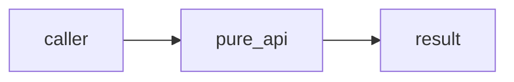
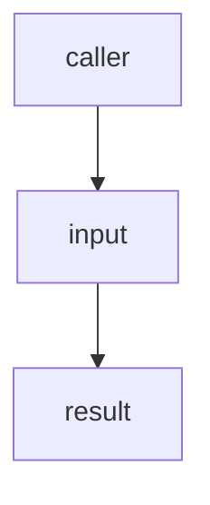
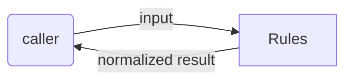

# queue: Scope Specification

<!--SECTION:SPEC_ID-->
QUE
<!--/SECTION:SPEC_ID-->

<!--SECTION:SCOPE_TYPE-->
## scope-type
product
<!--/SECTION:SCOPE_TYPE-->

<!--SECTION:VISION-->
## Vision & Primary Goal
selectBatch receives an array of strings and a nonnegative integer capacity. Return a fresh array containing the first capacity entries, preserving order and duplicates and leaving the input unchanged. Reject a non-array, any non-string entry, or a capacity that is negative, fractional or non-finite with TypeError. A zero capacity returns an empty array.
<!--/SECTION:VISION-->

<!--SECTION:OVERVIEW-->
## Overview

_One deterministic public capability._
<!--/SECTION:OVERVIEW-->

<!--SECTION:PROJECT_TYPE-->
## Project Type
- **Type:** service-module-sdk
- **Why this type:** deterministic library API.
<!--/SECTION:PROJECT_TYPE-->

<!--SECTION:GOLDEN_DX-->
## Target Experience
A caller submits an input and receives a deterministic normalized result; invalid input returns a typed error.
<!--/SECTION:GOLDEN_DX-->

<!--SECTION:SCOPE_DEPENDENCIES-->
## Scope Dependencies
- **Depends on:** none
- **Provides to:** fixture consumer
<!--/SECTION:SCOPE_DEPENDENCIES-->

<!--SECTION:REQUIREMENTS_AND_CONSTRAINTS-->
## Requirements & Constraints

### Requirements

### QUE-REQ-1 [должен]
**Когда** a caller invokes the public API with valid inputs, **the library must** return the contract result: selectBatch receives an array of strings and a nonnegative integer capacity. Return a fresh array containing the first capacity entries, preserving order and duplicates and leaving the input unchanged. Reject a non-array, any non-string entry, or a capacity that is negative, fractional or non-finite with TypeError. A zero capacity returns an empty array.

### QUE-REQ-2 [должен · нештатная]
**Если** input is invalid under the public contract, **то библиотека должна** reject it with the declared error type and no hidden side effect.

### Out-of-Scope
External publication or changing accepted behavior without authorization.

### Runtime & Deferred Scope
No deferred local runtime scope.

### Rules
| Rule | Category | Source |
|---|---|---|
| node-test | testing | ai/directives/testing/node-test.xml |
<!--/SECTION:REQUIREMENTS_AND_CONSTRAINTS-->

<!--SECTION:USE_CASES-->
## Use Cases

_Normal and invalid inputs are observable._
<!--/SECTION:USE_CASES-->

<!--SECTION:DATA_FLOW-->
## Data Flow

_Input is validated before the result is returned._
<!--/SECTION:DATA_FLOW-->

<!--SECTION:ARCHITECTURE-->
## High-Level Architecture
One pure module validates input before returning a result.

### Rejected Alternatives
Hidden I/O and global mutable state are out of scope.
<!--/SECTION:ARCHITECTURE-->

<!--SECTION:MODULE_MAP-->
## Module Map
- [core](./core/core.spec.md)
<!--/SECTION:MODULE_MAP-->

<!--SECTION:RESEARCH-->
## Research

No research documents.
<!--/SECTION:RESEARCH-->

<!--SECTION:DECISION_LOG-->
## Decision Log

Approval records

### Approval #1 — current specification set
- **Status:** approved
- **Reviewed set:** `specs/queue/queue.spec.md`, `specs/queue/core/core.spec.md`
- **Independent review:** clean
- **Operator decision:** approved
- **Recorded:** 2026-09-02

<!--/SECTION:DECISION_LOG-->

<!--SECTION:BOOTSTRAP_REQUIREMENTS-->

Prerequisites

| Requirement | Kind | Owner | Resolution | Readiness Gates | Gate Artifacts |
|---|---|---|---|---|---|
| Repository runtime, package manager, and configuration | file | this-scope-task | verify pre-provisioned fixture toolchain | — | package.json, tsconfig.json |

<!--/SECTION:BOOTSTRAP_REQUIREMENTS-->

<!--SECTION:HANDOFF-->
## Handoff to Modules
- **Primary input:** specs/queue/queue.spec.md
- **Areas requiring decomposition:** core
- **Named abstractions:** selectBatch
- **Bootstrap tickets ready for cascade:** none
- **Open risks:** none
<!--/SECTION:HANDOFF-->
